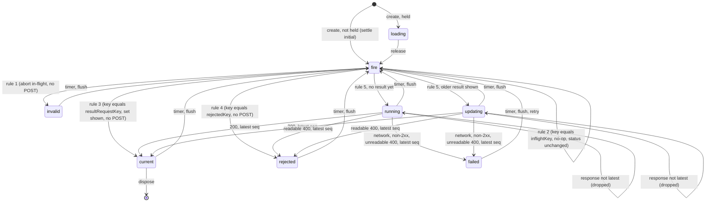

# SGS-100: Add the framework-free auto-run controller and the simulate client

- **Type**: Task
- **Component**: aoe4-build-order
- **Milestone / criteria**: M6 / M6.1
- **Priority**: high
- **Risk**: high
  <!-- strongModelTriggers: the controller's rule order and its seq / abort handling decide which result is shown (order of operations a result depends on, A3). -->
- **Invariants**: S3 (the controller is the only caller that decides when a simulate request is sent; it must never send an invalid one), A3 (same settled input, same request, no timing-dependent result). Not adjacent to A1 or A2.
- **LOC estimate**: ~220 (`auto-run.ts` ~170, `simulate-client.ts` ~50; business logic only, tests excluded)
- **Depends on**: none
- **On merge**: none
- **Source**: `design/M6.md` C6 (`simulate-client.ts`, `auto-run.ts`), "Behavior rules / Auto-run (`createAutoRunController`)", OD-7 (a); M6.1; plan outline D (file and symbol names there are superseded by the design)

## Context

The AoE4 page will stop using a Run button and re-run on edit. The state machine that decides when
to post, what to drop and what the status is must be testable without a DOM, so it lives in a
framework-free controller (OD-7 (a): no jsdom; Vitest fake timers and a stubbed `post`). This ticket
adds the controller and the browser-side client. Nothing wires it into the page yet.

## Scope

**New `components/apps/aoe4-build-order/simulate-client.ts`** (no React import):

- `postSimulation(buildOrder: SimulateRequest['buildOrder'], durationSeconds: number, signal?: AbortSignal): Promise<Response>`.
  It is the module-private `postSimulation` in `pages/apps/aoe4-build-order.tsx` moved as is
  (same URL `/api/aoe4-build-order/simulate`, method, headers, body `{ buildOrder, inputs: { durationSeconds } }`), plus `signal` passed to `fetch`.
- `readRejection(response: Response): Promise<{ issues: BuildOrderIssue[]; omittedIssues: number } | null>`.
  Reads a 400 body. Returns `null` when the body is not JSON or `issues` is not a non-empty array;
  `omittedIssues` is 0 when absent (or not a number). This is the check in the page's `errorMessages` today.
- `simulationFailureMessage(status: number | null): string`: `null` gives
  `The simulation could not be run. Please try again.`; `n` gives `The simulation could not be run (HTTP n).`

**Edit `pages/apps/aoe4-build-order.tsx`** (behavior-preserving; the page keeps using the Run button):

- Delete the local `postSimulation` and import it from `simulate-client.ts`. The two call sites
  (the pin-restore effect and `runSimulation`) call it without a signal.
- `errorMessages` and the `catch` in `runSimulation` take their text from `simulationFailureMessage`,
  and `errorMessages` reads the 400 body through `readRejection`, so the strings and the 400
  parse exist once. Its output (including the `N more issues not shown.` line) is unchanged.
  The page's removal of `errorMessages` belongs to the ticket that wires auto-run.

**New `components/apps/aoe4-build-order/auto-run.ts`** (no React import). Exports exactly the C6
names, with the C6 shapes:

- `AUTO_RUN_DEBOUNCE_MS = 500`, `AutoRunStatus`, `LiveInput`, `ShownInput`, `AutoRunDeps`,
  `AutoRunState`, `AutoRunController`, `createAutoRunController(deps, initial, held, onChange)`,
  `durationError(duration)`, `requestKey(request)`.
- `AutoRunDeps.post(request: SimulateRequest, signal: AbortSignal): Promise<Response>`. The request
  the controller builds is `{ buildOrder: conversion.order, inputs: { durationSeconds: Number(settled.duration) } }`.
  The later hook adapts `postSimulation` to this shape; the controller never calls `postSimulation` or `fetch` itself.
- `requestKey(request)` is `JSON.stringify(request)`. `selected` never enters it.
- `durationError(duration)` is `null` when `duration.trim()` is non-empty, `Number(duration)` is an
  integer, and `outOfRange(Number(duration), 'durationSeconds')` (from `lib/aoe4-build-order/schema.ts`) is `undefined`.
  Otherwise: for an empty or blank field `Duration is required.`; for anything else
  `Duration must be a whole number of seconds from ${min} to ${max}.` with `min` and `max` read from
  `SIM_INPUT_BOUNDS.durationSeconds`, never written as literals.
- The controller implements the design's auto-run table, one operation per row, and nothing else:
  create (held or not), input (held or not), flush (held or not), release, fire rules 1 to 5 in
  order with the first match winning, the response rows (late, 200, readable 400, other failure),
  retry, dispose, and the no-target case. State shape is `AutoRunState` from C6 (`settled`,
  `conversion = textToBuildOrder(settled.text, catalog)`, `durationError`, `request`, `result`,
  `resultRequestKey`, `shown`, `serverIssues`, `omittedIssues`, `errorMessage`). Details the table
  leaves open, fixed here:
  - Any abort of an in-flight request (rule 1, rule 3, a newer rule 5, `dispose`) also makes that
    request's response stale, so it is dropped even when the stubbed `post` ignores the signal and
    resolves anyway. Dropping is by request identity (a sequence number or equivalent), never by
    whether an `AbortError` was thrown.
  - `serverIssues` and `omittedIssues` are non-empty only while status is `rejected`, and
    `errorMessage` is non-null only while status is `failed`; every other transition clears them.
    A rejected or failed response never clears `result`, `resultRequestKey` or `shown`.
  - A 2xx whose body cannot be read as JSON is `failed` with `simulationFailureMessage(null)`
    (today's page treats it as a network error in its `catch`). A thrown error that is not an
    `AbortError` is the same.
  - Rule 3 sets `shown = { text: settled.text, durationSeconds: Number(settled.duration), selected: settled.selected }`.
  - `onChange` is called with the new state after each state change that a call or a timer or a
    response makes, never after `dispose`, and `getState()` always equals the last state passed to it.
    `input` while not held calls `onChange` only when the timer fires and changes state.
  - The timer is a `setTimeout` of `AUTO_RUN_DEBOUNCE_MS`, cleared with `clearTimeout`, so Vitest fake timers drive it. No `Date.now()`, no randomness.

**New tests** (`components/apps/aoe4-build-order/auto-run.test.ts`, `simulate-client.test.ts`;
Vitest's node environment, no new dependency, no DOM; `Response` is the Node global):

- `auto-run.test.ts` uses `vi.useFakeTimers()` and a `post` stub that records `(request, signal)`
  and returns promises the test resolves by hand. Shared setup (a catalog from `buildOrderCatalog(loadGameData('english'))`,
  a controller factory with a recorded `onChange` history, a deferred-response helper, valid and
  invalid text constants) is in helpers at the top of the file. Cases that differ only in input and
  expected value are `it.each` rows.
- `simulate-client.test.ts` stubs `fetch` with `vi.stubGlobal` and builds `Response` objects.

**Docs.** Grep for the names changed (`postSimulation`, `errorMessages`) in `docs/`, `ARCHITECTURE.md`
and comments; none is expected to need a change since page behavior is unchanged. `ARCHITECTURE.md`
"Where files go" is updated only if it lists per-file entries for `components/apps/aoe4-build-order/`.

**Out of scope:** `use-auto-run.ts` and any React import; wiring into the page (the page keeps Run,
`results-stale`, the scroll effects); `build-input.tsx`, `results.tsx`, `issue-list.tsx`, CSS;
any acceptance spec or acceptance helper; the adapter from `postSimulation` to `AutoRunDeps.post`
(the hook's job); `saved-builds.ts` and the builds routes; the pin-restore abort (Strict Mode is
off in this repo); adding `jsdom` or `@testing-library/react`.

## Diagrams

The controller is a state machine in a core control loop. Phases: read (input, timer), act (the five
fire rules, `post`), record (response rows).

## Acceptance criteria

All controller criteria are Vitest cases in `components/apps/aoe4-build-order/auto-run.test.ts` unless
named otherwise; each states the break it must catch. The names are the `describe`/`it` titles to use.

- [ ] `AUTO_RUN_DEBOUNCE_MS`, `AutoRunStatus`, `LiveInput`, `ShownInput`, `AutoRunDeps`, `AutoRunState`, `AutoRunController`, `createAutoRunController`, `durationError` and `requestKey` are exported from `auto-run.ts` with the C6 shapes, and `postSimulation`, `readRejection` and `simulationFailureMessage` from `simulate-client.ts`. Neither file imports `react`, `next`, or touches `window` or `document`: `git grep -nE "from 'react'|from 'next|window\.|document\." -- components/apps/aoe4-build-order/auto-run.ts components/apps/aoe4-build-order/simulate-client.ts` finds no match.
- [ ] `durationError` table: `'60'` and `'3600'` give `null`; `''` and `'   '` give `Duration is required.`; `'59'`, `'3601'`, `'61.5'` and `'abc'` give `Duration must be a whole number of seconds from 60 to 3600.` (the bounds come from `SIM_INPUT_BOUNDS`; the test builds the expected text from them). Breaks caught: `Number('')` being 0 accepted, a non-integer accepted, a bound written as a literal.
- [ ] `requestKey` / key test: two inputs differing only in `selected` produce equal request keys (one POST, not two); inputs differing in text content or duration produce different keys. Break caught: `selected` leaking into the key.
- [ ] create, held: status `loading`, `settled` equals `initial`, no timer pending (`vi.getTimerCount()` is 0 after advancing time), `post` not called.
- [ ] create, not held: `post` is called once with no timer advance, with a request whose `inputs.durationSeconds` equals `Number(initial.duration)`; status is `running`.
- [ ] input, not held: after `input(a)`, advancing less than `AUTO_RUN_DEBOUNCE_MS` posts nothing and leaves `getState().settled` unchanged (issues keep showing the previous settled input); reaching `AUTO_RUN_DEBOUNCE_MS` since the last `input` settles `a` and posts once. Three `input` calls spaced under `AUTO_RUN_DEBOUNCE_MS` apart post once, for the last. Break caught: a leading-edge or non-restarting timer.
- [ ] input with an equal `live` restarts the timer and the fire then posts nothing (rule 2 or 3). Break caught: a no-op on an equal input that lets the stale timer fire early.
- [ ] input, held: records `live`, sets no timer, posts nothing.
- [ ] flush, not held: cancels the timer and fires at once with the given `live` (settled becomes it); `flush()` with no argument settles the last recorded live input; a pending timer does not fire a second POST afterwards. Repeated `flush()` with no change after a result posts nothing and ends `current`.
- [ ] flush, held: records `live` when given, posts nothing, status stays `loading`.
- [ ] release, held: cancels any timer, settles the last recorded live input (including one recorded by `input` or `flush` while held) and posts at once. release, not held: no state change and no POST. Break caught: release firing a stale initial input.
- [ ] fire rule 1: invalid text (`conversion` has issues) or an invalid duration with an in-flight request: that request's signal is aborted, no new POST, status `invalid`, `request` is `null`. With no result ever shown, `result` and `shown` stay `null`. Break caught: posting an invalid request, or leaving the old request in flight.
- [ ] fire rule 2: while a request for key K is in flight, an edit that settles to K again sends no POST and does not abort the in-flight one (its signal is not aborted); its response still applies.
- [ ] fire rule 3: with a shown result for key K, an edit then an undo inside `AUTO_RUN_DEBOUNCE_MS` posts nothing and ends `current`; a comment-only edit and a `flush` to a build with equal content do the same, with `shown` equal to the new settled input (`text`, `durationSeconds`, `selected`) while `result` and `resultRequestKey` keep their values. If a request for a different key was in flight, it is aborted and its late response is dropped. Break caught: re-posting an unchanged request, or `shown` keeping the old text.
- [ ] fire rule 4: after a 400 for key K, settling K again sends no POST and ends `rejected` with the stored `serverIssues`; settling a different valid key posts (rule 5) and ends `running` or `updating` with `serverIssues` empty.
- [ ] fire rule 5 and its ordering: a table of rows (settled input, in-flight key, result key, rejected key) covers every outcome and first-match-wins: an invalid settled input while a request is in flight aborts it and ends `invalid` (rule 1 before rule 2); a valid key equal to both `inflightKey` and `resultRequestKey` is rule 2 (no abort, no POST); a key equal to both `resultRequestKey` and `rejectedKey` is rule 3. Status is `running` with no result and `updating` with an older result. Each rule 5 call passes a fresh `AbortSignal` and aborts the previous one.
- [ ] late response dropped: request A is in flight, an edit settles to B and posts; A resolves 200 afterwards. State is unchanged by A (`result`, `shown`, status `running` or `updating` for B); then B resolves and `result` is B's. Also: A aborted by rule 1 or rule 3 whose stubbed `post` ignores the signal and resolves 200 anyway changes nothing. Break caught: applying a superseded or aborted response.
- [ ] AbortError: a stale request whose `post` rejects with `new DOMException('x', 'AbortError')` changes no state and shows no error (`errorMessage` stays `null`, status unchanged).
- [ ] response 200, latest: sets `result`, `resultRequestKey`, `shown` from the settled input captured when the request was sent (not from an edit made while it was in flight), clears `serverIssues` and `errorMessage`, status `current`. While in flight, a newer unsettled `input` does not change `shown`.
- [ ] response 400, latest, `readRejection` reads it: status `rejected`, `serverIssues` and `omittedIssues` from the body, `result` and `shown` from the earlier success kept, `inflightKey` cleared.
- [ ] failure rows (table): `post` rejects with a `TypeError`; a 500; a 404; a 400 whose body is not JSON; a 400 with `issues: []`; a 200 whose body is not JSON. Each gives status `failed`, `errorMessage` equal to `simulationFailureMessage(null)` for the rejection and the unreadable 200 and `simulationFailureMessage(status)` for the statuses, the earlier `result` kept, and a later settle of the same key posts again (not treated as rule 2 or 4). Break caught: an unreadable 400 becoming `rejected`, or a failure leaving `inflightKey` set.
- [ ] retry: in status `failed`, `retry()` posts once for the current settled key and moves to `running` or `updating`; in `current`, `invalid`, `rejected`, `running`, `updating` and `loading` it posts nothing and changes nothing.
- [ ] dispose: with a pending timer, `dispose()` leaves `vi.getTimerCount()` at 0 and the timer never fires; with a request in flight, the signal is aborted, and a response arriving later (200 or failure) calls `onChange` no more and leaves `getState()` as it was; `input`, `flush`, `release` and `retry` after `dispose` post nothing and call no `onChange`. Break caught: a late response written after unmount.
- [ ] `simulate-client.test.ts`: `postSimulation` calls `fetch('/api/aoe4-build-order/simulate', ...)` once with `method: 'POST'`, JSON content type, body `JSON.stringify({ buildOrder, inputs: { durationSeconds } })`, and the given `signal` (and no `signal` when omitted); an aborted signal makes the returned promise reject with an `AbortError`. `readRejection`: a 400 with `{ issues: [i], omittedIssues: 3 }` gives `{ issues: [i], omittedIssues: 3 }`; a missing `omittedIssues` gives 0; non-JSON, `issues: []`, a non-array `issues` and a missing `issues` give `null`. `simulationFailureMessage(null)` and `simulationFailureMessage(500)` give the two exact strings in Scope.
- [ ] Page behavior is unchanged: `git grep -n "function postSimulation" -- pages components` finds only `simulate-client.ts`, and `git grep -n "fetch(" -- pages/apps/aoe4-build-order.tsx` finds no match. No file under `acceptance/` is changed, and `npm run acceptance` passes without edits to any spec. The page's run, error text for a 400 (including the `N more issues not shown.` line), HTTP-n error and network error are as before.
- [ ] `npx tsc --noEmit`, `npm run lint:dup` and `npm test` pass. The implementer lists in the report the tests it added and that no existing test was edited.
- [ ] No INVARIANTS.md regressions

## Open questions

None.
