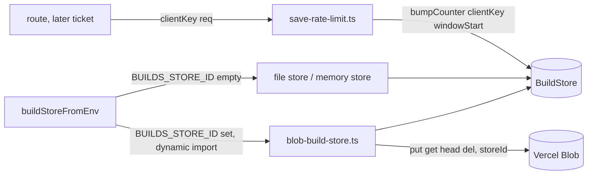

# SGS-101: Add the build store seam, the Blob adapter and the save rate limit

- **Type**: Task
- **Component**: aoe4-build-order
- **Milestone / criteria**: M6 / M6.4 (rate limit), M6.6 (store and env key prefix)
- **Priority**: medium
- **Risk**: high
  <!-- high: a compare-and-swap counter that bounds the save path (S3), and a Blob SDK whose "already
       exists" and etag errors could not be verified offline (designer risk). A new contract the design
       specifies with exact names does not count as a trigger by itself. -->
- **Invariants**: S3 (the save path is bounded: `takeSaveSlot` and the counter are what stop unbounded saves), A3 (`takeSaveSlot` reads no clock: `nowMs` is an argument)
- **LOC estimate**: ~280 (new `build-store.ts` ~130, `blob-build-store.ts` ~70, `save-rate-limit.ts` ~50, config and docs lines; business logic only, tests excluded)
- **Depends on**: SGS-099
- **On merge**: none
- **Source**: `design/M6.md` C2 and C5 (OD-4 (a), OD-8 (a)); `plans/M6-20261105.md` outline B

## Context

M6 saves a validated build order under a content-addressed id. This ticket adds the storage seam
(`BuildStore`) with a memory store, a file store (the default under `next dev`, Vitest and Playwright) and
a Vercel Blob adapter used only when `BUILDS_STORE_ID` is set, plus the per-client fixed-window save rate
limit that keeps its counter in that store. Nothing calls them yet (the routes are a later ticket), so no
behavior on the site changes.

## Scope

Read first: `design/M6.md` C2 and C5 (authoritative). Names from SGS-099's `lib/aoe4-build-order/saved-builds.ts`
(end state of that ticket, not yet merged): `savedBuildKey(env, id)`, `rateCounterKey(env, clientKey)`,
`storageEnv(vercelEnv)`. This ticket does not change `saved-builds.ts`.

1. New `lib/aoe4-build-order/build-store.ts`. It exports exactly:
   - `type PutResult = 'created' | 'exists'`, `interface CounterUpdate { windowStart: number; count: number }`,
     `interface BuildStore { putBuild(id: string, json: string): Promise<PutResult>; getBuild(id: string):
     Promise<unknown | null>; deleteBuild(id: string): Promise<void>; bumpCounter(clientKey: string,
     windowStart: number): Promise<CounterUpdate | 'contended'> }` (signatures as in C2).
   - `BUILDS_LOCAL_DIR_DEFAULT = '.builds-local'`.
   - `createMemoryBuildStore(env = 'development'): BuildStore`: two `Map`s (or one) per call, keyed by the full
     key from `savedBuildKey` / `rateCounterKey` with the store's env, so two stores share nothing.
   - `createFileBuildStore(dir: string, env: string): BuildStore`: writes `<dir>/<key>` (the same keys,
     `node:fs/promises`, creating parent directories on write). `putBuild` creates the file exclusively
     (`flag: 'wx'`), mapping `EEXIST` to `'exists'`. `getBuild` returns `null` for `ENOENT`. `deleteBuild`
     ignores `ENOENT`. `bumpCounter` is a synchronous read-modify-write (`readFileSync`, then `mkdirSync` and `writeFileSync`, with no `await` between the read and the write), so concurrent calls in one process never lose an update. No lock file. It never returns `'contended'`. Cross-process non-atomicity is accepted (the store is for `next dev`, Vitest and Playwright only; a lost count only loosens a dev limit); a comment at the function says so. `putBuild` stays as above (`wx`, `EEXIST` to `'exists'`, atomic across processes, matching the design). The file store never reads or writes outside `<dir>`: callers validate ids with
     `isSavedBuildId`, and `clientKey` yields only base64url characters, but the store must not rely on that
     for `..` or `/`; it rejects (throws) a key whose resolved path is not inside `<dir>`.
   - `bumpCounter` semantics (all stores): when the stored counter's `windowStart` equals the argument,
     store and return `{ windowStart, count: stored + 1 }`; otherwise (absent or another window) store and
     return `{ windowStart, count: 1 }`.
   - `buildStoreFromEnv(env: NodeJS.ProcessEnv = process.env): Promise<BuildStore>`: when `env.BUILDS_STORE_ID`
     is non-empty, `const { createBlobBuildStore } = await import('./blob-build-store')` and
     `createBlobBuildStore(env.BUILDS_STORE_ID, storageEnv(env.VERCEL_ENV))`; otherwise
     `createFileBuildStore(env.BUILDS_LOCAL_DIR ?? BUILDS_LOCAL_DIR_DEFAULT, storageEnv(env.VERCEL_ENV))`
     (an empty `BUILDS_LOCAL_DIR` also falls back to the default). Only the no-argument call (the production path, which reads `process.env`) memoizes its in-flight promise, per module
     instance; a call with an explicit `env` builds a fresh store every time and is never memoized, so tests pass
     their own env. A rejected promise is not memoized (respec 1): it is cleared so the next call tries again.
     This is the only place `process.env` is read in this ticket, and it is the only static or dynamic
     reference to `./blob-build-store`.
2. New `lib/aoe4-build-order/blob-build-store.ts`, the only file that imports `@vercel/blob`. It exports
   `createBlobBuildStore(storeId: string, env: string): BuildStore`. Every SDK call passes `storeId`; it reads
   and logs no token (credentials come from the function's OIDC token). Behavior as the C2 table:
   - `putBuild`: `put(savedBuildKey(env, id), json, { access: 'private', addRandomSuffix: false,
     allowOverwrite: false, contentType: 'application/json' })` gives `'created'`. If `put` throws, call
     `head(key)`: when it resolves the blob exists, return `'exists'`; when `head` throws, rethrow the `put`
     error (not the `head` error). No dependence on the SDK's "already exists" error class.
   - `getBuild`: `get(savedBuildKey(env, id), { access: 'private' })`; absent gives `null` (handle both a `null`
     result and a `BlobNotFoundError`, since the SDK behavior could not be verified offline), otherwise
     JSON-parse the response stream.
   - `deleteBuild`: `del(savedBuildKey(env, id))`; resolves when the blob is absent.
   - `bumpCounter`: up to 3 attempts. Each: `get(rateCounterKey(env, clientKey), { access: 'private', useCache:
     false })`; when present, parse `{ windowStart, count }`, compute the update as in item 1, and `put` with
     `allowOverwrite: true` and `ifMatch: <etag from the get>`; when absent, `put` with `allowOverwrite: false`
     and no `ifMatch`. A `BlobPreconditionFailedError` (etag changed) or a create conflict (the absent-case
     `put` throws and a following `head` says the blob now exists) retries; any other error propagates.
     After the third failed attempt return `'contended'`.
   - The implementer reads the installed `@vercel/blob` type declarations before writing and records, in the
     report, the exact option names used (`access`, `ifMatch`, `useCache`, the shape of `get`'s result and
     etag) and any place where the design's call shape does not match the installed types.
3. New `lib/aoe4-build-order/save-rate-limit.ts`, pure apart from its `store` argument and reading no clock or
   environment. It exports exactly `SAVE_RATE_LIMIT = Object.freeze({ maxSaves: 30, windowSeconds: 3600 })`,
   `clientKey`, and `takeSaveSlot`:
   - `clientKey(req: { headers: IncomingHttpHeaders; socket: { remoteAddress?: string } }): Promise<string>`
     (`IncomingHttpHeaders` as a type-only import from `node:http`). Source: the first comma-separated entry of
     `x-forwarded-for` (when the header is an array, its first element), trimmed; when that is absent or empty,
     `socket.remoteAddress`; else `'unknown'`. Any non-empty string is accepted. The result is the first 16
     characters of the unpadded base64url SHA-256 (Web Crypto `crypto.subtle`, `TextEncoder`) of that string,
     so no raw address is stored.
   - `takeSaveSlot(store: BuildStore, clientKey: string, nowMs: number): Promise<{ ok: true } | { ok: false;
     retryAfterSeconds: number }>`. `windowStart = floor(nowMs / 3_600_000) * 3_600_000`, with the window
     length derived from `SAVE_RATE_LIMIT.windowSeconds`. It calls `store.bumpCounter(clientKey, windowStart)`.
     `'contended'` gives `{ ok: false, retryAfterSeconds: 1 }`. A count of 30 or less gives `{ ok: true }`;
     above 30 gives `{ ok: false, retryAfterSeconds: max(1, ceil((windowStart + 3_600_000 - nowMs) / 1000)) }`.
     A store that throws propagates (the route maps it to 503). No environment variable changes the numbers.
   - Hash helper decision: `clientKey` keeps its SHA-256 to base64url step as a small private function inside
     `save-rate-limit.ts`. SGS-099 keeps its equivalent private in `saved-builds.ts` and this ticket does not
     export or change it, so `saved-builds.ts` is untouched. If `npm run lint:dup` flags the two, the
     implementer moves only then to a shared export and records it (that touches `saved-builds.ts`, allowed in
     that case only).
4. Dependencies and config. `npm install @vercel/blob@^2.8.2` (written as `"@vercel/blob": "^2.8.2"` in
   `dependencies`). Add `"overrides": { "zod": "$zod" }` to `package.json` (settled in the design; it makes `@vercel/oidc`'s nested zod follow the direct dependency `^4.6.7`, inside the patched line; the design's older `^4.6.6` text would fail with `EOVERRIDE`). Never run
   `npm audit fix --force`. Commit the updated `package-lock.json`. `.gitignore` gains `.builds-local/`.
5. Docs: `ARCHITECTURE.md` "Where files go" gains, as new rows or in the "App logic" row's notes, the three lib
   files (`build-store.ts`, `blob-build-store.ts`, `save-rate-limit.ts`) with their owner roles, the rule that
   `@vercel/blob` is imported only by `blob-build-store.ts` and loaded through a dynamic `import()`, and the
   local store directory `.builds-local/` (git-ignored, overridable by `BUILDS_LOCAL_DIR`). Grep `README.md`,
   `docs/` and `ARCHITECTURE.md` for `process.env`, `.env`, `storage` and `Blob`; fix any statement this makes
   untrue (the design records no `process.env` read other than `ACCEPTANCE_PORT` as the starting state).
   Document env vars by name and behavior only (`BUILDS_STORE_ID`, `BUILDS_LOCAL_DIR`, `VERCEL_ENV`).
6. Tests (Vitest, table style of the nearest existing tests; one file per module):
   - `build-store.test.ts`: one shared `describe.each` over `createMemoryBuildStore` and `createFileBuildStore`
     (file store in a per-test temp directory under `os.tmpdir()`, removed after), plus `buildStoreFromEnv`.
   - `blob-build-store.test.ts`: `vi.mock('@vercel/blob')`, no network.
   - `save-rate-limit.test.ts`: against `createMemoryBuildStore`, with `nowMs` passed in.

**Out of scope:** `builds-routes.ts`, `api-route.ts`, the routes, the OpenAPI spec, the page, the Playwright
`webServer.env` change for `BUILDS_LOCAL_DIR`, the smoke script, the acceptance specs, `saved-builds.ts`
(unless the lint:dup fallback above applies), any KV or Redis store, any env-tunable limit (OD-8 (a)), and a
`.env` file.

## Diagrams

Changes a core control loop? No. Crosses components? No (one component, files in `lib/aoe4-build-order/`).
The path through the three new modules:

## Injecting a store in a test

A later route function takes `store: () => Promise<BuildStore>`. A test passes
`() => Promise.resolve(createMemoryBuildStore())` (or a rejecting function for the 503 row) and a fixed
`nowMs`; production passes `buildStoreFromEnv`.

## Acceptance criteria

- [x] `build-store.ts` exports exactly the names in Scope item 1, `blob-build-store.ts` exports only
      `createBlobBuildStore`, and `save-rate-limit.ts` exports exactly `SAVE_RATE_LIMIT`, `clientKey` and
      `takeSaveSlot`.
- [x] Import boundary: every match of `git grep -n "@vercel/blob" -- lib` is in `blob-build-store.ts` or
      `blob-build-store.test.ts`; every match of `git grep -nE "blob-build-store" -- lib ':!*.test.ts'` outside
      `blob-build-store.ts` itself is the dynamic `import('./blob-build-store')` in `build-store.ts` (no static
      `import ... from './blob-build-store'` in any non-test file). `git grep -nE "from '(react|next)"` over
      the three new lib files is empty. `saved-builds.ts` has no diff unless the lint:dup fallback applied.
- [x] Shared `BuildStore` behavior table (rows run for both memory and file stores), each pinned:
      - `putBuild` on a new id returns `'created'` and `getBuild` returns the parsed JSON; a second `putBuild`
        of the same id with different JSON returns `'exists'` and `getBuild` still returns the first value
        (catches an overwrite).
      - `getBuild` of an absent id is `null`.
      - `deleteBuild` of a stored id then `getBuild` is `null`; `deleteBuild` of an absent id resolves.
      - `bumpCounter('c', w)` returns count 1, then 2, then 3 for the same `w`; then with `w + 3_600_000`
        returns count 1 (catches a window that does not reset), then `w` again returns count 1, not 4.
      - Counters for two client keys do not interact.
      - Two stores with different `env` over the same backing (two memory stores; two file stores over the same
        directory) share neither builds nor counters, and the file store writes `<dir>/<env>/builds/<id>.json`.
      - Ten concurrent `bumpCounter` calls on one key (`Promise.all`) never lose an update (respec 1): the counts
        returned are exactly 1 to 10, distinct, and the count stored afterwards is 10. The file store never
        returns `'contended'` (a test asserts no result is `'contended'`; the memory store likewise).
      - File store only: a key that would resolve outside the directory (a client key `../x`) throws and
        creates no file outside the directory.
- [x] `buildStoreFromEnv` table (explicit `env` argument, so nothing is memoized): `BUILDS_STORE_ID` unset or
      `''` with `BUILDS_LOCAL_DIR` set gives a store that writes under that directory (a put creates a file
      there); both unset gives the default directory `BUILDS_LOCAL_DIR_DEFAULT` (assert on a mocked
      `createFileBuildStore` path or on the written location in a temp working directory, not by writing into
      the repo); `BUILDS_STORE_ID: 'store_x'` with `VERCEL_ENV: 'preview'` calls the mocked
      `createBlobBuildStore('store_x', 'preview')`, and with `VERCEL_ENV: 'staging'` calls it with
      `'development'`. A `buildStoreFromEnv` whose import of `blob-build-store` rejects returns a rejected
      promise, and a later call with a working import resolves (no memoized rejection; run through
      `vi.resetModules` and the no-argument form for this row). With `BUILDS_STORE_ID` unset the mocked
      `blob-build-store` module is never imported (catches a static import).
- [x] Blob adapter table (mocked `@vercel/blob`; every call asserted to receive `storeId`):
      - `putBuild` calls `put` with the key `<env>/builds/<id>.json` and exactly `access: 'private'`,
        `addRandomSuffix: false`, `allowOverwrite: false`, `contentType: 'application/json'`.
      - `put` throws and `head` resolves: `'exists'`. `put` throws and `head` throws: the original `put` error
        is rethrown (catches returning `'exists'` unconditionally or rethrowing the `head` error).
      - `getBuild` absent (mock returns `null`, and separately mock throws `BlobNotFoundError`) gives `null`;
        present gives the parsed JSON.
      - `deleteBuild` calls `del` with the key and resolves when `del` resolves.
      - `bumpCounter` with an absent counter calls `put` once with `allowOverwrite: false` and no `ifMatch`.
        With a present counter in the same window it calls `put` with `ifMatch` equal to the get's etag and
        count + 1; present in an older window it writes count 1.
      - `bumpCounter` where `put` rejects with `BlobPreconditionFailedError` on the first attempt and resolves
        on the second returns the update after exactly 2 `put` calls; rejecting on all attempts returns
        `'contended'` after exactly 3 `put` calls and 3 `get` calls (catches a loop of 2 or 4, and a retry
        that reuses a stale etag: each attempt's `put` uses the etag of that attempt's `get`). A non-precondition
        error from `put` propagates after one attempt.
- [x] `takeSaveSlot` table (`nowMs` passed in; a window start `w` and the same client key):
      - Calls 1 to 30 in one window return `{ ok: true }` and call 31 returns `{ ok: false }` (catches `>=`
        versus `>`). A 32nd call is also refused.
      - Refusal `retryAfterSeconds` is 3600 at `nowMs = w`, 1 at `nowMs = w + 3_599_999`, and the matching
        `ceil` value at `w + 1_800_000` (1800); at `nowMs = w + 3_600_000` (the next window) a call is
        `{ ok: true }` again.
      - A store whose `bumpCounter` returns `'contended'` gives `{ ok: false, retryAfterSeconds: 1 }`.
      - A store whose `bumpCounter` rejects makes `takeSaveSlot` reject (not swallowed).
      - Two client keys have separate budgets.
      - `SAVE_RATE_LIMIT` is frozen (assignment throws in strict mode or `Object.isFrozen` is true) and
        `takeSaveSlot` reads no environment variable (a test sets a plausible override variable and sees the
        same boundary).
- [x] `clientKey` table: result is exactly 16 characters of `[A-Za-z0-9_-]`; `'1.2.3.4'` and
      `'1.2.3.4, 10.0.0.1'` (first entry, trimmed) give the same key; `' 1.2.3.4 '` equals `'1.2.3.4'`; an array
      header `['1.2.3.4', '5.6.7.8']` equals `'1.2.3.4'`; a different address gives a different key; a
      missing or empty header uses `socket.remoteAddress`; both missing gives the key of `'unknown'`; the key
      never contains the raw address; a non-IP string (`'spec-a'`) is accepted and distinct from `'spec-b'`.
- [ ] Dependencies: `package.json` has `@vercel/blob` at `^2.8.2` and an `overrides` entry `"zod": "$zod"`; `npm ci`
      succeeds; `npm audit` reports no advisory for `zod` (record the output in the PR body); the lockfile has
      a single resolved zod version, and no `npm audit fix --force` was run. `git grep -n "builds-local" --
      .gitignore` matches. No test file writes into `.builds-local/` (`git status` is clean after `npm test`).
- [x] `ARCHITECTURE.md` "Where files go" names the three lib files and `.builds-local/` as stated in Scope item 5.
- [x] `npx tsc --noEmit`, `npm run lint:dup` and `npm test` pass; `lint:dup` flags no duplication among
      `saved-builds.ts`, `save-rate-limit.ts` and the stores.
- [x] No INVARIANTS.md regressions

## Open questions

None.

## Re-spec 2026-11-09

- Underspecified: three designer questions (zod override, file store `bumpCounter` atomicity, memoization scope).
- Changed: zod override fixed as `$zod`; file `bumpCounter` is a synchronous read-modify-write with no lock file and never `'contended'`; memoization stated as no-argument call only, rejection not memoized; concurrency criterion tightened. `putBuild` already matched the design (`wx`/`EEXIST`).
- Stands: all other scope and criteria; no branch work exists.
