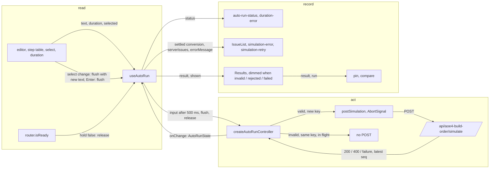

# SGS-102: Wire auto-run into the AoE4 page; remove Run, scroll and stale; dim the last good run; rewrite the Run specs

- **Type**: Task
- **Component**: aoe4-build-order
- **Milestone / criteria**: M6 / M6.1, M6.3, M6.9 (re-run spec, Run-spec rewrite, docs for re-run)
- **Priority**: high
- **Risk**: high
  <!-- strongModelTriggers: changes the order of operations a shown result depends on (the page stops deciding when to run and shows only what the controller reports, A3); removes the Run, results-stale and scroll behavior current callers and specs depend on. -->
- **Invariants**: S3 (the page must never send a request the client duration check or conversion rejects; it asks the controller and posts nothing itself except the pin restore), A3 (same settled input, same shown result; the page adds no timing-dependent state), S1 (imports stay inside `components/apps/aoe4-build-order/`, `lib/aoe4-build-order/` and `pages/apps/aoe4-build-order.tsx`). Not adjacent to A1 or A2.
- **LOC estimate**: ~200 (page ~70 net, `use-auto-run.ts` ~60, `auto-run-status.ts` ~20, `build-input.tsx` ~30, `results.tsx` ~10, `issue-list.tsx` ~10; business logic only; the acceptance and docs diff is large and excluded)
- **Depends on**: SGS-100
- **On merge**: none
- **Source**: `design/M6.md` C6 (`use-auto-run.ts`, test ids), "Auto-run", "Page wiring", "What each status shows", the "tabs (narrow)", scroll, pin and timeline rows, OD-6 (a), OD-7 (a); `plans/M6-20261105.md` outline E; M6.1, M6.3, M6.9

## Context

The page still runs only when Run is clicked, scrolls after a run, marks results stale and removes the
charts on a failed run. SGS-100 added the framework-free controller (`createAutoRunController`) and the
client (`simulate-client.ts`) but wired nothing. This ticket makes the page re-run on edit through a thin
hook over that controller, shows the last good result dimmed while the settled input is invalid, rejected
or failed, and rewrites every acceptance spec that clicked Run. Strict Mode is off, so no pin-restore
abort is done.

## Scope

Read `node_modules/next/dist/docs/` (Pages Router: `useRouter`, `router.isReady` on a statically optimized
page, hydration) before editing the page (AGENTS.md: this Next has breaking changes).

Names below from SGS-100 (`auto-run.ts`: `AUTO_RUN_DEBOUNCE_MS`, `AutoRunStatus`, `LiveInput`, `ShownInput`,
`AutoRunDeps`, `AutoRunState`, `AutoRunController`, `createAutoRunController`, `durationError`,
`requestKey`; `simulate-client.ts`: `postSimulation`, `readRejection`, `simulationFailureMessage`) are
described as SGS-100 ends, not as `main` reads today.

**New `components/apps/aoe4-build-order/use-auto-run.ts`:**

- `useAutoRun(args: { text: string; duration: string; selected: string; catalog: BuildOrderCatalog; hold: boolean }): AutoRunState & { flush(live?: LiveInput): void; retry(): void }`.
- It builds `AutoRunDeps` as `{ catalog, post: (request, signal) => postSimulation(request.buildOrder, request.inputs?.durationSeconds ?? 0, signal) }`
  (`inputs.durationSeconds` is always set by the controller; the adapter is this ticket's, as SGS-100 left it).
- One controller per mounted page: created from the first render's `{ text, duration, selected }` and `hold`;
  `input({ text, duration, selected })` on every later change of any of the three; when `hold` goes from true to
  false, `release()` runs after `input` with the same render's values; `dispose()` on unmount. The state returned is
  the last state passed to `onChange`, and before the controller exists (server render, first client render) it is
  status `loading` with `settled` equal to the first render's input. No request is sent while rendering on the server
  or before hydration.
- `flush` and `retry` are stable functions that call the controller's.
- No other logic: every rule (debounce, dedupe, abort, late drop, retry) stays in the controller.

**New `components/apps/aoe4-build-order/auto-run-status.ts`** (pure, no React import):

- `autoRunStatusMessage(status: AutoRunStatus, hasResult: boolean): string` with exactly:

  | status | `hasResult` | text |
  |--------|-------------|------|
  | `loading` | any | `Loading the build.` |
  | `running` | any | `Computing the simulation.` |
  | `current` | any | empty string |
  | `updating` | any | `Updating the results.` |
  | `invalid`, `rejected` | true | `The charts show the last valid build.` |
  | `invalid`, `rejected` | false | `No valid build to simulate yet.` |
  | `failed` | any | `The simulation failed.` |

**Edit `pages/apps/aoe4-build-order.tsx`:**

- Import `useRouter` from `next/router`; `hold = !router.isReady`. Call `useAutoRun({ text, duration, selected, catalog, hold })`.
  Keep `text`, `duration` and `selected` as live page state: the editor, step table and select still read it.
- Delete: the local `result`, `run`, `issues`, `checked`, `rejection`, `running` and `resultsShownCount` state,
  `runSimulation`, `errorMessages` and its import of `SimulateError`, both scroll effects, `stickyBarHeight`,
  the `resultsTop`, `editorBox` and `issuesBox` refs, the `stale` value, and the live `converted` memo. Keep
  `parsed` (the table view reads the live text) and the run-bar height `ResizeObserver` effect.
- `result` is the hook's `result`. `run` is derived: `shown === null ? null : { text: shown.text, durationSeconds: shown.durationSeconds, name: pinName(builds, shown.text, shown.selected) }`.
  `pinShownRun`, `unpin`, `alreadyPinned` and `Pin` are otherwise unchanged and act on `result` and `run` while
  dimmed. The timeline gets `text={run?.text ?? ''}`.
- Issues, the editor's `errorLines`, `duration-error`, `simulation-error` and `auto-run-status` read only the hook's
  settled state: `clientIssues = conversion.ok ? [] : conversion.issues`, and the check issues that were hidden until
  Run (`converted.lines !== undefined && !checked`) now show as soon as the input settles.
- Tabs: initial tab `build`; nothing sets `tab` from a run. `resultsEnabled = result !== null || pin !== null`
  (unchanged), `shownTab = resultsEnabled ? tab : 'build'`, `viewDisabled = shownTab === 'results'` (unchanged).
  A status alone never enables Results. Tabs stay at every width (the split layout is a later ticket).
- Select change: `setSelected(name)`, set the text to the build's text, then
  `flush({ text: build.text, duration, selected: name })` with the page's current `duration`. Enter in the duration
  field (the form `onSubmit`, which still calls `preventDefault`): `flush()`.
- The pin restore effect stays as it is except that `postSimulation` is the one from `simulate-client.ts`
  (SGS-100). It calls it without a signal.
- Build panel: `IssueList` with the settled conversion issues; when status is `rejected`, with `serverIssues` and
  `omittedIssues` instead. Then, when `errorMessage` is non-null, `simulation-error` (`role="alert"`, the message in
  one paragraph) and under it `simulation-retry`, a button reading `Try again` that calls `retry`, rendered only in
  status `failed`.
- Results panel: `ComparePanel` as today, then `Results` only when `result !== null`, with `dimmed` true when status is
  `invalid`, `rejected` or `failed`. With no result nothing is rendered below the compare panel (no `results-last-good`,
  no chart).

**Edit `components/apps/aoe4-build-order/build-input.tsx`:**

- Remove the `run-simulation` button, `running` and `onRun`. Add props for the status
  (`status: AutoRunStatus`, `hasResult: boolean`), `durationError: string | null` and a submit handler
  (`onSubmit`, called after `preventDefault`).
- Render `auto-run-status` once, inside the run bar: `id="auto-run-status"`, `data-testid="auto-run-status"`,
  `role="status"`, `data-status={status}`, text from `autoRunStatusMessage(status, hasResult)`. It stays in the DOM
  and empty for `current`.
- Under the duration input render `duration-error` (`id="duration-error"`, `data-testid="duration-error"`) with the
  `durationError` text when it is non-null. The input gets `aria-invalid="true"` and `aria-describedby="duration-error"`
  only while it is non-null.
- The select, the toggle, and the form's other behavior are unchanged.

**Edit `components/apps/aoe4-build-order/results.tsx`:** `stale` is replaced by `dimmed: boolean`. The root element is
`data-testid="results-last-good"`; when `dimmed`, it gets the dim class and `aria-describedby="auto-run-status"`.
The `results-stale` alert is removed.

**Edit `components/apps/aoe4-build-order/issue-list.tsx`:** the `rejected` prop is removed and the summary
`Fix N issues to run the simulation.` (`Fix 1 issue to run the simulation.` for one) is always shown above the list.
New optional prop `omittedIssues?: number`; when it is greater than 0 the list ends with one more item reading
`N more issues not shown.`

**Edit `components/apps/aoe4-build-order/workbench.module.css`:** `.stale` is replaced by a dim class whose computed
`opacity` is 0.5 or less, with no `transition` on opacity (so a test reads the final value at once). The `.issues`
and `.pinnedLabel` overflow rule keeps its other selectors.

**Acceptance helpers (`acceptance/helpers.ts`):** replace `runSimulation` and `runRejected` with:

- `waitForRun(page: Page, action?: () => Promise<void>): Promise<Response>` (Playwright's `Response`): registers the wait
  for the simulate POST response first, then awaits `action`, then awaits the response, then expects `auto-run-status`
  to have `data-status` `current`, and returns the response.
- `expectNoRun(page: Page, action?: () => Promise<void>): Promise<void>`: records simulate POSTs, awaits `action`, waits
  past `AUTO_RUN_DEBOUNCE_MS` (imported from `auto-run.ts`) plus a margin, and expects the record to be empty.
- `openPage` additionally waits for `auto-run-status` to reach `data-status` `current` (the default build always runs on
  load). A spec that needs another first-load outcome navigates with `page.goto` itself.

**Rewrite every acceptance spec that uses `runSimulation`, `runRejected`, `run-simulation` or `results-stale`**
(15 specs on `main` at the time of writing, found by `git grep -lE "runSimulation|runRejected|run-simulation|results-stale" -- acceptance`;
the examples are inline-issues, client-check, pin-compare, timeline-compare, m3-flow, m4-flow, step-band, step-table,
gathered-resources, narrow-layout, results-split, knight-longbow-page, small-screen, chart-readability,
gather-rates-per-villager). Rules, so a spec added meanwhile is covered:

1. A Run click becomes the edit that causes the request, inside `waitForRun(page, action)`; a spec that clicked Run with
   an unchanged input and asserts a property that holds for the shown result asserts it after `waitForRun` of the load or
   of the edit it needs.
2. `runRejected` becomes: the issues assertions the spec already makes, `auto-run-status` `data-status` `invalid`, and
   `expectNoRun`.
3. A `results-stale` assertion becomes `auto-run-status` `data-status` `invalid` plus a computed `opacity` of 0.5 or less
   on `results-last-good`; a `toHaveCount(0)` on it becomes `data-status` `current` plus full computed opacity.
4. A spec that expected Results to be disabled or empty right after `openPage`, or the run to select Results, uses the new
   rule: the first run has finished and Build is selected; Results is enabled; a spec that needs Results calls `showTab`.
5. A spec that counts simulate POSTs counts per action or by request body, since a load with a stored pin posts for the
   auto-run and for the restore.
6. A test of the changed behavior gets the new expected value; any other test keeps its expected value. The implementer
   lists every spec and test it edits and the reason (rule number) in the report.
7. The small-screen expectation "a run scrolls the results heading into view" becomes "the page does not scroll by itself":
   `window.scrollY` is unchanged after an edit's run completes.

**New `acceptance/aoe4-auto-run.spec.ts`** with the cases in the acceptance criteria. Failure responses are made with
`page.route` fulfilling the simulate path. Tests whose point is the timer (Enter and select skip it) use Playwright's
paused clock so the 500 ms timer cannot elapse by itself.

**Spear/longbow spec fold-in.** The hard-coded `MAN_AT_ARMS_STEP` in
`acceptance/aoe4-simulate-api-spear-longbow-build.spec.ts` no longer exists on `main` (the tests that used it were
deleted), so there is nothing to change. If a step-index constant is found in any acceptance spec the implementer
touches, it is replaced by a lookup of the step by `action` and `unit`; none is added.

**Unit tests (Vitest, no DOM, no new dependency):**

- New `components/apps/aoe4-build-order/auto-run-status.test.ts`: one table over every `(status, hasResult)` row above.
- `issue-list.test.ts`: every test that passes `rejected` is edited. The summary table (`Fix 1 issue ...`,
  `Fix 2 issues ...`) runs with no prop, "has no summary before a rejected run" is deleted, and a new case renders
  `omittedIssues: 3` and expects a last item `3 more issues not shown.`, and `omittedIssues: 0` expects none.
- `use-auto-run.ts` has no unit test (decided: the controller carries the rules; acceptance covers the wiring).

**Docs.** Rewrite `docs/aoe4-build-order.md` "Page" and the pin and 400 paragraphs for re-run on edit, and fix every
sentence that names the Run button or action or `results-stale`. Behavior and rules only, no measured timings. The
paragraphs to find (by phrase; examples, not a closed list): the page paragraph ("the run button", "a successful run
selects Results and scrolls it into view", "Run converts the text", "Run sends nothing, clears the shown result"),
the table-view paragraph ("Run reports", "Bounds are checked on Run", "Editing while a run is in flight"), the timeline
paragraph ("as it was when Run was clicked"), the pin paragraph ("the build selected at the Run", "marked stale
(`results-stale`)", "a failed run clears the shown result but not the pin"), and the 400 paragraph ("removes any
earlier charts"). They must state: the 500 ms pause then re-run; Enter in the duration field and choosing a build run
at once; a request is sent only for a valid settled input that differs from the shown or in-flight one; check issues
and `Fix N issues to run the simulation.` track the settled input at all times; the client duration check and its two
messages; an invalid, rejected (400) or failed input keeps the last good result dimmed with the status
(`auto-run-status`) and the issues or error beside the editor, `Try again` for a failure; the page never scrolls by
itself; Results is selected by no run; Results is enabled while there is a result or a pinned run; the pin name is that
of the shown result's input. `ARCHITECTURE.md` "Where files go" is updated only if it lists the files of
`components/apps/aoe4-build-order/` (grep first; it does not on `main`). `docs/api/openapi.json` is not changed
(the route and its responses do not change).

**Out of scope:** the controller and client (SGS-100) beyond importing them; split layout, `use-split-layout.ts` and
`WorkbenchTabs` `split` (outline F); Save, `?b=` and `savedLoadInFlight` (G; `hold` here is `!router.isReady` only);
the pin-restore abort and any `signal` on the restore (Strict Mode is off); builds routes and stores; the Strict Mode
double POST; changing any simulate response.

## Diagrams

The change moves the page's run control from a click handler onto the controller, grouped into read, act, record.

## Acceptance criteria

Specs below are Playwright in the named files; each states the break it catches. Wording of exact messages is as in
Scope. Unless a case says otherwise it runs at the default viewport with a fresh browser context (no stored pin).

- [ ] Wiring and removals hold in the end state: `git grep -nE "run-simulation|results-stale|runSimulation|runRejected" -- acceptance components pages docs` finds no match; `git grep -nE "scrollIntoView|scrollMarginTop" -- components pages` finds no match (specs may still scroll elements themselves); `git grep -niE "stale" -- components pages` finds no match; `git grep -nE "errorMessages" -- pages components` finds no match; `git grep -n "postSimulation" -- pages components` matches only in `simulate-client.ts`, `use-auto-run.ts`, `simulate-client.test.ts` and `pages/apps/aoe4-build-order.tsx`; `git grep -nE "\bRun\b([^-]|$)" -- docs/aoe4-build-order.md` finds no match (the "Run-out" sections stay).
- [ ] `autoRunStatusMessage` table test (`auto-run-status.test.ts`) pins every row of the Scope table. Break caught: a changed or missing message, `hasResult` ignored for `invalid` or `rejected`.
- [ ] `issue-list.test.ts`: the summary is shown with no prop for 1 and 2 issues with the exact texts above; `omittedIssues: 3` ends the list with `3 more issues not shown.`; `omittedIssues: 0` and an absent prop add no item. Break caught: summary still gated by a prop, the omitted line missing or shown for 0.
- [ ] `aoe4-auto-run.spec.ts` "no Run control": the page has no button named Run (`getByRole('button', { name: /run/i })` has count 0) and `auto-run-status` is inside `run-bar`. Break caught: Run left in place.
- [ ] "first load runs once": a fresh load of the default build sends exactly one simulate POST, its body is `{ buildOrder, inputs: { durationSeconds: 1200 } }` with the default build's `buildOrder` (`buildOrderFrom` of the textarea value), and `auto-run-status` ends `current`; `tab-build` stays selected and `tab-results` is enabled. Break caught: hold released before `router.isReady`, a second POST from the hook, the run selecting Results.
- [ ] "one POST per settled text edit": two `fill`s of the textarea back to back send one POST for the last text after `AUTO_RUN_DEBOUNCE_MS`, with a `buildOrder` equal to `buildOrderFrom(text)`; while the second wait is under 500 ms the status is not `running` and the issues list still shows the previous settled text's issues. Break caught: leading-edge or non-restarting debounce.
- [ ] "one POST per step-table and duration edit": a `step-add` click in the table view sends one POST whose `buildOrder.steps` has one more step; setting `duration-seconds` to 900 sends one POST with `inputs.durationSeconds` 900. Break caught: a table or duration edit that does not re-run, or runs twice.
- [ ] "an undo inside the debounce sends nothing": filling different valid text then the original text within the debounce window sends no POST (`expectNoRun`) and ends `current`; a comment-only edit (`# note` line) sends none and ends `current`. Break caught: re-posting an unchanged request.
- [ ] "Enter and build select skip the pause": with the clock paused so the timer cannot fire, a valid new duration then Enter in the field sends a POST, and choosing another prebuilt build sends a POST whose `buildOrder` equals that build's, and pinning that run then reads `Pinned: <that build's name>, <m:ss>`. Break caught: Enter navigating or waiting the debounce; select flushing with the old text or the old `selected`.
- [ ] "an invalid text edit dims the charts": after a valid run, text with an unknown id leaves `auto-run-status` `data-status` `invalid` with `The charts show the last valid build.`, `build-order-issues` visible with the `Fix 1 issue to run the simulation.` summary, `results-last-good` still visible with computed `opacity` of 0.5 or less, no POST (`expectNoRun`), and `tab-results` still enabled; restoring the earlier text returns to `current`, full computed opacity, and no POST. Break caught: charts removed, no dim, posting invalid text, a re-post on restore.
- [ ] "a first invalid load state has no target": with an invalid text from the start (filled before the first settle, with the first response held by `page.route`), the status says `No valid build to simulate yet.` once no result exists and neither `results-last-good` nor any chart is rendered. Break caught: an empty dimmed wrapper or a chart without data.
- [ ] "an invalid duration": `59`, `3601`, `61.5` each give `duration-error` with `Duration must be a whole number of seconds from 60 to 3600.`, `aria-invalid="true"` and `aria-describedby="duration-error"` on `duration-seconds`, status `invalid`, the charts dimmed, and no POST; an emptied field gives `Duration is required.`; a valid value afterwards removes `duration-error` and both attributes. Break caught: an out-of-range request reaching the route, an error with no attribute.
- [ ] "a 400 keeps the last result": a `page.route`-fulfilled 400 with `{ error, issues: [one issue], omittedIssues: 2 }` for the next request gives status `rejected` with the issue's message and `2 more issues not shown.` under the editor, the charts dimmed, no automatic second POST, and settling to a different valid input posts again and ends `current` with the issues gone. Break caught: removing the charts on a 400, retrying a known 400.
- [ ] "a failure shows a retry": a route-fulfilled 500 gives status `failed`, `simulation-error` reading `The simulation could not be run (HTTP 500).`, `simulation-retry` reading `Try again`, the charts dimmed; a request that the route aborts with a network error gives `The simulation could not be run. Please try again.`; clicking `simulation-retry` (route now continuing) sends one POST and ends `current` with `simulation-error` and `simulation-retry` gone. Break caught: failure leaving the in-flight key set so a retry is a no-op, retry rendered outside `failed`.
- [ ] "a superseded request is aborted and its response never shows": the first POST is held by `page.route`; an edit then sends a second POST; the second completes and the status is `current`; the first request ends as aborted (`requestfailed`), and after the first is released the shown result is still the second's (pin it and read `pinned-label`: `Pinned: <name>, <m:ss>` of the second duration). Break caught: a late response overwriting the newer one.
- [ ] "the page never scrolls by itself": at 390 px wide, after scrolling the page to a non-zero `window.scrollY`, an edit that produces a run (and one that produces an invalid state) leaves `window.scrollY` unchanged and the selected tab `build`. Break caught: a surviving scroll effect.
- [ ] The rewritten specs: every spec listed by the Scope grep passes with `npm run acceptance`, uses `waitForRun` or `expectNoRun` where it used `runSimulation` or `runRejected`, and its three `results-stale` assertions (and any added since) are the dimmed-plus-status assertions of rule 3. The report lists each edited spec, the rule applied, and any test removed (with the reason it can no longer hold).
- [ ] The small-screen spec asserts that no run scrolls the page, in place of "a run scrolls the results heading into view".
- [ ] `docs/aoe4-build-order.md` states every item listed under Scope "Docs"; it quotes the status texts, the two duration messages, `Try again` and the summary text exactly as in Scope and contains no measured timing.
- [ ] `npx tsc --noEmit`, `npm run lint:dup`, `npm test` and `npm run acceptance` pass; `npx next build` succeeds (the page prerenders with `hold` true and sends no request). The implementer records the commands and the test counts in the report.
- [ ] No INVARIANTS.md regressions

## Open questions

None.
