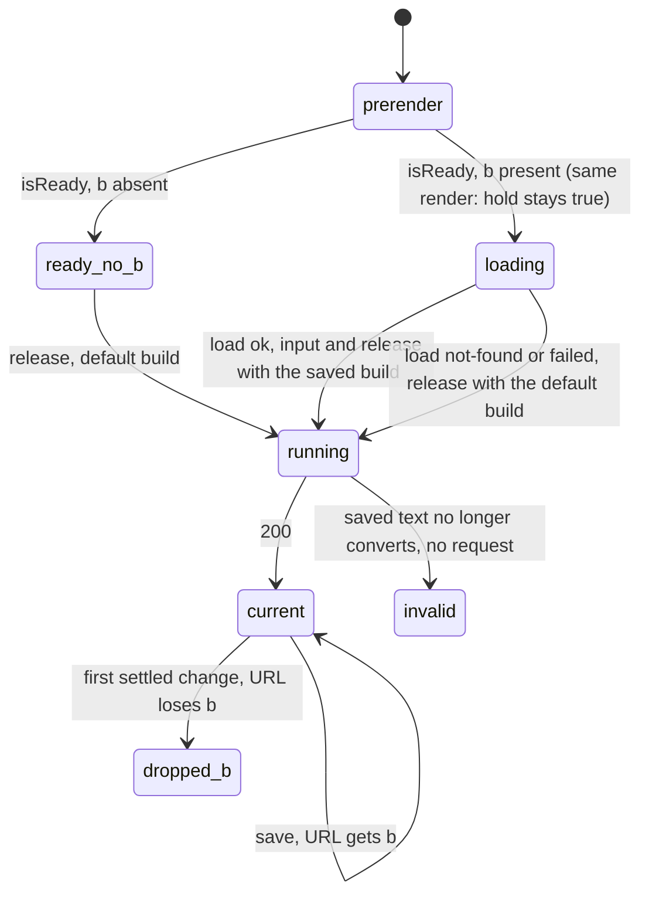

# SGS-105: Add the Save button, the copyable link and the `?b=<id>` load to the AoE4 page

- **Type**: Task
- **Component**: aoe4-build-order
- **Milestone / criteria**: M6 / M6.5 (Save button, copyable link, `?b=` load, unknown-id error), M6.9 (save-then-open spec, docs for save and open)
- **Priority**: medium
- **Risk**: standard
- **Invariants**: S1 (imports stay inside `components/apps/aoe4-build-order/`, `lib/aoe4-build-order/` and `pages/apps/aoe4-build-order.tsx`), S3 (the page posts to the save route only for a settled, valid, `current` input and never sends an unvalidated body; the opened record is re-checked by `checkBuildOrder` through the controller before any simulate request), A3 (a `?b=` load and a manual edit of the same content show the same result: the page adds no timing-dependent state). Not adjacent to A1 or A2.
- **LOC estimate**: ~190 (`save-build.tsx` ~90, `saved-build-loader.ts` ~35, `save-build-client.ts` ~40, page ~70 net, `build-input.tsx` ~15, `disabled` on `build-text-editor.tsx` and `step-table.tsx` ~10; UI markup and CSS, tests, docs and specs excluded where they carry no branch)
- **Depends on**: SGS-103, SGS-102
- **On merge**: none
- **Source**: `design/M6.md` C6 (save part: `SaveBuild`, `loadSavedBuild`, `savedBuildOption`, the test ids), "Save and link", "`?b=<id>` load", "Page wiring", the "tabs (narrow)" row, OD-5 (a), OD-6 (a), OD-8 (a); `reports/M6-designer-2.md` Q4, Q5, Q9; `plans/M6-20261105.md` outline G; M6.5, M6.9

## Context

SGS-103 adds the builds routes (`POST` saves a validated `{ buildOrder, durationSeconds }` and returns
`{ id, path }`; `GET` reads it back). SGS-102 makes the page re-run on edit through `useAutoRun`. This ticket is
the page side of M6.5: a Save button that is enabled only while the shown result matches the settled input, a
read-only link with a Copy button, and opening `/apps/aoe4-build-order?b=<id>` to load that build into the
editor and run it. The address bar never claims a link for content it no longer shows (OD-5 (a)).

## Scope

Read first: `design/M6.md` C6, "Save and link", "`?b=<id>` load", "Page wiring" (authoritative for rules). Read in
`node_modules/next/dist/docs/02-pages/04-api-reference/03-functions/use-router.md` (`isReady`, "should only be used inside
`useEffect`", shallow `replace`) and
`02-pages/03-building-your-application/02-rendering/04-automatic-static-optimization.md` (`query` is empty during
prerender) before editing the page; this Next is 16 and has breaking changes (AGENTS.md). Checked while writing:
`router.isReady` is false on the prerender and the first client render of a statically optimized page, and
`router.replace(url, as, { shallow: true })` updates the URL without rerunning `getStaticProps`.

**Parallel work.** SGS-104 (split layout) edits the same page areas (`WorkbenchTabs` props, `viewDisabled`, tab
state, the hooks block, `showTab` and `openPage` in `acceptance/helpers.ts`, the layout sentences in
`docs/aoe4-build-order.md`). This ticket does not depend on it and is written against `main` plus SGS-102 and
SGS-103; whichever of the two lands second rebases. Nothing here reads a split flag: setting `tab` after a `?b=`
load is harmless when SGS-104 renders no tablist, and the specs below use `showTab` or an explicit 390 px viewport,
so they hold with and without SGS-104.

Names from the dependencies are described as their tickets end, not as `main` reads today:

- SGS-099 `saved-builds.ts`: `savedBuildSchema`, `SavedBuild`, `SaveBuildRequest`, `SaveBuildResponse { id; path }`,
  `isSavedBuildId`, `SAVED_BUILD_ID_PATTERN`, `savedBuildPath`; `api.ts`: `BuildsError { error }`, `SimulateError`.
- SGS-103: `POST /api/aoe4-build-order/builds` answers 201 and 200 `{ id, path }`, 400 `SimulateError`, 413
  `BuildsError`, 429 `BuildsError` with `Retry-After`, 503 `BuildsError`, 405. `GET /api/aoe4-build-order/builds/{id}`
  answers 200 `SavedBuild & { id }`, 404, 500, 503. Acceptance helpers `BUILDS_PATH`, `buildPath(id)`,
  `postBuild(request, body, client)`, `uniqueClient(spec)`.
- SGS-100 and SGS-102 (`auto-run.ts`, `use-auto-run.ts`): `useAutoRun({ text, duration, selected, catalog, hold })`
  returns `AutoRunState & { flush; retry }` with `status` (`AutoRunStatus`), `settled: LiveInput`, `conversion`,
  `result`, `shown`; `hold` true gives status `loading`, no timer and no POST, and `release()` (run by the hook when
  `hold` turns false, after `input` with the same render's values) settles the last live input and fires at once.
  `auto-run-status` has `data-status`; helpers `waitForRun(page, action?)`, `expectNoRun(page, action?)`,
  `openPage(page)` (waits for status `current`), `AUTO_RUN_DEBOUNCE_MS`; `BuildInput` takes `status`, `hasResult`,
  `durationError`, `onSubmit`; `autoRunStatusMessage`.

### Modules (new files in `components/apps/aoe4-build-order/`, none imports `next`, and only `save-build.tsx` imports React)

1. **`saved-build-loader.ts`** (no React): `loadSavedBuild(id: string, signal: AbortSignal)` returns
   `Promise<{ status: 'ok'; saved: SavedBuild } | { status: 'not-found' } | { status: 'failed' }>` and never rejects.
   - `!isSavedBuildId(id)`: `not-found`, and `fetch` is not called.
   - Otherwise `fetch('/api/aoe4-build-order/builds/' + id, { signal })`, header `Accept: application/json`.
     200 whose JSON passes `savedBuildSchema.safeParse`: `ok` with the parsed record (the extra `id` key is
     dropped by the schema). 404: `not-found`. Any other status, a 200 body that fails the schema or is not
     JSON, a network error and an aborted signal: `failed`.
   - `savedBuildOption(id: string, saved: SavedBuild): PrebuiltBuild` returns `{ name: `${saved.buildOrder.name}
     (${id})`, text: formatBuildOrderText(saved.buildOrder) }`.
2. **`save-build-client.ts`** (no React; names not in the design, see Open questions):
   - `postSavedBuild(request: SaveBuildRequest, signal?: AbortSignal): Promise<{ ok: true; response: SaveBuildResponse } | { ok: false; message: string }>`
     posts JSON to `/api/aoe4-build-order/builds` (201 and 200 are success; a body that is not a
     `SaveBuildResponse` is a failure). Every failure is mapped by `saveFailureMessage` and the function never
     rejects.
   - `saveFailureMessage(status: number | null, retryAfter: string | null, body: unknown): string` with exactly:

     | case | text |
     |------|------|
     | 400 with a non-empty `issues` array in `body` | `The build could not be saved: <first issue's message>` |
     | 413 | `The build is too large to save.` |
     | 429, `retryAfter` a whole number of seconds below 60 | `Too many saves. Try again in <n> seconds.` (`Try again in 1 second.` for 1) |
     | 429, `retryAfter` 60 or more | `Too many saves. Try again in <m> minutes.` with `m = ceil(seconds / 60)` (`1 minute` for 60) |
     | 429, `retryAfter` missing, not a whole number, or below 1 | `Too many saves. Try again later.` |
     | 503 | `Saving is unavailable right now. Try again later.` |
     | any other status, a 400 with no readable issue, or `null` (network error) | `The build could not be saved. Try again.` |
3. **`save-build.tsx`** exports `SaveBuild`. Props (the names are the implementer's; the data is): `status:
   AutoRunStatus`, `settled: LiveInput`, `conversion` (the settled conversion), `builds: PrebuiltBuild[]`, `busy:
   boolean` (a `?b=` load is in flight) and `onSaved(response: SaveBuildResponse, input: LiveInput): void`. Rules:
   - **Enabled** only when `status === 'current'`, `busy` is false and no save is in flight. Otherwise it is
     `disabled` (the attribute) and visibly dimmed. `data-testid="save-build"`, visible text `Save build`.
   - **Click** posts, through `postSavedBuild`, `{ buildOrder: { ...conversion.order, name: pinName(builds,
     settled.text, settled.selected) }, durationSeconds: Number(settled.duration) }`. The body is built from the
     settled input and never from the live text.
   - **201 or 200:** shows `saved-build-link` (a read-only `<input>`, `aria-label="Link to this saved build"`,
     value `window.location.origin + response.path`) and `copy-saved-link` (text `Copy link`) in the run bar,
     moves focus to the input and selects all its text, clears any `save-build-error`, and calls `onSaved`. A repeat
     click on the same settled input shows the same link.
   - **Failure:** shows `save-build-error` (`role="alert"`) with the `postSavedBuild` message, hides the link
     panel, and leaves Save enabled.
   - **Hiding:** when the settled input's `text`, `duration` or `selected` differs from the input saved, the link
     panel and `save-build-error` are hidden. Escape inside the panel hides it and returns focus to Save. The
     panel is the only place that renders a saved link; nothing else on the page does.
   - **Copy:** `navigator.clipboard.writeText(link)` (the only clipboard call under `components` and `pages`); on
     success the button reads `Copied` until the link panel hides or the settled input changes; if the call
     rejects or `navigator.clipboard` is missing, the input text is selected and the hint `Could not copy. Select
     the link and copy it by hand.` shows next to it.
   - The link input and the run bar must not widen the page: with the panel shown nothing scrolls sideways at 390
     px, and the sticky run bar (768 px and wider) stays within 40% of the viewport height.

### Page (`pages/apps/aoe4-build-order.tsx`) and `BuildInput`

4. `builds` becomes page state (`useState(props.builds)`), so a loaded option can be put at the front. `pinName`,
   the select and `useAutoRun`'s `selected` all read the state.
5. **The `?b=` read.** `useRouter` from `next/router`. A `useEffect` keyed on `router.isReady` (never read during
   render for anything but `hold`) reads `router.query.b` once: an array gives its first value, and an absent or
   empty value is the normal first load. Only the initial `b` is read: a later change of `query.b` (back or forward
   after a save) loads nothing.
   - `hold = !router.isReady || savedLoadInFlight` as SGS-102 passes it, with `savedLoadInFlight` true for every
     render in which `router.isReady` is true, `b` is present and the load has not ended. No render may have
     `isReady` true, `b` present, and `hold` false before the load ends; otherwise the controller fires the default
     build and a second request follows. A derivation such as `router.isReady && initialB !== undefined &&
     !loadEnded` (a `loadEnded` state set by the effect) satisfies it, a flag set inside the effect does not.
   - Present `b` fails `isSavedBuildId`, or `loadSavedBuild` returns `not-found` or `failed`: `saved-build-error`
     (`role="alert"`) shows `That saved build was not found. Showing the default build.` (`not-found`) or `That saved
     build could not be loaded. Showing the default build.` (`failed`), the load ends, and the default build runs.
   - `ok`: in one state update, `builds` gets `savedBuildOption(id, saved)` at its front, `selected` is its name,
     the text is its text (through the page's `editText`, so open step rows stay consistent), `duration` is
     `String(saved.durationSeconds)`, and the load ends, so the hook's `input` and `release` run with that
     input. A saved record whose text no longer converts is loaded as text and the status is `invalid`, with no
     request (the controller's rule).
   - While the load runs: the select, the duration input, the text editor, the step table and Save are `disabled`
     with `aria-busy="true"`; the attribute is absent afterwards. `BuildInput` gets a `busy` prop,
     `BuildTextEditor` and `StepTable` a `disabled` prop (a `<fieldset disabled>` wrapper is enough for the table).
     The Text/Table toggle is unchanged.
   - The effect's `AbortController` aborts on cleanup, and no state changes after unmount or after an aborted
     load.
6. **Tab after a load (OD-6 (a)).** Nothing sets `tab` except a successful `?b=` load: the first run that follows
   it and ends `current` sets `tab` to `results`. If that run ends `invalid`, `rejected` or `failed`, `tab` stays
   `build`. No other run changes the tab.
7. **The URL (OD-5 (a)).** The page owns every `router.replace`. After a save (`onSaved`) it calls
   `router.replace({ query: { b: response.id } }, undefined, { shallow: true })`. The baseline for the URL is the
   input the `b` belongs to: the saved input after a save, the loaded input after a `?b=` load, and the default
   build's input after a failed load. When the settled input's `text`, `duration` or `selected` first differs
   from that baseline, the page calls `router.replace` with the `b` removed, shallow, once, and the link panel hides
   (item 3). The settled input is what counts, never the live text, so `b` stays through the 500 ms pause, and it
   stays through the `?b=` load and its first run (the render between the load ending and the controller releasing
   still shows the default input as settled; that must not count as a change). A selection that changes the
   settled input counts. The final URL after removal is `/apps/aoe4-build-order` with no `?`; verify
   that `{ query: {...} }` without a `pathname` keeps the current path under Next 16 and add `pathname:
   router.pathname` if it does not.
8. `BuildInput` hosts `SaveBuild` after the view toggle and before nothing else, inside the run bar form; Save is
   `type="button"` so Enter in the duration field still means `flush()` and never saves. The link panel follows the
   Save button in tab order, then Copy.
9. Imports from `lib/aoe4-build-order/` into `components` and `pages/apps` are limited to `saved-builds.ts`
   (values and types) and `api.ts` (types), plus what the page already imports. Neither `api-route.ts`,
   `builds-routes.ts`, `build-store.ts`, `blob-build-store.ts` nor `save-rate-limit.ts` is imported client-side.
   **Bundle check:** SGS-103 makes `saved-builds.ts` import `api-route.ts`, and `api-route.ts` exports
   `englishCatalog`, which calls `loadGameData` (`data.ts` imports the 300 kB snapshot JSON). The page's client
   bundle has no game data today because the imports used only by `getStaticProps` are stripped; verified on `main`
   (`npx next build` at 1e6d6c2: the string `unit_workshop_ram_3_eng` from `english.json` is in `.next/server` and in
   no file under `.next/static`). The implementer runs the check after the build and records the result. If the
   string reaches `.next/static`, the data import came through `saved-builds.ts`; apply the fix in Open questions
   (a) and record it.

### Out of scope

The controller, `useAutoRun` and the status texts (SGS-100, SGS-102); split layout (SGS-104); the routes, stores and
rate limit (SGS-101, SGS-103) beyond calling them; the smoke script and the agent how-to (outline H); saving
comments, blank lines or the raw text (OD-1 (a): the parsed order only); a DELETE or listing UI; the
name rule for a loaded build (Open questions); `docs/api/openapi.json` (no route changes); the Strict Mode double
effect (Strict Mode is off).

### Tests

10. **Vitest** (no DOM, no new dependency; table style of `simulate-client.test.ts` from SGS-100):
    - `saved-build-loader.test.ts`: `savedBuildOption` for a record named `Fast Castle` and id `Zx3_k9-QaB0` gives
      name `Fast Castle (Zx3_k9-QaB0)` and the text equal to `formatBuildOrderText` of the order (and the text
      re-converts with `textToBuildOrder`). `loadSavedBuild` with `vi.stubGlobal('fetch', ...)`, one row each:
      `abc` and a 12-character id give `not-found` and `fetch` is not called; a valid id requests
      `/api/aoe4-build-order/builds/<id>` with the given `signal`; 200 with a valid record (extra `id` key) gives
      `ok` and `saved` without `id`; 200 with `{ version: 2 }` and 200 with a non-JSON body give `failed`; 404
      gives `not-found`; 500 and 503 give `failed`; a rejecting `fetch` gives `failed`; an already-aborted signal
      gives `failed`. Breaks caught: a 404 mapped to `failed`, a 500 mapped to `not-found`, a fetch for a malformed
      id, a body that skips the schema.
    - `save-build-client.test.ts`: the `saveFailureMessage` table above, including `retryAfter` `'1'`, `'59'`,
      `'60'`, `'61'`, `'3600'`, `null`, `'abc'`, `'0'`, and a 400 with `issues: []`. `postSavedBuild` with a
      stubbed `fetch`: 201 and 200 give `ok` with the response body; 429 with header `Retry-After: 90` gives
      `Too many saves. Try again in 2 minutes.`; a rejecting `fetch` gives the network text; a 201 whose body is
      `{}` is a failure. Break caught: `Retry-After` ignored, 60 shown as seconds, minutes rounded down.
    - `save-build.test.ts` (`renderToStaticMarkup`, table style of the nearest component test): `SaveBuild` renders
      `save-build` with the `disabled` attribute for each of `loading`, `running`, `updating`, `invalid`,
      `rejected`, `failed`, and without it for `current`; with `busy` true it is disabled even for `current`; no
      `saved-build-link` is rendered on first render. Break caught: Save enabled while a run is pending.

11. **Acceptance** (Playwright). Helpers added to `acceptance/helpers.ts`: `openSavedBuild(page, id)` (goes to
    `${AOE4_PAGE}?b=${id}` and waits for `auto-run-status` `data-status` `current`). Saved builds that a test only
    opens are created with `postBuild(request, body, uniqueClient('aoe4-save-open'))` from SGS-103 so the UI save is
    not the setup. New `acceptance/aoe4-save-open.spec.ts`. Every test that saves, through the UI or the API, uses
    its own `uniqueClient`, set on its context (`browser.newContext({ extraHTTPHeaders: { 'x-forwarded-for': ... } })`),
    so no test shares the 30-save budget (OD-8 (a)). Failure responses of the builds route are made with
    `page.route`. Tests whose point is the 500 ms pause use Playwright's paused clock. No test clicks `tab-*` at the
    default viewport.

**Docs.** In `docs/aoe4-build-order.md` add a subsection "Saving a build and opening it by link" after the "Page"
text. It states, as rules and with no measured result or copied rate-limit number: Save is enabled only while the
shown result matches the settled input; a save stores the parsed build order with the name the pin would use and
the duration, so comments and blank lines are not kept and the text reopens in canonical form; the same content
gives the same link, and saving again returns it; the link is the page's origin plus `?b=<id>` and is shown
read-only with a Copy button, which falls back to a selected link and a hint; the link and the `b` in the address
bar go away on the first settled change and a save puts `b` back; opening `?b=<id>` loads the build into the editor
and runs it, adds an option `<name> (<id>)` to the select, disables the editor while it loads, and on a narrow
screen opens Results after the first successful run; an unknown or malformed id, or a failed load, shows the
message and runs the default build; a saved build whose text no longer converts opens as text with the issues; the
save error texts and the 429 wording follow `saveFailureMessage`. Fix every statement this makes untrue: grep
`docs/aoe4-build-order.md` for `starts on Build` and for the sentence that the select holds the prebuilt builds
only, and make each state the `?b=` exception. `ARCHITECTURE.md` is not changed (it does not list the files of
`components/apps/aoe4-build-order/`; grep first). The agent how-to is outline H's.

## Diagrams

The change adds a source of `hold` to the page's run gate (the `?b=` load), so the state machine of the gate:

Read, act, record for a save: the page reads the settled input and status, `SaveBuild` posts the settled build to
the builds route, and the page records the link, the shallow `replace` and the baseline input.

## Acceptance criteria

Specs are Playwright in `acceptance/aoe4-save-open.spec.ts` unless a case names another file. Each states the
break it catches. A "saved build" below is created through the API unless the case saves through the UI.

- [ ] Wiring holds in the end state: `git grep -nE "router\.(replace|push)" -- components pages` finds every match in
      `pages/apps/aoe4-build-order.tsx`; `git grep -n "navigator.clipboard" -- components pages` finds every match in
      `save-build.tsx`; `git grep -n "/api/aoe4-build-order/builds" -- components pages/apps` finds every match in
      `saved-build-loader.ts` and `save-build-client.ts`; `git grep -nE "api-route|builds-routes|build-store|blob-build-store|save-rate-limit" -- components pages/apps`
      finds no match; `git grep -nE "from 'next|from 'react" -- components/apps/aoe4-build-order/saved-build-loader.ts components/apps/aoe4-build-order/save-build-client.ts`
      finds no match.
- [ ] Bundle: after `npx next build`, `grep -rlF "unit_workshop_ram_3_eng" .next/static` (a string that appears only in
      `data/aoe4-build-order/aoe4world/english.json`; if a snapshot refresh removes it, use another snapshot-only
      string) lists no file, and the same string is still found under `.next/server`. The report records both
      results. Break caught: a client import that pulls the game data into the page.
- [ ] Unit tests in Scope item 10 pass and each table has the rows listed there.
- [ ] "save, copy, open in a fresh context": on the default build, `save-build` is enabled once status is `current`.
      Clicking it posts one body whose `buildOrder.name` is the default build's name, whose `durationSeconds` is
      1200, and which `postBuild`'s schema accepts (201). `saved-build-link` is visible with value matching
      `^<page origin>/apps/aoe4-build-order\?b=[A-Za-z0-9_-]{11}$`, is the focused element, and has its whole text
      selected (`selectionStart` 0, `selectionEnd` the value length). `page.url()` ends with `?b=<that id>`. A new
      context (its own `x-forwarded-for`) that goes to the link shows `build-order-select` with the selected option
      label `<default name> (<id>)`, reaches status `current` with exactly one simulate POST whose `buildOrder.steps`
      equal the saved ones, `duration-seconds` 1200, `page.url()` still ending `?b=<id>`, and the editor text equal
      to the saved order's `formatBuildOrderText`. Breaks caught: a link built from the live text, a missing focus move,
      a second default-build POST before the load (hold released early), `b` dropped by the load itself.
- [ ] "an edited build round trips": after `fill`ing the text with an edit and `duration-seconds` with 900, waiting
      for the run, saving and opening the link in a fresh context: the duration input reads 900, the POST's
      `buildOrder` equals the saved one, and the select's selected label matches `^.+ \(edited\) \([A-Za-z0-9_-]{11}\)$`.
      Break caught: the request or the duration taken from the live state or from the default.
- [ ] "the same content gives the same link": two clicks on Save with no edit give two builds POSTs (201, then 200)
      and the same link value. Break caught: a link that changes per click.
- [ ] "Save is enabled only when the shown result is current" (a table over states, each asserting the `disabled`
      attribute and a computed `opacity` below 1 when disabled, 1 when enabled): `current` enabled; text with an
      unknown unit id (`invalid`) disabled; duration `59` (`invalid`) disabled; the simulate response held by
      `page.route` (`running`) disabled with no builds POST made by a click; a route-fulfilled 500 (`failed`) disabled;
      a route-fulfilled 400 (`rejected`) disabled; after restoring a valid input and `waitForRun`, enabled. Break
      caught: Save posting a build the charts do not show.
- [ ] "an edit after a save hides the link and drops `b`": after a UI save, with the clock paused, `fill`ing the text
      leaves `saved-build-link` visible and `?b=` in `page.url()` until `AUTO_RUN_DEBOUNCE_MS` elapses; after it, the
      link and `save-build-error` are gone and `page.url()` has no `b` and no `?` (checked under `expect.poll`). A
      duration edit and a build-select change behave the same. Saving again shows a link with `b` back in the URL.
      Break caught: `b` removed on the live edit instead of the settled one, or never removed, or the link left
      visible for changed content.
- [ ] "an edit and an undo inside the pause keeps the link": with the clock paused, an edit then restoring the saved
      text before `AUTO_RUN_DEBOUNCE_MS` elapses leaves the link visible and `b` in the URL after the pause (the
      settled input never changed). Break caught: dropping on the live change.
- [ ] "Copy": with clipboard permissions granted, clicking `copy-saved-link` leaves `navigator.clipboard.readText()`
      equal to the link and the button reading `Copied`. With `navigator.clipboard.writeText` replaced by a
      rejecting stub (`addInitScript`), clicking Copy shows `Could not copy. Select the link and copy it by hand.`,
      and the input's text is selected. Break caught: a Copy that claims success when refused.
- [ ] "Escape closes the panel": Escape with focus in the link input hides `saved-build-link` and
      `copy-saved-link` and `save-build` is the focused element. Break caught: a trapped focus.
- [ ] "Save keeps the Enter rule": Enter in `duration-seconds` runs the build at once (a simulate POST) and sends no
      builds POST; Enter or Space on a focused `save-build` saves. Break caught: Save as a submit button.
- [ ] "save errors" (a table over route-fulfilled responses, each asserting the exact `save-build-error` text, the link
      panel hidden and `save-build` enabled): 429 with `Retry-After: 5` gives `Too many saves. Try again in 5 seconds.`;
      `Retry-After: 90` gives `Too many saves. Try again in 2 minutes.`; 429 with no header gives `Too many saves. Try
      again later.`; 400 with `{ error, issues: [{ code: 'out-of-range', message: 'name: 117 characters, more than
      100' }] }` gives `The build could not be saved: name: 117 characters, more than 100`; 413 gives `The build is
      too large to save.`; 503 gives `Saving is unavailable right now. Try again later.`; an aborted request gives
      `The build could not be saved. Try again.`. A later successful save clears the error. Break caught: a missing
      branch, rounded-down minutes, a hidden error.
- [ ] "opening a missing or malformed id" (a table): `?b=abc` (malformed) shows `saved-build-error` with `That saved
      build was not found. Showing the default build.`, makes no request to `/api/aoe4-build-order/builds/`, selects
      the default build and reaches `current` with one simulate POST; `?b=AAAAAAAAAAA` (valid shape, absent) gives the
      same text after one GET that answered 404; a route-fulfilled 500 and an aborted GET give `That saved build could
      not be loaded. Showing the default build.`. In every row `b` stays in the URL until the first settled edit, then
      is removed. Break caught: a fetch for a malformed id, a missing default run, `b` removed at once.
- [ ] "the first `b` wins": `?b=<saved id>&b=AAAAAAAAAAA` loads the saved build with no `saved-build-error`. A back
      navigation after a save (the shallow `replace` entry) loads nothing new: the GET count stays at the initial
      one. Break caught: reading the last value, a reload on `query.b` change.
- [ ] "the load holds the first run and disables editing": with the GET held by `page.route`, `auto-run-status` has
      `data-status` `loading`, no simulate POST was sent, and the select, `duration-seconds`, `build-order-text` and
      `save-build` are `disabled` with `aria-busy="true"` (the table view's controls are disabled too after
      `showView(page, 'table')`); after releasing the GET, exactly one simulate POST is sent, its `buildOrder` equals the
      saved build's, the controls are enabled and `aria-busy` is gone. Break caught: the default build posted while the
      load runs, an edit racing the load.
- [ ] "a saved build that no longer converts": a route-fulfilled GET 200 with a record whose order names the unit id
      `knigt` loads its text into the editor, shows the issues in `build-order-issues`, ends with `auto-run-status`
      `data-status` `invalid`, sends no simulate POST (`expectNoRun`) and leaves `tab-build` selected at 390 px.
      Break caught: a run for text the catalog rejects, Results selected for an invalid load.
- [ ] "the tab after a load" at an explicit 390 px wide viewport: a successful `?b=` load ends with `tab-results`
      selected (`aria-selected="true"`) and `panel-results` visible; a load with no `b` ends with `tab-build` selected;
      a `?b=` that falls back to the default build (404) ends with `tab-build` selected. Break caught: a tab switch
      on every run or on a failed load.
- [ ] "leaving during a load aborts it": with the GET held, navigating away (`page.goto('/')`) makes the GET request
      end as aborted (`requestfailed`), and no console error is logged. Break caught: a missing abort on unmount.
- [ ] "layout with the link shown": after a save, with the link panel visible, `document.documentElement.scrollWidth`
      is at most 390 at a 390 px wide viewport, and at 768x1024 and 1280x720 the `run-bar` height is at most 40% of the
      viewport height (all rects read in one `page.evaluate`). Break caught: a long link widening the page or a run
      bar that covers the editor.
- [ ] Test hygiene: no test shares a `uniqueClient` with another (each test creates its context with its own header);
      `git grep -n "request.post\|page.request.post" -- acceptance/aoe4-save-open.spec.ts` finds no match (posts go
      through `postBuild`).
- [ ] Docs: `docs/aoe4-build-order.md` carries every statement listed under Scope "Docs", quotes the Save, Copy,
      `Copied`, load and 429 texts exactly as in Scope, and contains no measured timing and no rate-limit number;
      every match of `git grep -n "starts on Build" -- docs/aoe4-build-order.md` also states the `?b=` exception.
- [ ] `npx tsc --noEmit`, `npm run lint:dup`, `npm test`, `npm run acceptance` and `npx next build` pass (the page
      prerenders with `hold` true and no `?b=` read, and sends no request). Every existing test that failed because
      `builds` is page state or `BuildInput` gained props keeps its expected value; the report lists each test edited.
- [ ] No INVARIANTS.md regressions

## Open questions

- `designer` (non-blocking, with a pre-agreed fallback): the page client imports value exports from `saved-builds.ts`
  (`isSavedBuildId`, `savedBuildSchema`), and SGS-103 makes `saved-builds.ts` import `api-route.ts`, which exports
  `englishCatalog` and so imports `data.ts` (the snapshot JSON). The bundle criterion above tests whether the page
  gets the game data. Recommended fix if it does: move `englishCatalog` out of `api-route.ts` into its own
  `lib/aoe4-build-order/english-catalog.ts` (importers: `simulate.ts` and `builds/index.ts`), so `api-route.ts` and
  `saved-builds.ts` hold no data import. This changes where one C7 name lives, so the designer should confirm it. The
  implementer applies it only when the check fails and records it, and then `api-route.ts` exports six names, not
  seven.
- `designer` (non-blocking): the design says Save posts `name: pinName(builds, settled.text, settled.selected)`, and an
  opened build is the option `<name> (<id>)`. So saving a build that was just opened, unchanged, posts the name `Fast
  Castle (Zx3_k9-QaB0)`, which differs from the stored `Fast Castle`, so it gets a new id and reopens as `Fast Castle
  (Zx3_k9-QaB0) (Aa1...)`. Editing a loaded build gives `Fast Castle (Zx3_k9-QaB0) (edited)`, and a loaded name near
  the 100-character cap can push the save past `SAVED_NAME_MAX_CHARS` (a 400 shown as the save error). This ticket
  follows the design as written. Decide whether Save should strip a trailing ` (<id>)` from a loaded option's name,
  or keep the stored name for an unchanged loaded build.
- `designer` (non-blocking): the design names `SaveBuild`, `loadSavedBuild` and `savedBuildOption` only. This ticket
  adds `postSavedBuild` and `saveFailureMessage` in `components/apps/aoe4-build-order/save-build-client.ts` (so the
  save call and its message table are unit-testable without a DOM) and the return shape of `loadSavedBuild`
  (`ok`, `not-found`, `failed`). Confirm the names, or move them into the files the design lists.
