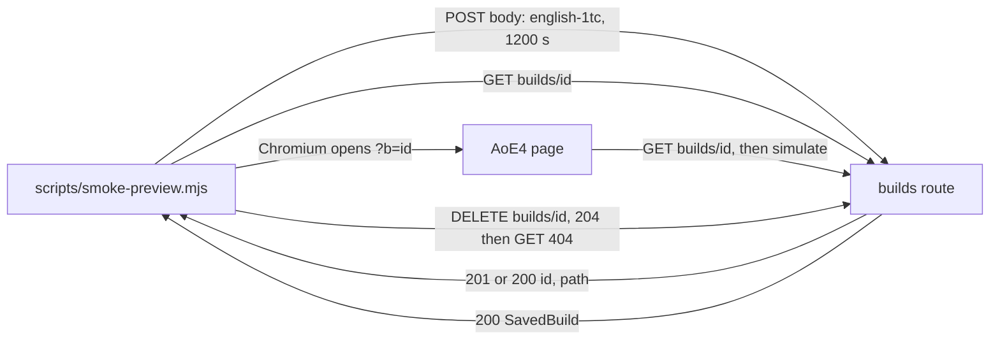

# SGS-106: Add `npm run smoke:preview` and document how an agent saves a build and prints its link

- **Type**: Task
- **Component**: aoe4-build-order
- **Milestone / criteria**: M6 / M6.7 (the preview smoke), M6.9 (docs: how an agent saves a build and prints its link; how the owner runs the smoke). M6.8 is human evidence on this ticket's PR and is not a criterion here.
- **Priority**: medium
- **Risk**: standard
- **Invariants**: S3 (the smoke sends one bounded save per run and never loops; every wait has a timeout), adjacent to A3 only through the saved record (the smoke posts a fixed build and compares the read-back by value). Not adjacent to A1 or A2.
- **LOC estimate**: ~130 (`scripts/smoke-preview.mjs` ~120, 1 line in `package.json`; the acceptance spec, docs and the `ARCHITECTURE.md` row excluded)
- **Depends on**: SGS-103, SGS-105
- **On merge**: none. Human action before merge (M6.8, owner Q15 A): the owner enables "Protection Bypass for Automation" on the Vercel project, exports `VERCEL_AUTOMATION_BYPASS_SECRET`, runs the smoke on this PR's preview and reports the output; the PR stays unmerged until then.
- **Source**: `design/M6.md` "Smoke (`npm run smoke:preview -- <url>`)", OD-2 (a), OD-3 (a); `reports/M6-designer-2.md` Q12; `plans/M6-20261105.md` outline H, Spec gaps 1 and 2 (owner Q15 A, Q16 A); M6.7, M6.9

## Context

M6 adds saved builds behind `POST` and `GET`/`DELETE /api/aoe4-build-order/builds`. The owner has no way to
check a deployed preview end to end, and an agent has no written way to save a build and hand back its link.
This ticket adds a script that saves a build to a deployment, reads it back, opens its link in a browser and
deletes it, and documents both that script and the plain request an agent sends.

**Merge hold (owner Q15 A).** This ticket's PR is "the M6 PR" the owner smoke-tests on its own preview deploy
(M6.8). The tech-lead and the manager must not merge it, even when every gate passes, until the owner reports
that `npm run smoke:preview -- <its preview url>` printed all four `PASS` lines and exited 0. Every other M6 PR
auto-merges as usual. The implementer states this hold in the PR body (as the sentence "Do not merge until the
owner's smoke passes on this preview", with no ticket ids).

## Scope

Read first: `design/M6.md` "Smoke" (authoritative for steps, order and exit codes), C3 and C4 (route statuses).
This repo is Next 16 and the script touches no Next API, so no Next doc is needed. Read Playwright's
`chromium.launch`, `browser.newContext({ extraHTTPHeaders })` and `expect`-free polling (`page.waitForFunction`
or `locator.waitFor`) in `node_modules/@playwright/test` types before writing step 3.

Names from the dependencies, described as their tickets end (not on `main` yet): SGS-103 answers
`POST /api/aoe4-build-order/builds` with 201 (created) or 200 (same content already stored) and
`{ id, path }`; `GET /api/aoe4-build-order/builds/{id}` with 200 `{ buildOrder, durationSeconds, ..., id }`
(`SavedBuild & { id }`) or 404 `{ error }`; `DELETE` with 204 (an absent build also gives 204) outside
production and 405 in production. Preview and development both allow `DELETE` (`savedBuildReply` row 1 allows
it whenever `env !== 'production'`). SGS-105 gives the page `/apps/aoe4-build-order?b=<id>`, whose select
(`data-testid="build-order-select"`) gains an option named `<name> (<id>)` and selected, whose
`data-testid="auto-run-status"` carries `data-status` and reaches `current` after a run, and whose
`data-testid="chart-units-produced"` chart is visible once a result shows.

1. **New `scripts/smoke-preview.mjs`** (the repo's first `scripts/` file; plain ES module, no `tsx`, no new
   dependency; it imports `chromium` from `@playwright/test`, already a devDependency). Usage
   `node scripts/smoke-preview.mjs <url>`. `<url>` is the deployment origin (a trailing slash is ignored). A
   usage error prints `usage: npm run smoke:preview -- <url>` and exits 2 before any request; a usage error is
   a missing or unparsable `<url>`, or a URL whose protocol is not `http:` or `https:`. Every request is built from the parsed origin, so the script never follows the page to another
   host for its API calls.
   - **auth.** Read `process.env.VERCEL_AUTOMATION_BYPASS_SECRET`. When it is set and non-empty, send the
     header `x-vercel-protection-bypass: <secret>` on every `fetch` and in `extraHTTPHeaders` of the browser
     context. The secret is never written to stdout, stderr, a thrown message, or a URL; the script logs no
     request headers. When it is unset, try anyway; if the first response (step 1's POST) is 401 or 403, print
     `set VERCEL_AUTOMATION_BYPASS_SECRET` and exit 2 (nothing was saved, so nothing is deleted). When it is set
     and the response is 401 or 403, the step fails like any other status (exit 1), not exit 2.
   - **Steps run in order and stop at the first failure.** Each step prints exactly one line: `PASS <step>` or
     `FAIL <step>: <reason>`. The step names are `save`, `read back`, `open` and `delete`. A `PASS` line may add
     a short detail after the name; `save` adds the status and the id (`PASS save: <status> <id>`, e.g. `PASS save: 201 <id>`). The only other
     fixed line is `FAIL production deployment: delete is disabled`. The exit code is
     0 only when all four steps pass, 1 on any failure, 2 only for the usage error and the unset-secret case.
   - **1 save.** Read `data/aoe4-build-order/builds/english-1tc.json` with `fs` and `JSON.parse`, from a path
     resolved against `import.meta.url` (so it works from any cwd). `POST <origin>/api/aoe4-build-order/builds`
     with `Content-Type: application/json` and body `{ buildOrder, durationSeconds: 1200 }`. Status 201 or 200
     with a body whose `id` satisfies the 11-character URL-safe pattern (`/^[A-Za-z0-9_-]{11}$/`, the
     `SAVED_BUILD_ID_PATTERN` value; a literal copy is allowed in a plain `.mjs`, so the script imports nothing
     from `lib/`) passes. Any other status or a body without a valid `id` fails with the status (and the
     `error` text when the body is JSON with a string `error`).
   - **2 read back.** `GET <origin>/api/aoe4-build-order/builds/<id>`. Status 200 and `body.buildOrder` and
     `body.durationSeconds` deep-equal what was sent (compare by value, key order ignored; use
     `node:util` `isDeepStrictEqual` or `node:assert` `deepStrictEqual`).
   - **3 open.** Playwright Chromium (`chromium.launch()`, one context with the bypass header when set) opens
     `<origin>/apps/aoe4-build-order?b=<id>`. Within 30 seconds in total, (a) the select
     `build-order-select` has a selected option whose text contains `(<id>)`, (b) `auto-run-status` has
     `data-status="current"`, and (c) `chart-units-produced` is visible. A browser launch failure fails the step
     with a message that names `npm run acceptance:setup`. The browser is closed in a `finally` on every path.
   - **4 delete.** `DELETE <origin>/api/aoe4-build-order/builds/<id>` must give 204, then `GET` of the same URL
     must give 404. When the DELETE gives 405 the line is exactly
     `FAIL production deployment: delete is disabled` (the saved build stays; the exit code is 1). Any other
     status prints `FAIL delete: <reason>`.
   - **`finally` delete.** Once step 1 returned a valid id, a `finally` block sends the `DELETE` when step 4 has
     not already run it (a step 2 or 3 failure, a thrown error). Its result prints no extra `PASS` or `FAIL`
     line unless the delete itself failed, in which case it prints one `FAIL delete: <reason>` line; the exit
     code stays 1. Because the build content is fixed, a build another run or tool saved with the same content
     is deleted too; the script is for previews and local runs only.
   - **repeat.** No special code: a second run saves the same content, so step 1 gets 200 with the same id.
   - **production.** No special code beyond the 405 rule above.
   - Network errors (a thrown `fetch`) fail the current step with the error's `message`, never with a header
     or the URL's credentials. The script sets a timeout on each `fetch` (`AbortSignal.timeout`, 15 s).
2. **`package.json`**: add the script `"smoke:preview": "node scripts/smoke-preview.mjs"` beside `acceptance`.
   `npm run smoke:preview -- <url>` then passes `<url>` through. No other `package.json` change.
3. **`ARCHITECTURE.md`**: add one row to "Where files go": kind `Scripts`, location `scripts/`, note: Node
   scripts run by hand or through an npm script (for example `npm run smoke:preview`). Not deployed and not
   imported by the app. A script is a plain `.mjs` run by Node, which `tsconfig.json` does not type-check, so
   it imports nothing from `lib/`, `components/` or `pages/`; a script that needs app code is written as a
   `.ts` file and gets its own ticket for how it runs. Add only this one row.
4. **`docs/aoe4-build-order.md`**: add two subsections after SGS-105's "Saving a build and opening it by link"
   (same heading level). Rules only, no measured result, no copied rate-limit number:
   - **"Saving a build from a script"** (the agent how-to; docs only, no helper): to save a build, send
     `POST <origin>/api/aoe4-build-order/builds` with `Content-Type: application/json` and a body
     `{ "buildOrder": <BuildOrder>, "durationSeconds": <integer in the simulate route's bound> }`, where
     `buildOrder` is the same JSON the simulate route takes (a prebuilt file under
     `data/aoe4-build-order/builds/` is a valid body source). It names the status codes and bodies an agent
     must handle, as the OpenAPI file documents them: 201 created and 200 already saved, both `{ id, path }`;
     400 with `issues` (fix the build and resend); 413 (record too large); 429 with `Retry-After` (wait that
     many seconds); 503 (try again later). It states that the link to print is the deployment's origin plus
     `path` (`<origin><path>`), that `path` is relative so the agent supplies the origin it posted to, and that
     the same content always returns the same link. It includes one runnable example: a `curl` that posts a
     build file from `data/aoe4-build-order/builds/` and a one-line Node `fetch` equivalent that prints
     `new URL(path, origin).href`. For a protected preview it says to add the header
     `x-vercel-protection-bypass: <secret>` from the owner's bypass secret and never print the secret.
   - **"Checking a deployment with the smoke test"** (how the owner runs it): one-time setup
     `npm run acceptance:setup` (Chromium) and enabling "Protection Bypass for Automation" in the Vercel
     project settings, which creates `VERCEL_AUTOMATION_BYPASS_SECRET`; export it in the shell, then
     `npm run smoke:preview -- https://<preview-host>`. It lists the four steps and what each checks (save,
     read back, open in a browser, delete), the line format (`PASS <step>` or `FAIL <step>: <reason>`), the
     exit codes (0 all pass, 1 a step failed, 2 usage error or the secret missing), that a run stops at the
     first failure and still deletes what it saved, that a second run reuses the same link, that the script is
     for previews and local runs (against production the delete is refused, the line is
     `FAIL production deployment: delete is disabled`, and the saved build stays), and that each run costs one
     save of the rate limit. The bypass header name is `x-vercel-protection-bypass`; both subsections use that
     exact name.
   - Fix every statement the change makes untrue: grep the doc for `smoke` and for `agent` and for a sentence
     that says saved builds can only be made from the page; each must agree with the new text.
5. **Acceptance spec `acceptance/smoke-preview.spec.ts`** (new). It runs the script as a child process
   (`execFile(process.execPath, ['scripts/smoke-preview.mjs', url], { env })`, with a `cwd` that is not the repo
   root for one case) against a stub HTTP server the spec starts on an ephemeral port in the test process and
   closes in `afterEach` (the Playwright `webServer` is not used, so no store state is shared with any other
   spec and the smoke's delete cannot race another spec's saved build). The stub implements the routes of the
   Scope's dependency paragraph, records every request (method, path, headers), and serves a small HTML page at
   `/apps/aoe4-build-order` that holds a `build-order-select` with a selected option `ENG 1TC (<id>)`, an
   `auto-run-status` with `data-status="current"` and a visible `chart-units-produced`; each scenario below
   changes only what it says. Table style, one row per scenario, with the helper shared by all rows.
6. **Hold and verification notes** are in Context and in the criteria. The implementer also runs the script
   by hand against `npm run dev` (see the last criteria) and records the output in the report and the PR body.

**Out of scope:** a `save-build` CLI or any agent helper script (docs only, owner Q16 A); any change to the
builds routes, the page, the store or OpenAPI; a production smoke that keeps or removes a saved build; reading
`VERCEL_AUTOMATION_BYPASS_SECRET` from a file; running the smoke from CI; unit tests under `scripts/` (the
Vitest `include` list does not cover it, and this ticket does not change that list).

## Diagrams

Crosses components (the script, the deployed route and the page). No state machine changes.

## Acceptance criteria

Spec cases (all in `acceptance/smoke-preview.spec.ts`; each asserts the exit code, the exact stdout lines and the
recorded stub requests):

- [ ] "all steps pass": the stub accepts the save with 201. Exit code 0; stdout is, in order, one `PASS save: 201 <id>` line, then `PASS read back`, `PASS open`, `PASS delete`, and no `FAIL` line. The stub's request log is, in order, POST builds, GET builds/id, the page request, DELETE builds/id, GET builds/id. The POST body deep-equals `{ buildOrder: <the parsed english-1tc.json>, durationSeconds: 1200 }`. Break caught: a step skipped or reordered, a wrong fixture or duration.
- [ ] "repeat run": the stub answers the second save of the same content with 200 and the same id. Exit code 0 and `PASS save: 200 <id>` with the same id as the first run. Break caught: the script treating 200 as a failure.
- [ ] "secret set is sent and never printed": `VERCEL_AUTOMATION_BYPASS_SECRET` set to a sentinel string. Every recorded stub request (fetch and the page navigation and its subresources) carries `x-vercel-protection-bypass` with the sentinel, and neither stdout nor stderr contains the sentinel in any scenario of this file (assert in a shared `afterEach` for every row). Break caught: a header missing on the browser context, or the secret echoed in an error message.
- [ ] "secret unset, first response 401" and "secret unset, first response 403": the stub answers the save with that status. Exit code 2, stdout/stderr contain `set VERCEL_AUTOMATION_BYPASS_SECRET`, the stub saw exactly one request, and no DELETE was sent. Break caught: continuing past a protected deployment, or deleting an id that was never saved.
- [ ] "secret set, first response 401": exit code 1 and stdout has a `FAIL save:` line that includes `401`. Break caught: exit 2 when the secret was set.
- [ ] "save fails": the stub answers 400 `{ error: 'x' }`. Exit code 1, a `FAIL save:` line that includes `400`, no GET after it, and no DELETE. Break caught: running later steps after a failure, or deleting without an id.
- [ ] "read back differs": the stub's GET returns a record whose `durationSeconds` is 900. Exit code 1, `FAIL read back:`, no `open` line, and a DELETE was sent (the `finally` delete). Break caught: the delete missing from the failure path, or the compare ignoring `durationSeconds`.
- [ ] "open fails" (takes about 30 s; set this case's test timeout to at least 60 s): the page has no option containing `(<id>)`. Exit code 1, `FAIL open:`, a DELETE was sent. Break caught: the select check missing, or a page wait with no bound.
- [ ] "delete refused in production": the stub's DELETE answers 405. Exit code 1 and stdout contains exactly `FAIL production deployment: delete is disabled`; the first three steps print `PASS`. Break caught: the text or exit code differing from the design.
- [ ] "delete leaves the build": the stub's DELETE answers 204 but the following GET still answers 200. Exit code 1 and a `FAIL delete:` line. Break caught: step 4 not re-reading.
- [ ] "usage" (respec 1): one row each for no argument, an unparsable `<url>` (`not a url`) and a non-http URL (`ftp://example.com`): each exits 2 with `usage: npm run smoke:preview -- <url>` and the stub saw no request. Break caught: a usage error that exits 0 or 1, or a request sent before validation.
- [ ] "runs from another directory": one row of "all steps pass" runs with `cwd` set to a temp directory and still passes. Break caught: the fixture path resolved against `process.cwd()`.

Other criteria:

- [ ] `package.json` has the script `smoke:preview` and `git grep -n "smoke:preview" -- package.json` finds it; the script path it runs exists. `scripts/smoke-preview.mjs` imports nothing from `lib/`, `components/` or `pages/`, and `tsx` is not in `package.json` (`git grep -nE "from '\.\./(lib|components|pages)" -- scripts` finds no match).
- [ ] No file other than `scripts/smoke-preview.mjs`, `acceptance/smoke-preview.spec.ts`, `package.json`, `ARCHITECTURE.md` and `docs/aoe4-build-order.md` changes, apart from `package-lock.json` if and only if `npm` rewrites it (it should not, since no dependency is added).
- [ ] Local verification (recorded in the report and the PR body, with the real output): with `BUILDS_LOCAL_DIR` set to a throwaway directory and `npm run dev` running, `npm run smoke:preview -- http://localhost:<port>` exits 0 and prints four `PASS` lines; running it a second time exits 0 and its `save` line shows status 200 and the same id. The implementer states the port, that the dev server was stopped after, and that the throwaway directory holds no leftover record.
- [ ] Docs (read against the "Saving a build from a script" and "Checking a deployment with the smoke test" subsections): the agent how-to names the request body fields, every status listed in Scope item 4 with what to do, and the printed link as `<origin><path>`; the smoke subsection names `VERCEL_AUTOMATION_BYPASS_SECRET`, `x-vercel-protection-bypass`, the four steps, the three exit codes, the first-failure stop and the production refusal; the example `curl` runs unchanged against `npm run dev` and returns an `{ id, path }` body (the implementer runs it and says so in the report). No timing, count, rate-limit number or run-out time appears in either subsection, and every match of `git grep -n "protection-bypass" -- docs/aoe4-build-order.md` is spelled `x-vercel-protection-bypass`.
- [ ] `ARCHITECTURE.md` "Where files go" has a `Scripts` row naming `scripts/`; `git grep -n "scripts/" -- ARCHITECTURE.md` finds it.
- [ ] The PR body states the merge hold sentence from Context.
- [ ] `npm test`, `npx tsc --noEmit && npm run lint:dup` and `npm run acceptance` pass, and the new spec's cases pass in a full acceptance run.
- [ ] No INVARIANTS.md regressions

## Open questions

None.

## Re-spec 2026-11-09

- Underspecified: the exit code for usage errors and the exact output line formats (two designer questions); the owner smoke run was filed as an open question though it is a merge-time action.
- Changed: usage errors (missing, unparsable, non-http(s) URL) exit 2 before any request; line format and step names confirmed; the owner action moved to `On merge` as a human action; Open questions emptied; the "usage" criterion now has three rows.
- Branch work: none exists yet.
