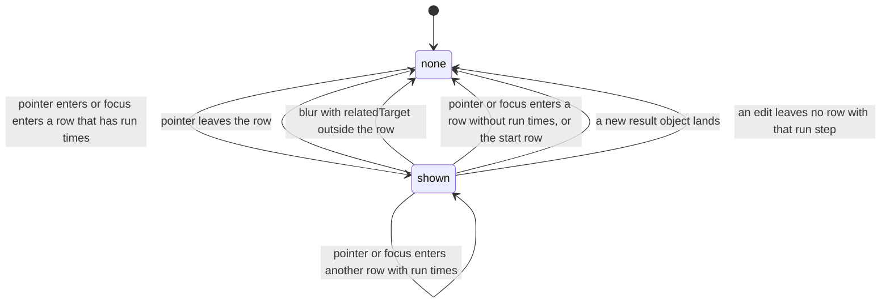

# SGS-109: Row hover and focus shade the charts; remove the step timeline so the charts take the width

- **Type**: Task
- **Component**: aoe4-build-order
- **Milestone / criteria**: M7 / M7.3, M7.5, M7.7 (part: the timeline docs and specs)
- **Priority**: medium
- **Risk**: standard
- **Invariants**: S1 (imports stay inside `components/apps/aoe4-build-order/`, `lib/aoe4-build-order/` and `pages/apps/aoe4-build-order.tsx`), A3 (the hover and focus state is read by no result path; the same input gives the same result with or without a row active). Not adjacent to S3, A1 or A2.
- **LOC estimate**: ~120 logic (`step-table.tsx` row handlers ~45, page `active` state and wiring ~35, `results.tsx` ~25 net, CSS ~15) and about 250 lines deleted (`step-timeline.tsx`, `timelineRows`, `TimelineRow`, CSS); business logic only, the spec and docs rewrite is large and excluded
- **Depends on**: SGS-108
- **On merge**: none
- **Source**: `design/M7.md` (Behavior rules "Active step (page)" and `Results`, the DOM contract, Criteria map M7.3, M7.5, M7.7); `plans/M7-20261110.md` outline C and owner answer DQ6; M7.3, M7.5

## Context

After SGS-107 and SGS-108 each step-table row carries its run times, so the separate step timeline repeats them. M7 makes the row the control: pointing at a row or focusing a control in it shades that run step on every chart, and the timeline, its column and the `results-split` wrapper go, so the charts take the full Results width.

## Scope

Names from SGS-107 (`StepRun`, `StepAnnotation`, `BuildAnnotations`, `stepSpan(timing, end)` in `step-annotations.ts`; `timelineRows` and `TimelineRow` still exported there) and SGS-108 (`StepTable.annotations`, the `step-row` DOM contract with `data-kind` and `data-run-step`, `step-run`, `StepKindBadge`, `KIND_CLASS` in `step-annotation.tsx`, the page's memoized `annotations` and `stale`, `Results.dimmed = stale`) are described as those tickets end, not as `main` reads today. Today the active state lives in `Results` and the timeline rows are the controls.

**Page (`pages/apps/aoe4-build-order.tsx`):**

- New state `active: { result: SimulationResult; step: number } | null`, moved here from `Results`. The effective `activeStep` is `active.step` only while `active.result === result` and some live annotation has `run.runStep === active.step`; otherwise `null`. An inline expression or a small helper, the implementer picks.
- Pass `annotations`, `activeStep` and `onActiveStepChange` to `StepTable`, where `onActiveStepChange(null)` clears and `onActiveStepChange(runStep)` sets `{ result, step: runStep }` for the shown `result`. Pass `activeStep` to `Results`; stop passing `text` and `landmarks` to it.
- Remove the `useEffect` that sets `--run-bar-height` through `ResizeObserver`, and any ref (`pageSection`, `runBar`) only that effect used. Only the sticky timeline column read that variable; keep a ref another code path still uses.

**`step-table.tsx`:**

- Props `activeStep?: number | null` (default `null`; a `runStep`) and `onActiveStepChange?: (runStep: number | null) => void`. They act only while `annotations` is non-null.
- On each step `<tr>` (not on the start row's controls individually): `onPointerEnter` calls `onActiveStepChange(run.runStep)` when the row's annotation has a `run`, else `null`; `onPointerLeave` calls `null`; `onFocus` (React's focus bubbles from any control in the row) acts like pointer enter; `onBlur` calls `null` only when `e.relatedTarget` is not inside `e.currentTarget` (`!e.currentTarget.contains(e.relatedTarget as Node | null)`), so moving focus between controls of one row never clears. The last event wins, as the timeline rows did.
- The start row calls `onActiveStepChange(null)` on pointer enter and on focus entering it (no band).
- A row whose `annotation.run?.runStep === activeStep` (with `activeStep !== null`) gets `data-active="true"` and the Bootstrap class `table-active` (built with `cn`). Rows get no `tabIndex`; keyboard access is through the controls already in the row.

**`results.tsx`:**

- `ResultsProps` drops `text` and `landmarks` and adds `activeStep: number | null`; the component drops its `active` state and `useMemo` of rows. `highlight = activeStep === null ? null : stepSpan(result.steps[activeStep], result.durationSeconds)` (`stepSpan` keeps its clamp and in-progress rules).
- Remove the `results-split` wrapper `div` (DQ6: the wrapper and its test id go) and the two column `div`s; the four `SeriesChart`s render directly inside `results-last-good`, after the message lists. Remove the imports of `StepTimeline`, `timelineRows` and `useMemo`/`useState` that become unused (the per-villager `useState` stays).

**Deletions:**

- `components/apps/aoe4-build-order/step-timeline.tsx`; `timelineRows`, `TimelineRow` and any helper only they used, in `step-annotations.ts`, with their cases in `step-annotations.test.ts`. Keep every export the annotation model, `step-annotation.tsx`, `results.tsx` or `line-chart.tsx` still imports.
- In `workbench.module.css`: the `@media (min-width: 1800px)` block holding `.resultsSplit`, `.timelineColumn` and `.chartsColumn`. In `results.module.css` and `step-annotation.module.css`: any class no component references any more after the timeline goes (for example the timeline's legend row, badge and time-cell classes if SGS-108 left copies). Check each class by grepping its `styles.<name>`.

**Specs (`acceptance/`)** (read `step-row` in Table view; each test first asserts the API status it relies on, as the existing ones do; layout reads in one `page.evaluate` or under `expect.poll`):

- `aoe4-build-order-step-band.spec.ts`: drive `step-row` instead of `step-timeline-row`. Each test switches to Table view (`showView(page, 'table')`) before hovering; the default 1280 px viewport shows Build and Results side by side. Keep all nine cases: no band before hover; exact span on the four charts, to the run end when in progress; pointer off removes it; keyboard focus on a control inside a row shows the band (the old "Tab moves to the next row" becomes: focus the last control of row i, `step-delete`, press Tab, and `step-trigger-kind` of row i+1 is focused and the band is row i+1's span); blur removes it; a zero-length step draws a line; an age-up band ends at its marker; waiting and not-reached rows draw no band and still read `data-active="true"`; the active row looks active by computed style (a computed box-shadow on the row's first cell changes, for a flagged and an unflagged row); a new run clears the band and `data-active` while the pointer stays. Add three cases: the unaligned-stale case, the no-flash case and the edit case (see criteria).
- `aoe4-results-split.spec.ts` (keep the file name): replace the timeline cases as the criteria say; delete the sticky, wrapped-run-bar and stacked-timeline cases and the 1799/1800 boundary case.
- `aoe4-narrow-layout.spec.ts`: drop `step-timeline-scroll` from `SCROLL_BOXES` (rename the test that loops it so its title names the compare table only) and delete the 1024 px stacked-timeline test and its describe. No new 390 px check.
- `aoe4-build-order-knight-longbow-page.spec.ts` and `aoe4-build-order-m3-flow.spec.ts`: move the timeline assertions to `step-row`: row count equals the build's step count, `data-kind` on the palace and research rows, `step-kind-legend` visible, `data-status` and `data-flagged` on the step rows of the m3 paste, `data-reaction` replaced by the `step-field-reaction` checkbox count or checked state (Table view). Any other spec that still reads a removed test id moves the same way.
- Every spec the implementer edits is listed in the report.

**Docs (`docs/aoe4-build-order.md`, find by phrase):**

- Replace the paragraph that begins "A step timeline sits above the charts" with one on the annotated build order and hover shading. The run-cell rules (Started, Finished, Waited, Blocked by text, flagged and long-wait highlight, kind colours and legend) already live in the step table paragraph from SGS-108; move anything the old paragraph states that is not yet there into it, then delete the old paragraph. The new text states: pointing at a row, or focusing a control in it, highlights the row and shades that step's span (Started to Finished) on every chart; an in-progress step's span runs to the end of the run; a step that starts and finishes in the same second shows as one vertical line; a waiting or not-reached step, or a row with no run times, shows no band; moving off the row or running again clears it; shading still works while the result is stale for a row that still has its times. Delete the sentences about the timeline's own scroll box, the labels coming from the shown text, and "shows no timeline" (a `start`-only paste shows no step rows and no legend).
- Replace the sentence that begins "At 1800 px and wider the step timeline sits in a column" (and the one after it) with: the charts are the only column at every width and take the full Results width. In the Narrow layout paragraph drop "the step timeline and" from "the step timeline and compare tables scroll sideways inside their own boxes".
- Behavior and rules only, no measured sizes or timings. `ARCHITECTURE.md` and `docs/api/openapi.json` are unchanged (grep first).

**Out of scope:** the Text-tab gutter and any hover or caret handling in the text editor (M7.6, a later ticket); the run cell, legend, `buildAnnotations`, `alignSteps` and `resultsStale` (SGS-107, SGS-108); the `aria-describedby` rule; tab stops on rows; collapsed table rows; a 390 px check; chart internals (`line-chart.tsx` keeps its `highlight` prop and band elements); any route, API or engine change.

## Diagrams

The active-step state (page-level) after this ticket; the shading follows the derived state, so every transition ends in `none` or `shown`.

## Acceptance criteria

Playwright specs below are in `acceptance/` and run in Table view; each states the break it catches. Viewports are inputs.

- [ ] Wiring and removal hold in the end state: `git grep -n -i "step-timeline\|step timeline\|StepTimeline\|timelineRows\|TimelineRow\|results-split\|resultsSplit\|timelineColumn\|chartsColumn" -- components pages docs acceptance` has every match in `acceptance/aoe4-results-split.spec.ts` (its count-0 assertions), and none under `components`, `pages` or `docs`; no `--run-bar-height` and no `ResizeObserver` for the run bar remain under `pages` or `components`.
- [ ] `ResultsProps` has no `text` or `landmarks`; `results-last-good` holds the four charts as direct children after the message lists, and no element with test id `results-split` exists.
- [ ] "hover shades every chart": hovering a `step-row` whose `data-run-step` is set shows exactly one `chart-step-band` in each of the four charts, with `data-from` equal to the API step's `startedAt` and `data-to` equal to its `completedAt` (the run duration for an in-progress step); the row has `data-active="true"`. Break caught: highlight read from the wrong index (a live index used as a run index) or a chart missing the prop.
- [ ] "focus shades like hover and Tab moves it": focusing `step-delete` of a completed row shows that row's span, and Tab into the next row's `step-trigger-kind` moves the band to the next row's span, then blurring removes it. Break caught: `onFocus` placed on a single control instead of the row, or blur not clearing.
- [ ] "no flash inside a row" (pins the blur `relatedTarget` check): install a `MutationObserver` on the page that counts removals of `chart-step-band` nodes, focus `step-trigger-kind` of a completed row with a nonzero span, press Tab to move to the next control in the same row, and the removal count is 0 and the band is still shown; then Tab out of the row and the band is removed. Break caught: `onBlur` clearing unconditionally (the band disappears and returns between the blur and the focus events).
- [ ] "hover over an unaligned row while stale draws no band": after the first run, hold the simulate response with `page.route(SIMULATE_PATH)`, edit a step with a number field in a later row k so its `data-run-step` is gone and `step-run` has `data-stale="true"`; hovering row k draws no band and sets no `data-active`; hovering an unchanged earlier completed row j (j < k) draws the band with that run step's span from the first response, while `results-last-good` has computed opacity `0.5`; then release the held request. Break caught: the active step set for a row with no run, or shading disabled while stale.
- [ ] "an edit that unaligns the active row removes the band at once": focus a number field in a completed row with a nonzero span (for example `step-field-count`), confirm the band is shown, type a changed value, and under `expect.poll` the band count is 0 and no element has `data-active` while the field keeps focus and the simulate response is held. Break caught: the derived `activeStep` using `active.step` without checking that some live annotation still has that run step.
- [ ] "a new run clears the band": hovering a row, then changing the duration so a new result lands while the pointer stays over the row, leaves no band and no `data-active`, and the pointer is still over the row. Break caught: `active.result === result` not checked.
- [ ] "no band for rows with no start": hovering a waiting row and a not-reached row (from the pasted builds the existing spec uses) draws no band and each reads `data-active="true"`. Break caught: a band drawn from a null `startedAt`.
- [ ] "the hovered row looks active": for an unflagged row and for a flagged row the computed `box-shadow` of the row's first `td` is different while hovered than before, and exactly one element has `data-active="true"`. Break caught: `table-active` missing, or covered by the flagged tint.
- [ ] The existing step-band cases for a zero-length step (one visible vertical line per chart, `visibility` visible, stroke not `none`) and an age-up step (band right edge within 1 px of the age-up marker and inside the plot area on every chart) pass on `step-row`.
- [ ] `step-table` render unit test (extend the file SGS-108 added, same `renderToStaticMarkup` style): with a fixed `BuildAnnotations` of three steps where step 1 has `run: null`, `activeStep` set to the second step's `runStep` gives `data-active="true"` and the `table-active` class on exactly that row; `activeStep` null gives neither on any row; the `run: null` row never gets them, whatever `activeStep` is. Break caught: matching the live row index instead of `run.runStep`.
- [ ] "the charts take the width" (`aoe4-results-split.spec.ts`, one `page.evaluate`, a table over `WIDE_VIEWPORT`, `SPLIT_VIEWPORT` and `TABS_VIEWPORT`): after a run, `step-timeline`, `step-timeline-scroll` and `step-timeline-legend` each have count 0, and the `chart-units-produced` width is at least 95% of the `results-last-good` width. A build with no steps (`start -> sheep`) still draws `chart-units-produced`, has no `step-row` and no `step-kind-legend`. The page does not scroll sideways at `WIDE_VIEWPORT`. Break caught: a column wrapper or reserved timeline width left behind.
- [ ] `aoe4-narrow-layout.spec.ts`: `SCROLL_BOXES` names no timeline test id, no test reads one, and the file's narrow checks (390 px text view, table view of the longest build, Results with a pinned run, the compare scroll box) still pass.
- [ ] `docs/aoe4-build-order.md` states every item in Scope "Docs", quotes no measured size or timing, and `git grep -n -i "timeline" -- docs/aoe4-build-order.md` finds no sentence about a step timeline.
- [ ] Every edited spec and test is listed in the report; `npx tsc --noEmit`, `npm run lint:dup`, `npm test` and `npm run acceptance` pass; `npx next build` succeeds. The implementer records the commands and test counts.
- [ ] No INVARIANTS.md regressions

## Open questions

none
