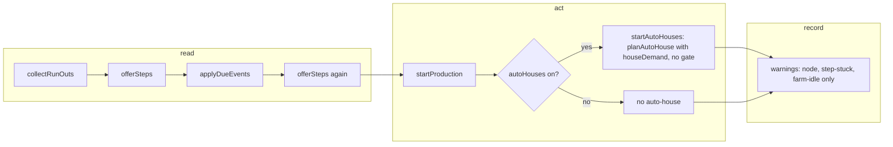

# SGS-111: Drop the auto-house gate and remove the two house-gate warnings

- **Type**: Task
- **Component**: aoe4-build-order
- **Milestone / criteria**: M7 / M7.8
- **Priority**: high
- **Risk**: high
  <!-- strong-model triggers: changes what a run computes (auto-house planning, timings of every order with a `build house` step); removes two codes from a public response schema and the OpenAPI spec. -->
- **Invariants**: A3 (the new rule stays deterministic: no randomness, no clock), A2 (an auto-house never takes a resource below zero; the payment path is unchanged), A1 (no number moves into code; a prebuilt build that breaks a bar is retuned in its data file). Adjacent to criticalPaths `simulateBuildOrder`/`runInstant` (the call into `startAutoHouses` is unchanged, its early return goes).
- **LOC estimate**: about -70 business logic (`simulate.ts`: delete `lastHouseStep`, `houseGateOpen`, `accrueHeld`, `houseWarnings`, the `heldAt`/`heldSeconds` fields and the gate check; `model.ts`: two union variants; `depletion.ts`: one rank branch), plus tests, docs and OpenAPI JSON edits
- **Depends on**: none
- **On merge**: none
- **Source**: `design/M7.md` Behavior rules "Auto-houses (M7.8)", Contracts "Removed contracts (M7.8)", Criteria map M7.8 and M7.7 docs row; `reports/M7-designer-3.md` (owner answer DQ1 = A); `plans/M7-20261110.md` outline E; backlog `simulate.ts houseGateOpen`

## Context

Today auto-houses stay off until the order's last `build house` step has started, so one late explicit house
freezes production at the supply limit (the owner's build 259 case: held 12:24 with 18 villagers and 8
longbows by 7:30 against 20 and 10 without house steps). The owner chose rule A: with `autoHouses` on,
auto-houses plan from the start; explicit `build house` steps add houses on top. The two warnings that
existed only to explain the gate become unreachable and are removed.

## Scope

Read first: `design/M7.md` Behavior rules "Auto-houses (M7.8)" (authoritative, every row), and
`docs/aoe4-build-order.md` "Houses and supply". All names below are on `main` today.

**Engine (`lib/aoe4-build-order/simulate.ts`)**
- `startAutoHouses`: drop the `houseGateOpen` condition from its early return (it still returns when
  `autoHouses` is off or the house entry is missing). Planning stays `planAutoHouse` with `houseDemand`; the
  rest of the function (builder source, affordability, `engine.needs`, `startConstruction`) is unchanged. In
  `runInstant` steps still run first, then `startAutoHouses`, so an explicit house starting at the same
  instant is under construction when the planner counts supply.
- Delete `lastHouseStep`, `houseGateOpen`, `accrueHeld`, `houseWarnings`, the `Engine` fields `heldAt` and
  `heldSeconds` (type and initializer), the `accrueHeld` call in `simulateBuildOrder`, and the
  `...houseWarnings(engine)` entry in the `sortWarnings` input.
- `Engine.supplyBlocked` is read only by `accrueHeld`: once that is gone, delete the field and its three
  writers (`offerSteps` outcome handling, the produce-order supply branch, and the reset in `runInstant`) too.
  If another reader exists in the end state, keep it. Remove imports and helpers the deletions orphan
  (`isReaction` and `formatMinSec` still have other users; check, do not assume).

**Model and ordering**
- `model.ts`: `SimWarning` loses the `auto-houses-never-start` and `auto-houses-held` variants; it keeps
  `node-depleted`, `idle-arrival`, `farm-idle`, `step-stuck`. No warning code is added.
- `depletion.ts` `tieRank`: delete the auto-house branch and fix the comment above it to read: node
  warnings by ref order (`node-depleted` before `idle-arrival`), then `farm-idle`, then `step-stuck` by step.
  Rank values stay a valid total order for the remaining codes.

**OpenAPI (`docs/api/openapi.json`)**
- Remove the `auto-houses-never-start` and `auto-houses-held` variants from the `SimWarning` `oneOf`
  (the `$ref` list and the component schemas) and rewrite the `warnings` description of the simulate response
  to drop the sort tail and the two sentences about them. Keep the remaining sentences.

**Docs**
- `docs/aoe4-build-order.md`, "Houses and supply": delete the gate paragraph ("Auto-houses are off until the
  last `build house` step ...") and the two-warning list with the sentence that follows it. Replace them
  with the rule: with `autoHouses` on, auto-houses plan from the start whether or not the order has `build
  house` steps; explicit `build house` steps start as ordered and add houses on top; a house under
  construction counts toward supply for the planner whichever kind it is, so a surplus house appears only
  when an explicit step starts after auto-houses already covered the demand; with `autoHouses: false` no
  auto-house is planned and production blocks at supply until an explicit step adds more; when no node has
  enough gatherers or a resource of the cost is short the auto-house waits and supply may block production
  meanwhile; no warning reports production held at supply.
- Same file: the warnings sort sentence in the Warnings section, the Severity table rows for both codes, and
  the `warnings` field description in the response section (the code list, the "house-gate warning"
  sentences and the sort tail). Grep the file for every mention of the two codes, "house-gate" and "last
  `build house` step"; each must be rewritten or removed.
- `data/aoe4-build-order/README.md`: replace the sentences that say auto-houses stay off until the last
  `build house` step and that the knight-longbow run carries `auto-houses-held` with the new rule (explicit
  houses add supply on top of auto-houses). Do not quote measured timings.

**Tests**
- `lib/aoe4-build-order/simulate-house-warnings.test.ts`: rewrite (rename to `simulate-house-gate.test.ts`
  with `git mv`). Delete every case about the two warnings. Replace with the reduced fixture below. Keep any
  case that still tests something real about auto-houses (for example `autoHouses: false` blocking at
  supply); delete the `digest`/`digestTimeline` helpers if nothing uses them afterwards.
- `lib/aoe4-build-order/depletion.test.ts`, `sortWarnings`: drop the `neverStart`/`held` helpers and rows;
  keep the node, `farm-idle` and `step-stuck` ordering cases.
- Every other test that fails because the gate is gone (a test of the changed behavior gets the new
  expected value computed by the engine and checked against the rule; any test whose subject is something
  else keeps its expected value and pins the old setting in its setup, for example `autoHouses: false`).
  The implementer lists every test edited and why.
- Acceptance: `acceptance/aoe4-simulate-api-house-warnings.spec.ts` rewritten (rename to
  `aoe4-simulate-api-house-gate.spec.ts`): the same reduced order posted with `autoHouses: true`; assert
  the API returned 200, villager production continues past the old hold and no warning code starts with
  `auto-houses`. Keep the `autoHouses: false` case if it asserts the supply block. In
  `acceptance/aoe4-simulate-api-contract.spec.ts`: the `SimWarning` variant code list, the `WarningKeys`
  tuple and its values lose both variants.
- Prebuilt builds: `english-1tc` (explicit houses at steps 1 and 7, 0-based) and `english-knight-longbow`
  (steps 1, 7, 21 to 23) were gated, so their timings shift. Rerun every spec that reads their times
  (examples: `aoe4-simulate-api-knight-longbow-build`, `-prebuilt-plans`, `-prebuilt-farms`, the
  knight-longbow 1800 s and 3600 s idle checks, `aoe4-build-order-knight-longbow-page`, `-m3-flow`, and
  `builds.test.ts`; use `git grep` for `english-1tc` and `english-knight-longbow` under `acceptance/` and
  `lib/` for the full set) and update each pinned number to the value the engine now returns, recording the
  old and new values in the report. Retune `data/aoe4-build-order/builds/*.json` only if a bar breaks: no
  step waiting or not reached, no idle villager at the horizon. `english-spear-longbow-maa-crossbow` has no
  explicit house step and must not change.

**Reduced fixture (no new data file).** In the unit test (`run`, `at`, `twoTowns`, `woodStart` as the
current file defines them): an explicit `build house` at `at(0)` and a second one behind `at(600)` (today's
`lateHouse` shape with the late trigger moved to 600), `durationSeconds` at least 700, with a produce
source that reaches the supply limit well before 600 s. The case proves itself first: with
`autoHouses: false` on the same order, production is blocked at supply before 600 s (population stops
rising and a `produce` step or order waits on population until the late house starts), which is the state the
old rule produced for `autoHouses: true`. Then with `autoHouses: true`: the population keeps rising past the
instant production first hit the limit in the first run, and `warnings` holds no code starting with
`auto-houses`.

**Out of scope:** adding the 4-house build 259 text or `english-1tc-council-hall.json` (not in the repo;
adding it changes `listBuilds()`); any new warning or UI signal for production held at supply; changes to
`planAutoHouse`, `houseDemand` or `houseBuilderSource`; the UI step table; any other M7 work.

## Diagrams

Changes the control path inside one instant (`runInstant`). Phases: read (supply, demand), act, record.

## Acceptance criteria

- [ ] With `autoHouses: true` and an order whose only `build house` steps are one at `at(0)` and one behind `at(600)`, an auto-house starts before the late step starts and population keeps rising past the supply limit the same order hits with `autoHouses: false`; the unit test first asserts that the `autoHouses: false` run is blocked at supply before 600 s (the old hold), so it fails if the fixture does not build the case.
- [ ] The same unit case asserts `warnings` contains no code that starts with `auto-houses`; a mutation that restores the `houseGateOpen` early return in `startAutoHouses` makes the production-continues assertion fail.
- [ ] An order with no `build house` step plans auto-houses exactly as before (a test pins the result of an existing no-house case unchanged).
- [ ] A reaction `build house` step that never fires no longer stops auto-houses: a unit case with such a step and `autoHouses: true` shows auto-houses start and production passes the first supply limit.
- [ ] An explicit house and the planner at the same instant: a unit case where an explicit `build house` starts at the instant `startAutoHouses` runs asserts the planner counts it as under construction (no extra auto-house for the demand it already covers).
- [ ] With `autoHouses: false` no auto-house is ever started and production blocks at supply until an explicit `build house` step adds supply (existing behavior, still pinned by a test).
- [ ] The same order and inputs run twice return deeply equal results (A3).
- [ ] `git grep -n "auto-houses-never-start\|auto-houses-held\|houseGateOpen\|lastHouseStep\|accrueHeld\|houseWarnings\|heldAt\|heldSeconds"` over `lib`, `components`, `pages`, `acceptance`, `docs`, `data` returns no match except, if any, a negative assertion that the code is absent (for example "no warning code starts with `auto-houses`", which does not contain these strings).
- [ ] `SimWarning` in `model.ts` has exactly the variants `node-depleted`, `idle-arrival`, `farm-idle`, `step-stuck`; `docs/api/openapi.json` `SimWarning` `oneOf` lists the same four codes and the contract spec asserts that list.
- [ ] `sortWarnings` still orders by `at`, then node warnings in ref order (`node-depleted` before `idle-arrival`), then `farm-idle`, then `step-stuck` by step; the `depletion.test.ts` table keeps those rows and a mutation that swaps the `farm-idle` and `step-stuck` ranks fails it.
- [ ] `docs/aoe4-build-order.md` and `data/aoe4-build-order/README.md` state the new rule and mention neither removed code nor any "off until the last `build house` step" gate; the `warnings` description in the doc and in OpenAPI list only the four remaining codes and their sort order.
- [ ] Every prebuilt build (`english-1tc`, `english-knight-longbow`, `english-spear-longbow-maa-crossbow`) still meets the existing bar in its specs (no step `waiting` or `not-reached`, no idle villager at the horizons the specs check); `english-spear-longbow-maa-crossbow` times are unchanged.
- [ ] `npm test`, `npx tsc --noEmit`, `npm run lint:dup` and the contract spec pass; `npm run acceptance` passes for every spec the change touches and every spec that reads a prebuilt build.
- [ ] No INVARIANTS.md regressions

## Open questions

none
