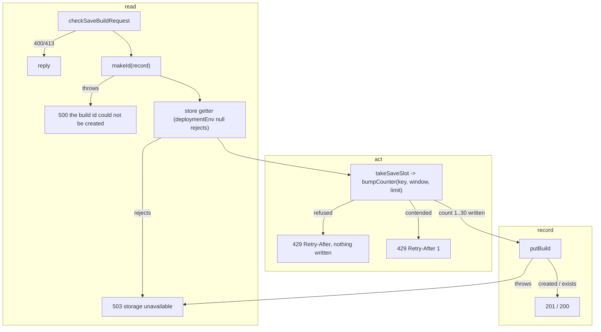

# SGS-112: Fix builds-route debt: typed replies, one issue cap, one counter step, fail-closed env, id failure 500

- **Type**: Task
- **Component**: aoe4-build-order
- **Milestone / criteria**: M8 / M8.6, M8.7, M8.8
- **Priority**: medium
- **Risk**: high
  <!-- strongModelTriggers: changes the BuildStore.bumpCounter signature and the RouteReply, ReplyTarget and sendReply contracts every AoE4 route depends on, and adds a 500 response to the public saveBuild API. -->
- **Invariants**: S3 (the issue cap stays at MAX_REPORTED_ISSUES while it moves into one helper)
- **LOC estimate**: 200 (api-route.ts `issuesError` and generics, build-store.ts `nextCounter` / `deploymentEnv` / `storeFor`, blob-build-store.ts counter loop, save-rate-limit.ts `takeSaveSlot`, builds-routes.ts id step and exports, two page routes; most of the diff is tests)
- **Depends on**: none
- **On merge**: none
- **Source**: design/M8.md C2, C3 and the Criteria map rows M8.6, M8.7 (blob import, SGS-103 route gaps) and M8.8 (issue cap, counter step, `recordingTarget`, blob comment, ARCHITECTURE wording)

## Context

The saved-build routes have known defects and duplicated code: a refused save still writes the rate-limit counter, an id-generation failure answers 503, an unset `VERCEL_ENV` on Vercel silently selects the `development` storage prefix (and allows DELETE), `sendReply` no longer checks response bodies, and the issue cap and counter step are each written twice. This ticket fixes them before the named-build routes build on the same contracts (C2, C3).

## Scope

All paths under `lib/aoe4-build-order/` unless noted. Read at `origin/main`; nothing here depends on another ticket.

**Typed replies (`api-route.ts`).** `RouteReply<Body = unknown>`, `ReplyTarget<Body = unknown>` and `sendReply<Body>(res: ReplyTarget<Body>, reply: RouteReply<Body>)` exactly as design C3. Every route handler passes a `NextApiResponse<...>` whose body type is the union of what its reply function returns, so a wrong body fails `tsc`: `pages/api/aoe4-build-order/simulate.ts` (already types its response; it must keep compiling), `builds/index.ts`, `builds/[id].ts`. `saveBuildReply`, `savedBuildReply` and `methodNotAllowed` return `RouteReply<...>` with their body unions, built only from existing types: `SaveBuildResponse`, `BuildsError` and `SimulateError` from `api.ts`, and the GET body written inline as `SavedBuild & { id: string }` (`SavedBuild` from `saved-builds.ts`; do not export a new name for it). Add the generic to `ReplyTarget` so `NextApiResponse<Body>` satisfies it. Where `tsc` cannot infer `Body` (a handler's `NextApiResponse<Union>` with a narrower reply such as `methodNotAllowed`'s `RouteReply<BuildsError>`), the handler may pass an explicit type argument, `sendReply<Union>(res, reply)`; it never casts the reply or the response.

**One issue cap (`api-route.ts`, `saved-builds.ts`, `pages/api/aoe4-build-order/simulate.ts`).** Export `issuesError(all: readonly BuildOrderIssue[]): SimulateError` from `api-route.ts` (design C3: caps at `MAX_REPORTED_ISSUES`, `omittedIssues` only when greater than 0, `error` is the first issue's message, input has at least one issue). `badRequest` in `saved-builds.ts` and the tail of the `simulate.ts` handler both call it. `api-route.ts` stays browser-safe (it imports only types and `MAX_REPORTED_ISSUES` from `api.ts`, which is already browser-safe because `saved-builds.ts` imports it).

**One counter step (`build-store.ts`, `blob-build-store.ts`).**
- `CounterResult = CounterUpdate | 'contended' | 'refused'`; `bumpCounter(clientKey, windowStart, limit)` returns `Promise<CounterResult>` (design C2; the named-build methods are not part of this ticket).
- Export `nextCounter(stored: unknown, windowStart: number, limit: number): CounterUpdate | 'refused'`: same window and `count >= limit` gives `'refused'`; same window and `count < limit` gives `count + 1`; a new window or an unreadable value (including a non-number `count`) gives `1`.
- The memory, file and Blob stores all call it, and none writes when it returns `'refused'`. The Blob store's `COUNTER_ATTEMPTS` loop returns `'refused'` without calling `put`. The private copy in `build-store.ts` and the inline copy in `blob-build-store.ts` are deleted.

**Refused writes nothing (`save-rate-limit.ts`).** `takeSaveSlot(store, clientKey, nowMs)` keeps its signature and calls `store.bumpCounter(clientKey, windowStart, SAVE_RATE_LIMIT.maxSaves)`. A counter update gives `{ ok: true }`; `'refused'` gives `retryAfterSeconds = max(1, ceil((windowStart + 3600000 - nowMs) / 1000))`; `'contended'` gives 1. Saves 1 to 30 in a window are allowed and the stored count after any number of refusals is still 30.

**Fail closed (`saved-builds.ts`, `build-store.ts`, `builds-routes.ts`, `builds/[id].ts`).**
- `deploymentEnv(env: { VERCEL?: string; VERCEL_ENV?: string }): string | null` in `saved-builds.ts`: a non-empty `VERCEL` with an empty or unset `VERCEL_ENV` gives `null`, otherwise `storageEnv(env.VERCEL_ENV)`. Samples: `{}` gives `development`; `{VERCEL:'1', VERCEL_ENV:'preview'}` gives `preview`; `{VERCEL:'1'}` and `{VERCEL:'1', VERCEL_ENV:''}` give `null`.
- `storeFor` in `build-store.ts` rejects with `Error('VERCEL is set but VERCEL_ENV is not')` when `deploymentEnv` is `null`, before it touches `BUILDS_STORE_ID`. It uses `deploymentEnv` for the stored-key env. A failed promise is not memoised (the existing `processStore` reset still applies).
- `savedBuildReply` takes `deps.env: string | null`. `null` disallows DELETE exactly as `production` does (`Allow: GET`, 405 for DELETE). `builds/[id].ts` passes `deploymentEnv(process.env)`.
- Every builds route then answers 503 through its existing getter-rejects path, which logs.

**Id failure is 500 (`builds-routes.ts`).** `saveBuildReply` order after the M6 body checks: id generation (`deps.makeId ?? savedBuildId`, a new optional `deps.makeId?: (record: SavedBuild) => Promise<string>`), then the store getter (503), the slot (429), `putBuild` (503) and 201 / 200. A throw or rejection from `makeId` gives `500 { error: 'the build id could not be created' }` and `console.error('builds: id generation failed', cause)`, with no getter call and no counter write. Export `errorReply(status, error, headers?)`, `storageUnavailable(cause)` and a new `idFailure(cause)` (500 plus the log) from `builds-routes.ts`.

**`recordingTarget` once.** New test-only `route-test-support.ts` exports `recordingTarget()` (moved unchanged in behaviour from `api-route.test.ts` and `builds-routes.test.ts`, which then import it). It is typed with the new `ReplyTarget<Body>`.

**Playwright (`playwright.config.ts`).** `webServer.env` sets `BUILDS_STORE_ID: ''`, `VERCEL_ENV: ''` and `VERCEL: ''` instead of filtering them out with `DROPPED_ENV`, so a developer's `.env.local` cannot send acceptance runs to Vercel Blob. Before relying on it, read `node_modules/next/dist/docs/` (the environment-variables page) and record in the report the passage showing that a variable already present in the process environment, including an empty string, wins over `.env.local`. If the docs say otherwise, stop and report instead of guessing. The comment above the env block states why the values are blank.

**OpenAPI (`docs/api/openapi.json`).** Add a `500` response to `saveBuild` (it has none today): schema `BuildsError`, a description saying the build id could not be created and the client should try again later, and an example `{"error":"the build id could not be created"}`. `info.version` stays `2.4.0`: the version bump belongs to the ticket that adds the named-build paths, and the contract spec pins the current version and path set. Do not touch other operations.

**Contract spec (`acceptance/aoe4-builds-api-contract.spec.ts`).** The `saveBuild` response-key list in `declares every documented status of each operation` gains `'500'`. The test `the 503 and 500 examples have no live reproduction and validate as BuildsError only` also validates the new `saveBuild` 500 example as `BuildsError` (an id failure has no live reproduction either). Nothing else in the spec changes.

**Docs and comments.** `ARCHITECTURE.md`: the AoE4 saved-build storage row says `BUILDS_STORE_ID` "is set and non-empty" selects the Blob store and "unset or empty" selects the file store, states that `VERCEL` set without `VERCEL_ENV` makes the store (and so every builds route) fail with 503, and names `nextCounter` as the one counter step; the route logic row names the generic `RouteReply<Body>` / `sendReply`, `issuesError`, and that the shared reply helpers (`errorReply`, `storageUnavailable`, `idFailure`) live in `builds-routes.ts`. The comment above `read` in `blob-build-store.ts` states what `get` returns for a missing blob, checked against the installed `@vercel/blob` types or source (read `node_modules/@vercel/blob` before writing it), and that `BlobNotFoundError` is also treated as absent. `docs/aoe4-build-order.md`:
- The `saveBuild` reply table (the one with rows 201, 200, 400, 413, 429, 503 that a script reads) gains the row `| 500 | the build id could not be created | try again later |`.
- The "Builds routes" bullets state that `DELETE` answers 405 in production and also when `VERCEL` is set without `VERCEL_ENV` (where every builds route answers 503 anyway, because the store cannot be chosen), and that a save refused by the rate limit writes nothing, so the stored count never passes the limit.

Then grep `docs/aoe4-build-order.md`, `README.md` and `ARCHITECTURE.md` for `VERCEL_ENV`, `bumpCounter`, `rate`, `500` and `503` and fix any other statement these changes make untrue.

**Test debt in the files this ticket already edits (M8.7).**
- `build-store.test.ts`: the "never imports `blob-build-store`" checks (`uses BUILDS_LOCAL_DIR when BUILDS_STORE_ID is unset|empty`) assert `blobFactory.imported` was not called, but `vi.mock` runs its factory at module load and `beforeEach` resets the spy, so a static import passes them. Take `buildStoreFromEnv` from a fresh `import('./build-store')` after `vi.resetModules()` in those cases, so the factory runs during that import when, and only when, the module imports the Blob store statically. The failed-import case also asserts `rejects.toThrow('blob import failed')`.
- `builds-routes.test.ts`: the GET 500 (stored value fails the schema) and the getter-rejects 503 tests assert `console.error` was called once; the no-client check inspects each logged argument's `message` and string values for the client key rather than `JSON.stringify(error.mock.calls)` (an `Error` stringifies to `{}`).
- `acceptance/aoe4-builds-api.spec.ts`: the GET read-back test uses `toEqual` on the whole body (and on `buildOrder`) instead of `toMatchObject`. If the server normalises the posted `buildOrder`, the expected value is the normalised order stated in the test, not a loosened matcher.

**Tests to update.** A rule, not a list: every test that calls `bumpCounter` or `takeSaveSlot`, or builds a `BuildStore` stub, gets the `limit` argument and the new result type (`build-store.test.ts`, `blob-build-store.test.ts`, `save-rate-limit.test.ts`, `builds-routes.test.ts` are examples). A test whose expectation the new behaviour changes (a refused save now leaves the counter unchanged; an id failure is 500) gets the new expected value. A test that pins a module's export list gets the new exports and nothing else changes in it: `build-store.acceptance.test.ts` `build-store exports exactly the documented names` gains `nextCounter` (and any other export from `build-store.ts` the change adds); its `takeSaveSlot` end-to-end case needs no change, since 30 allowed and the 31st refused still hold. The implementer lists every test it edits.

**Where the env tests live.** The `deploymentEnv` sample rows go in `saved-builds.test.ts` (the function is in `saved-builds.ts`); the `storeFor` / `buildStoreFromEnv` fail-closed cases go in `build-store.test.ts`.

**Out of scope:** the named-build routes, store methods and OpenAPI 2.5.0 (later tickets); the Blob SDK retry multiplication during an outage (stays in BACKLOG); `design/M6.md` smoke notes (a state-branch file); the `?b=` query handling and the knight-longbow README.

## Diagrams

The save route changes its order of operations (id generation moves ahead of the store, a refused slot stops writing). Read, act, record:

## Acceptance criteria

- [ ] `saveBuildReply` with `makeId` that throws (and again with one that rejects) answers `{ status: 500, body: { error: 'the build id could not be created' } }`, logs `builds: id generation failed` with the cause, calls the store getter zero times and writes no counter. The test would fail if `makeId` ran inside the store try block (it would answer 503).
- [ ] `nextCounter` is exported from `build-store.ts` and its test table covers: same window below the limit (count + 1), same window at the limit (`'refused'`), same window above the limit (`'refused'`), a new window (1), `null`, and a stored value whose `count` is not a number (1). The memory, file and Blob stores each have a case where the 31st `bumpCounter(key, W, 30)` returns `'refused'` and a following `bumpCounter(key, W, 31)` returns count 31, which fails if a refused call wrote 31 or 32 (the file store case reads the counter file; the Blob case asserts `put` was not called on the refused call).
- [ ] `takeSaveSlot` test: 32 calls in one window give `{ ok: true }` for the first 30 and `{ ok: false }` for the rest; every existing Retry-After row (offsets 0, 1 800 000, 1 800 001, window length minus 1 ms) and the contended case still hold; the `bumpCounter` stub receives `SAVE_RATE_LIMIT.maxSaves` as its third argument.
- [ ] A search for the counter step finds one implementation: `git grep -n "count + 1" -- lib/aoe4-build-order` has every non-test match in `build-store.ts`.
- [ ] A search for issue capping finds one implementation: `git grep -n "MAX_REPORTED_ISSUES" -- lib pages` has every non-test match in `api.ts` (the definition) and `api-route.ts` (`issuesError`); `saved-builds.ts` and `pages/api/aoe4-build-order/simulate.ts` contain no `.slice(0, MAX_REPORTED_ISSUES)`.
- [ ] `issuesError` has its own test: 1 issue gives no `omittedIssues`; exactly `MAX_REPORTED_ISSUES` gives none; `MAX_REPORTED_ISSUES + 1` gives `issues` of length `MAX_REPORTED_ISSUES` and `omittedIssues: 1`; `error` is the first issue's message. The existing over-cap cases for `checkSaveBuildRequest` and the simulate route still pass.
- [ ] (respec 1) `saved-builds.test.ts` has a `deploymentEnv` table whose rows are the four samples in Scope; the `{VERCEL:'1'}` row fails if `deploymentEnv` ignores `VERCEL`. In `build-store.test.ts`, `buildStoreFromEnv({ VERCEL: '1' })` and `({ VERCEL: '1', VERCEL_ENV: '' })` reject with `VERCEL is set but VERCEL_ENV is not` even when `BUILDS_STORE_ID` is set (the mocked Blob factory is not called), and `({ VERCEL: '', VERCEL_ENV: '' })` resolves to the file store.
- [ ] `savedBuildReply` with `env: null`: DELETE answers 405 with `Allow: GET` and deletes nothing; GET still works. With `env: 'development'` DELETE still answers 204. The `[id].ts` adapter passes `deploymentEnv(process.env)` (a `git grep -n "storageEnv(process.env" -- pages` finds nothing).
- [ ] Every builds route answers 503 and logs when the getter rejects with the fail-closed error (`saveBuildReply` and `savedBuildReply` GET with `getter = () => buildStoreFromEnv({ VERCEL: '1' })`).
- [ ] The build-store blob-import tests fail under this mutation, which the report names and shows: replace the dynamic `await import('./blob-build-store')` in `storeFor` with a top-level static import. (Today only the `doMock` case fails under it; the two `uses BUILDS_LOCAL_DIR when BUILDS_STORE_ID is unset|empty` cases pass, which is the defect.)
- [ ] The GET 500 and getter-reject 503 tests in `builds-routes.test.ts` fail when the `console.error` call in `readSavedBuild` / `storageUnavailable` is removed, and the no-client check fails when a stored error logs the client key in its message (the report names the mutation used).
- [ ] (respec 1) The `sendReply` types bite: a handler whose `NextApiResponse<Body>` does not include a body its reply function can return fails `npx tsc --noEmit`. No handler casts its reply or response (`as` / `any`) to get there; an explicit `sendReply<Union>` type argument is allowed. The report shows one such deliberate mismatch failing `tsc` (for example removing `BuildsError` from the `builds/[id].ts` response type), then reverted. `npx tsc --noEmit` and `npm run lint:dup` pass at the end.
- [ ] `recordingTarget` is defined once: `git grep -n "function recordingTarget" -- lib` matches only `route-test-support.ts`, and `api-route.test.ts` and `builds-routes.test.ts` import it.
- [ ] `playwright.config.ts` `webServer.env` has `BUILDS_STORE_ID`, `VERCEL_ENV` and `VERCEL` set to `''` and no longer filters them with `DROPPED_ENV`. With a throwaway `.env.local` containing `BUILDS_STORE_ID=blob_must_not_be_used` and `VERCEL_ENV=production`, `acceptance/aoe4-builds-api.spec.ts` still passes against the file store (the implementer runs it once and records the result; delete the `.env.local` after). The report quotes the Next docs passage from Scope.
- [ ] (respec 1) `docs/api/openapi.json` `saveBuild` has a `500` response whose schema is `BuildsError` with the example from Scope, and `info.version` is still `2.4.0`. In `acceptance/aoe4-builds-api-contract.spec.ts`, the `saveBuild` response-key assertion includes `'500'` and the no-live-reproduction test validates the `saveBuild` 500 example as `BuildsError`; the spec passes after that edit (it fails before the edit, since the key list no longer matches).
- [ ] (respec 1) `build-store.acceptance.test.ts` `build-store exports exactly the documented names` lists `nextCounter`, and the file passes.
- [ ] (respec 1) `ARCHITECTURE.md` and the `blob-build-store.ts` comment carry the statements in Scope. The `docs/aoe4-build-order.md` `saveBuild` reply table has the row `| 500 | the build id could not be created | try again later |`, and its Builds routes bullets state the fail-closed `DELETE` rule and that a refused save writes nothing. The grep over `docs/aoe4-build-order.md`, `README.md` and `ARCHITECTURE.md` for the Scope terms leaves no statement contradicted by the code.
- [ ] No INVARIANTS.md regressions

## Open questions

none

## Re-spec 1 - 2026-11-10

- Underspecified: the contract spec's pinned `saveBuild` key list, the build-store export-list test, and the `docs/aoe4-build-order.md` reply table all break or go stale with the new 500 and `nextCounter`, and none was in Scope; the `deploymentEnv` test file and the GET body type were unnamed.
- Changed: Scope adds the contract-spec edit, an export-list test rule, the docs 500 row and Builds-routes bullets, `SavedBuild & { id: string }` as the inline GET body, explicit `sendReply<Union>` allowed (no casts), and `deploymentEnv` rows in `saved-builds.test.ts`; four criteria tagged `(respec 1)`.
- No branch work exists yet; the design revision to M8.md did not touch C2, C3 or the Debt table.
