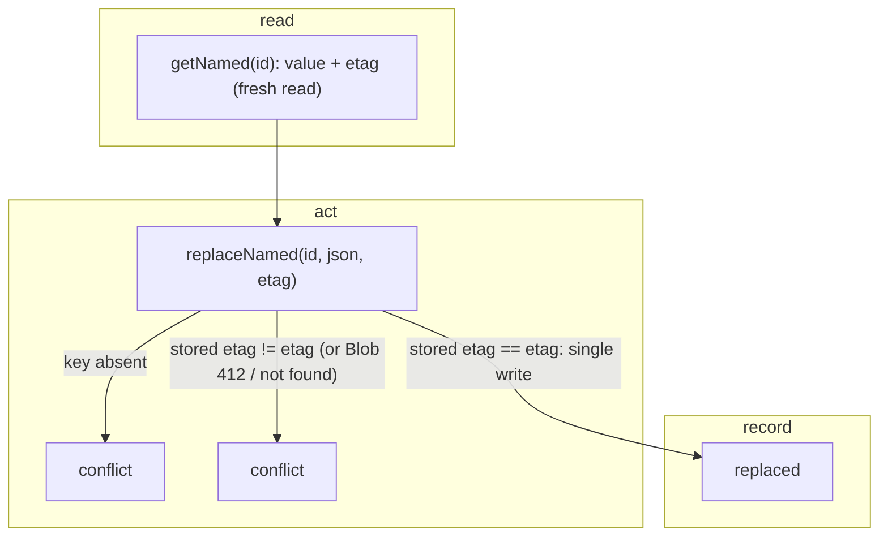

# SGS-120: Add the named-build store methods (memory, file and Blob compare-and-swap)

- **Type**: Task
- **Component**: aoe4-build-order
- **Milestone / criteria**: M8 / M8.1 (server)
- **Priority**: medium
- **Risk**: high
  <!-- strongModelTriggers: changes shared mutable state and the order of operations a result depends on: replaceNamed is a read-compare-write on stored builds, and a wrong compare-and-swap on Blob silently overwrites a concurrent writer's version. No criticalPaths symbol applies. -->
- **Invariants**: none
- **LOC estimate**: ~150 (build-store.ts: four methods on the memory and file stores plus one etag helper; blob-build-store.ts: four methods sharing the existing `read` and `put` helpers; business logic only, tests excluded)
- **Depends on**: SGS-112, SGS-119
- **On merge**: none
- **Source**: `design/M8.md` C2 (named methods, etag rule) and Behavior rules "Named builds server" (update conflict, read latest); `plans/M8-20261110.md` outline I

## Context

Named builds are editable, so the store needs a read that always returns the latest bytes with an etag and a write that succeeds only if the stored etag is still the one the caller read. Without that compare-and-swap, two tabs saving at once would overwrite each other. This ticket adds the four store methods and their tests; the routes that call them are a later ticket.

## Scope

All paths under `lib/aoe4-build-order/`. Read the end state of SGS-112 (not yet integrated: read its local branch tip) and SGS-119.

**Interface (`build-store.ts`).** Export `ReplaceResult = 'replaced' | 'conflict'` and `StoredWithEtag { value: unknown; etag: string }`, and add to `BuildStore`, exactly as design C2:

- `createNamed(id, json): Promise<PutResult>`: stores `json` under `namedBuildKey(env, id)` (from `named-builds.ts`, SGS-119) and never overwrites; an existing key gives `'exists'` and leaves it unchanged.
- `getNamed(id): Promise<StoredWithEtag | null>`: the stored JSON parsed, with its etag; `null` when absent. Always a fresh read (never a cached one).
- `replaceNamed(id, json, etag): Promise<ReplaceResult>`: compare-and-swap. It writes only when the key exists and its current etag equals `etag`, and returns `'replaced'`. A different etag, or an absent key, returns `'conflict'` and writes nothing. It never retries.
- `deleteNamed(id): Promise<void>`: removes the key; absent is not an error.

`putBuild` / `createNamed` (and `getBuild` / `getNamed`, `deleteBuild` / `deleteNamed`) differ only in the key, so each pair shares one implementation per store, parameterised by key, to stay under jscpd threshold 0. `putBuild`, `getBuild` and `deleteBuild` behave as before.

**Memory and file stores (`build-store.ts`).** The etag is opaque; use the SHA-256 (hex) of the stored JSON text from one small helper in `build-store.ts` that both stores call (the stored text includes the incrementing `revision`, so every replace changes it). `replaceNamed` reads, compares and writes with no `await` between the read and the write (the same reason `bumpCounter` is synchronous in the file store), so two concurrent calls in one process cannot both succeed. The file store keeps `fileFor`'s plain-path check for the named key.

**Blob store (`blob-build-store.ts`).** Reuse the existing `read` helper and `put` options.

- `createNamed`: `put` with `allowOverwrite: false`, then `head` on failure to tell `'exists'` from an outage, as `putBuild` does.
- `getNamed`: `get` with `useCache: false` (the CDN cache must be bypassed), returning the parsed value and `blob.etag`; null result or `BlobNotFoundError` gives `null`.
- `replaceNamed`: one `put` with `allowOverwrite: true` and `ifMatch: etag`. `BlobPreconditionFailedError` gives `'conflict'`. `BlobNotFoundError` also gives `'conflict'`: which error the SDK raises for `ifMatch` on a deleted blob could not be checked without a live store (SDK source and types only say "Only perform the operation if the blob's current ETag matches"), so both map to the same result. Any other error propagates. No retry loop and no `head` fallback: a retry with the old etag would be correct but a retry that re-read the blob and used its new etag would overwrite the concurrent writer.
- `deleteNamed`: `del` of the key; `BlobNotFoundError` is swallowed, any other error propagates.

**Docs.** `ARCHITECTURE.md` AoE4 saved-build storage row: add that the store also holds named builds (`namedBuildKey`) with `createNamed`, `getNamed`, `replaceNamed` (compare-and-swap on an opaque etag), `deleteNamed`. Grep `ARCHITECTURE.md` and `docs/aoe4-build-order.md` for "BuildStore" and "stores" and fix any statement that now reads as "builds are immutable only" for the store.

**Tests to update.** A rule, not a list: every test that builds a `BuildStore` stub or object literal gets the four new methods (or is built from `createMemoryBuildStore()` with overrides), for example `builds-routes.test.ts` `withBroken` and `save-rate-limit.test.ts` stubs. The implementer lists every test it edits.

**Out of scope:** the named-build routes, adapters and OpenAPI (a later ticket); the client; the `revision` and secret logic (routes own it); the Blob SDK retry behaviour during an outage (stays in BACKLOG); any change to `bumpCounter`, `putBuild`, `getBuild` or `deleteBuild` behaviour.

## Diagrams

Changes shared mutable state across callers (a compare-and-swap), so the state path is shown in read, act, record phases:

## Acceptance criteria

- [ ] Memory and file stores share one `describe.each` over the existing `factories` in `build-store.test.ts` with these cases: `createNamed` returns `'created'`, then `'exists'` for the same id and leaves the first JSON readable through `getNamed`; `getNamed` of an absent id is `null`; `getNamed` returns the stored value and a non-empty string etag; `replaceNamed` with the etag from `getNamed` returns `'replaced'`, and a following `getNamed` returns the new value with an etag different from the old one; `deleteNamed` removes it and deleting an absent id resolves.
- [ ] A stale etag is refused: after one successful `replaceNamed`, a second `replaceNamed` with the old etag returns `'conflict'` and `getNamed` still returns the first replacement (an implementation that ignored the etag fails this). Run for memory and file.
- [ ] `replaceNamed` on an absent id returns `'conflict'` and `getNamed` still returns `null` (an implementation that created the key fails this). Run for memory and file.
- [ ] Two `replaceNamed` calls started together with the same etag (`Promise.all`) give one `'replaced'` and one `'conflict'`, and the stored value is the winner's. This fails if an `await` sits between the compare and the write. Run for memory and file.
- [ ] Named builds and saved builds do not share keys: the same id passed to `putBuild` and to `createNamed` creates both (`'created'` each) and `getBuild` / `getNamed` return each own value. Two envs share no named build (as the existing env-isolation test does for builds). The file store test also reads the file at `<env>/named-builds/<id>.json` under its directory.
- [ ] `blob-build-store.test.ts` (mocked `@vercel/blob`, the existing `found` helper) pins, per method: `getNamed` calls `get` once with `{ access: 'private', storeId, useCache: false }` on `<env>/named-builds/<id>.json` and returns `{ value, etag }` with the blob's etag; null and `BlobNotFoundError` give `null`; any other error propagates. `replaceNamed('id', json, 'etag-1')` calls `put` exactly once with `{ access: 'private', addRandomSuffix: false, contentType: 'application/json', storeId, allowOverwrite: true, ifMatch: 'etag-1' }` and returns `'replaced'`.
- [ ] Blob `replaceNamed` failure rows (table test): `BlobPreconditionFailedError` gives `'conflict'` with exactly one `put` call (a retry loop copied from `bumpCounter` fails this); `BlobNotFoundError` gives `'conflict'`; a generic `Error('service down')` rejects with that error (a catch-all returning `'conflict'` fails this); `head` and `get` are not called by `replaceNamed` in any row.
- [ ] Blob `createNamed` gives `'created'` with `allowOverwrite: false` and no `ifMatch`; when `put` rejects and `head` finds the blob it gives `'exists'`; when `put` rejects and `head` rejects it rethrows the `put` error. Blob `deleteNamed` calls `del` with the named key, swallows `BlobNotFoundError`, and propagates any other error.
- [ ] Search criteria hold: every non-test `ifMatch` match under `lib` is in `blob-build-store.ts`, and every non-test `@vercel/blob` import under `lib`, `components` and `pages` is in `blob-build-store.ts` only.
- [ ] `npx tsc --noEmit` and `npm run lint:dup` pass (the shared per-key implementations leave no clone), and every test file that builds a `BuildStore` compiles with the four new methods.
- [ ] The `ARCHITECTURE.md` row names the four methods and the grep in Scope leaves no statement contradicted by the code.
- [ ] No INVARIANTS.md regressions

## Open questions

none
