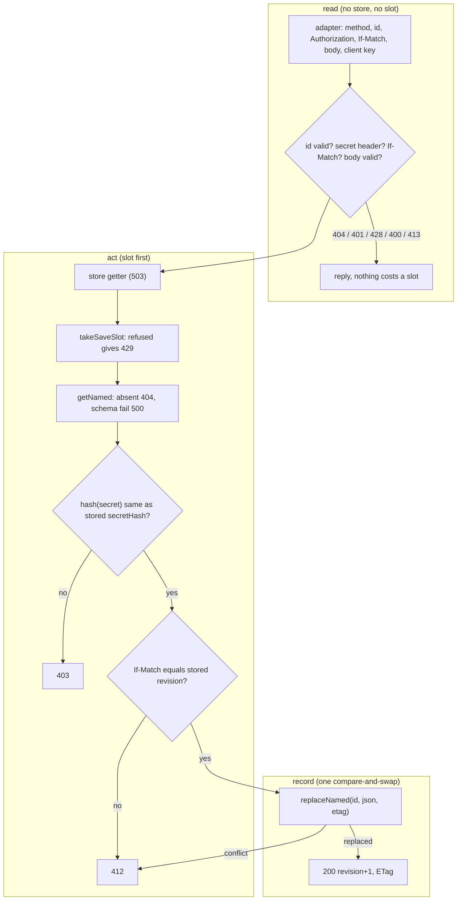

# SGS-121: Add the named-build routes, adapters, OpenAPI 2.5.0 and API specs

- **Type**: Task
- **Component**: aoe4-build-order
- **Milestone / criteria**: M8 / M8.1 (server)
- **Priority**: medium
- **Risk**: high
  <!-- Risk high per the plan (outline J): a new public API that issues and checks bearer edit secrets, a 22-row update order whose order is the security property (rate limit before the secret check, secret before revision), and a compare-and-swap result mapped to 412. strongModelTriggers: changes shared or mutable state and the order of operations a result depends on. Business logic is about 220 lines, under the 250-line trigger; no criticalPaths symbol changes. -->
- **Invariants**: S3 (every write is bounded: 128kb body, 65536-byte record, one rate-limit slot per write); A3 is not touched (nothing here calls the simulator)
- **LOC estimate**: ~220 (new `named-builds-routes.ts` ~170: `createNamedBuildReply`, `namedBuildReply` and their row helpers; two adapters ~25 each; business logic only, tests, OpenAPI JSON and docs excluded)
- **Depends on**: SGS-112, SGS-119, SGS-120
- **On merge**: CONTEXT.md Key surfaces: add `POST /api/aoe4-build-order/named-builds` (`createNamedBuild`) and `GET`, `PUT`, `DELETE /api/aoe4-build-order/named-builds/{id}` (`getNamedBuild`, `updateNamedBuild`, `deleteNamedBuild`) with handlers in `lib/aoe4-build-order/named-builds-routes.ts`
- **Source**: `design/M8.md` C1 (routes, the three response-order tables, route functions, OpenAPI), C2 (`deps.env`, shared `SAVE_RATE_LIMIT` budget), C3 (shared reply helpers) and Behavior rules "Named builds server"; `plans/M8-20261110.md` outline J

## Context

M8 adds editable named builds. The stores (SGS-120) and the browser-safe shapes, ids, secrets and header parsers (SGS-119) exist; nothing serves them. This ticket writes the create, read, update and delete reply functions, the two thin Next adapters, the OpenAPI additions (2.4.0 to 2.5.0) and the unit and acceptance specs. An update succeeds only for the holder of the edit secret and only against the latest revision, and the secret must never be logged or stored.

## Scope

All lib paths are under `lib/aoe4-build-order/`. Read the end states of SGS-112, SGS-119 and SGS-120 (none is integrated yet: read their local branch tips, not `origin/main`). From them this ticket uses, exactly: `RouteReply<Body>`, `ReplyTarget<Body>`, `sendReply<Body>`, `methodNotAllowed` (`api-route.ts`); `errorReply`, `storageUnavailable`, `idFailure` (`builds-routes.ts`); `deploymentEnv` (`saved-builds.ts`); `takeSaveSlot`, `clientKey` (`save-rate-limit.ts`); `BuildStore`, `createMemoryBuildStore` with `createNamed`, `getNamed`, `replaceNamed`, `deleteNamed`; and every C1 library name of `named-builds.ts`. Use `StoreGetter` (`() => Promise<BuildStore>`) from `builds-routes.ts`; if SGS-112's end state does not export it, export it there rather than redeclaring it.

**Route logic (new `named-builds-routes.ts`).** Plain functions returning `RouteReply`, with the signatures of design C1 "Route functions":

- `createNamedBuildReply(req: { method; body; clientKey }, deps: { store: StoreGetter; catalog: BuildOrderCatalog; nowMs: number; random?: RandomBytes }): Promise<RouteReply<CreateNamedBuildResponse | BuildsError | SimulateError>>`.
- `namedBuildReply(req: { method; id; body; authorization; ifMatch; clientKey }, deps: { store: StoreGetter; catalog: BuildOrderCatalog; env: string | null; nowMs: number }): Promise<RouteReply<NamedBuild | UpdateNamedBuildResponse | BuildsError | SimulateError>>`. It dispatches GET, PUT and DELETE.

Both follow the three order tables of C1 row by row (the first match wins). Texts and statuses are exactly those of the tables:

- **Create (15 rows).** 405 `Allow: POST`; then `checkSaveBuildRequest` (400 `SimulateError` or 413 `BuildsError`, the M6 rows 3 to 9); then id, edit secret and secret hash are made (`newNamedBuildId(deps.random)`, `newEditSecret(deps.random)`, `editSecretHash`), and a throw or rejection is `idFailure(cause)` (500 `the build id could not be created`, log `builds: id generation failed`), before any store call; then the store getter, `takeSaveSlot` and `createNamed` inside one try whose catch is `storageUnavailable(cause)` (503 `storage is unavailable; try again later`); a refused slot is 429 `too many saves from this client; try again later` with `Retry-After`; `createNamed` returning `'exists'` is 500 `the build id could not be created`, logged `builds: named id collision`, no retry; otherwise 201 with header `ETag: revisionEtag(1)` and body `{ id, path: namedBuildPath(id), editSecret, revision: 1, updatedAt }`. The stored JSON is `{ ...checked.record, revision: 1, createdAt, updatedAt, secretHash }` with `createdAt = updatedAt = new Date(deps.nowMs).toISOString()`; the plaintext secret is not in it. The same body posted twice gives two ids and two secrets.
- **Update, PUT (22 rows).** 405 for a method that is not GET, PUT or (DELETE where allowed): `Allow: GET, PUT` when `deps.env` is `'production'` or `null`, `GET, PUT, DELETE` otherwise. Then, in this order: `{id}` fails `isNamedBuildId` gives 404 `no named build with that id` with no store call; `parseEditSecret(req.authorization)` null gives 401 `an edit secret is required` with `WWW-Authenticate: Bearer`; `parseIfMatchRevision(req.ifMatch)` null gives 428 `If-Match with the current revision is required`; the body check (`checkSaveBuildRequest`, 400 or 413); then inside one try (catch `storageUnavailable`): the store getter, `takeSaveSlot` (429 as above, before the secret check so guessing is rate-limited), `getNamed` (null gives 404 `no named build with that id`), `storedNamedBuildSchema` safeParse (failure gives 500 `the stored build could not be read`, log `builds: stored build failed its schema`), `!sameSecretHash(await editSecretHash(secret), stored.secretHash)` gives 403 `the edit secret does not match`, an `If-Match` revision different from `stored.revision` gives 412 `the build has changed since that revision`, `replaceNamed(id, json, etag)` with the etag `getNamed` returned, `'conflict'` gives 412 with the same text, and success gives 200 with header `ETag: revisionEtag(revision)` and body `{ id, path, revision, updatedAt }`. The stored JSON is the parsed stored record with `version`, `buildOrder` and `durationSeconds` from the checked request, `revision + 1`, `updatedAt = new Date(deps.nowMs).toISOString()`, and `createdAt` and `secretHash` kept. The name is `buildOrder.name`, so an update may rename. The same content as stored still gives a new revision.
- **GET and DELETE (7 rows).** Method row as in PUT row 1; an invalid id is 404 with no store call; a rejecting getter or a throwing store call is 503; GET absent is 404 `no named build with that id`; GET with a stored value that fails `storedNamedBuildSchema` is 500 `the stored build could not be read` (logged as above); GET found is 200 with headers `Cache-Control: NAMED_BUILD_CACHE_CONTROL` and `ETag: revisionEtag(stored.revision)` and a `NamedBuild` body (every stored field but `secretHash`, plus `id`); DELETE (only when `deps.env` is neither `'production'` nor `null`) calls `deleteNamed` and is 204 also when absent.
- **Secrets.** The edit secret appears only in the 201 body and in the request's `Authorization` header. It is never logged, never stored (only `secretHash`), never in a URL, and `secretHash` is never in any response body. No log line in this file includes the request, its headers, the stored record or the secret; a schema failure logs only the zod error and the fixed message, as `readSavedBuild` does.
- **No copy of shared code (jscpd threshold 0).** `errorReply`, `storageUnavailable` and `idFailure` are imported from `builds-routes.ts`. Any further step the two save-style replies share (the 429 reply for a refused slot, the 405 `Allow` list) is one function that both `saveBuildReply` and the named replies call: extract it in `builds-routes.ts` in place, without changing `saveBuildReply`'s replies.

**Adapters (new).** `pages/api/aoe4-build-order/named-builds/index.ts` and `pages/api/aoe4-build-order/named-builds/[id].ts`, modelled on `pages/api/aoe4-build-order/builds/index.ts` and `[id].ts`: each exports `config = { api: { bodyParser: { sizeLimit: '128kb' } } }` and a default handler that calls the reply function with `req.method`, `req.body`, `req.query.id`, `req.headers.authorization`, `req.headers['if-match']`, `await clientKey(req)`, `{ store: buildStoreFromEnv, catalog: englishCatalog(), nowMs: Date.now() }` (and `env: deploymentEnv(process.env)` for `[id].ts`) and passes the reply to `sendReply`. The handler's `NextApiResponse<...>` body type is the union its reply function returns, so a wrong body fails `tsc`. Adapters hold no logic.

**OpenAPI (`docs/api/openapi.json`).** `info.version` goes from `2.4.0` to `2.5.0`; the `saveBuild` 500 already exists from SGS-112 and is not added here. Add:

- `/api/aoe4-build-order/named-builds` with `post` (`createNamedBuild`; request body `SaveBuildRequest`; responses 201, 400, 405, 413, 429, 500, 503) and `/api/aoe4-build-order/named-builds/{id}` with a path parameter `id` (pattern `^[A-Za-z0-9_-]{22}$`) and `get` (`getNamedBuild`; 200, 404, 405, 500, 503), `put` (`updateNamedBuild`; request body `SaveBuildRequest`; header parameter `If-Match`, required; `security` `editSecret`; 200, 400, 401, 403, 404, 405, 412, 413, 428, 429, 500, 503) and `delete` (`deleteNamedBuild`; 204, 404, 405, 503). Every JSON error uses `BuildsError` except 400, which is `SimulateError`; 405 documents `Allow`, 429 `Retry-After`, 401 `WWW-Authenticate` (`const: "Bearer"`), 201 and 200 `ETag`, GET 200 `Cache-Control` (`const: "no-store"`).
- Schemas `CreateNamedBuildResponse` and `UpdateNamedBuildResponse` (closed, every property required and described, id and secret patterns as `named-builds.ts`), and `NamedBuild` (`allOf` `SavedBuild` plus `id`, `revision`, `createdAt`, `updatedAt`, closed with `unevaluatedProperties: false`, no `secretHash`). Reuse `SaveBuildRequest` and `BuildsError`.
- `components.securitySchemes.editSecret` (`type: http`, `scheme: bearer`).
- Prose in each operation states the rules in the tables in plain words (the shared rate-limit budget with `saveBuild`, that 403, 404 and 412 on update still cost a slot, that the secret is returned once and only its hash is kept, that DELETE is 405 in production), and one example per JSON response. No other existing operation changes.
- Update every existing acceptance spec that pins the old version or path set: a rule, not a list (the specs that assert `info.version` is `2.4.0`, and the path-set assertion of `aoe4-builds-api-contract.spec.ts`, which becomes version `2.5.0` and the six paths). A test whose point is the surface it already checks keeps that check.

**Unit tests (new `named-builds-routes.test.ts`).** One table-driven case per row of the three tables, using `createMemoryBuildStore`, an injected `random` and the `recordingTarget` helper of `route-test-support.ts` where the reply goes through `sendReply`, in the style of `builds-routes.test.ts`.

**Acceptance (new specs, each with its own `x-forwarded-for` client).** `acceptance/aoe4-named-builds-api.spec.ts` (live routes) and `acceptance/aoe4-named-builds-api-contract.spec.ts` (ajv against the schemas through `acceptance/openapi-schemas.ts`, as `aoe4-builds-api-contract.spec.ts` does). Small helpers beside `BUILDS_PATH` and `postBuild` in `acceptance/helpers.ts` (examples: a named-builds path constant and a post helper), named so they do not clash with the `namedBuildPath` export of `named-builds.ts`.

**Docs.** `ARCHITECTURE.md`: the AoE4 route logic row names `named-builds.ts` (browser-safe ids, secrets, shapes and header parsers) and `named-builds-routes.ts`, and that the named route files under `pages/api/aoe4-build-order/named-builds/` only adapt `req` and `res`. `docs/aoe4-build-order.md`, "Builds routes" section: add a short "Named builds routes" subsection in rules, not field lists (the four operations; read-latest with `no-store`; update needs the edit secret and the current revision and a stale revision is 412; the order of checks, with the rate-limit slot before the secret check; one write budget shared with `saveBuild`; DELETE outside production only; the secret is never stored or logged). Grep `ARCHITECTURE.md`, `docs/aoe4-build-order.md` and `README.md` for `saved build`, `builds routes`, `rate` and `immutable` and fix any statement these routes make untrue.

**Out of scope:** the client, my-builds, page and save panel; `scripts/smoke-preview.mjs`; the store methods and library module (SGS-119, SGS-120); the `saveBuild` 500 (SGS-112); a version history or a creator delete in production; any edit to `savedBuildSchema`, `checkSaveBuildRequest` or `takeSaveSlot`.

## Diagrams

The update crosses the adapter, the route logic, the rate limit and the store, and its order is the contract. Read, act, record:

## Acceptance criteria

- [ ] `named-builds-routes.test.ts` has a case for every row of the create, update and GET/DELETE tables (each status, body text and header exactly as in Scope), and every store-touching row asserts which store calls were made: rows 1 to 9 of create and rows 1 to 12 of update call neither the store getter nor `bumpCounter`, and a refused slot (create 12, update 14) writes neither the counter nor a build.
- [ ] Create pins: with a `random` whose bytes differ for 16 and 32 requested bytes, the 201 body's `id` equals `newNamedBuildId(random)` and its `editSecret` equals `newEditSecret(random)`; the stored value read with `getNamed` parses with `storedNamedBuildSchema`, has `revision: 1`, `createdAt === updatedAt === new Date(nowMs).toISOString()` and `secretHash === await editSecretHash(editSecret)`, and its stored text does not contain the `editSecret` (a route that stored the secret fails this). The reply header is `ETag: "1"`. Two creates of the same body give different ids and secrets.
- [ ] Create failure rows: a `random` that throws gives `500 { error: 'the build id could not be created' }`, logs `builds: id generation failed`, and calls the getter zero times (a route that made the id inside the store try would answer 503); a store whose `createNamed` returns `'exists'` gives the same 500 with the log `builds: named id collision` and no second `createNamed` call; a rejecting getter and a throwing `createNamed` each give 503.
- [ ] Update ordering, each its own case: a bad id with no `Authorization` gives 404 and the getter is not called; no `Authorization` and no `If-Match` gives 401 with `WWW-Authenticate: Bearer`; a valid secret with no `If-Match` and an invalid body gives 428 (not 400); an invalid body with both headers gives 400 and the getter and counter are untouched; an exhausted slot with a wrong secret gives 429 and `getNamed` is not called (a route that checked the secret before taking the slot fails this); a wrong secret with a stale `If-Match` gives 403 (a route that compared revisions first fails this, because it would reveal revisions to non-owners).
- [ ] Update slot accounting: a 404 (absent id), a 403 and a 412 each increase the client's counter by one, and a 401, a 428 and a 400 do not (the memory store's counter is read through a recording wrapper of `bumpCounter`).
- [ ] Update success and repeat: with the secret from a create and `If-Match: "1"`, the reply is 200 with `ETag: "2"` and body `{ id, path, revision: 2, updatedAt }`; `getNamed` then returns `revision: 2`, the new `buildOrder` (including a changed name), the original `createdAt` and `secretHash`, and `updatedAt` equal to the injected `nowMs`; repeating the same request gives 412. An update with the same content as stored still gives revision 3. A stored value that fails the schema (for example `revision: 0` with a marker string as `secretHash`) gives 500 `the stored build could not be read`, and no logged argument, including an `Error`'s `message`, contains the marker.
- [ ] Update compare-and-swap row: a store wrapper whose `replaceNamed` first writes a competing version through the inner store with the same etag and then calls the real `replaceNamed` gives 412 `the build has changed since that revision`, and `getNamed` afterwards returns the competitor's value (a route that retried with a fresh etag, or treated `'conflict'` as success, fails this). A `replaceNamed` that throws gives 503.
- [ ] GET and DELETE: GET of a created build is 200 with `Cache-Control: no-store`, `ETag: "<revision>"` and a body with no `secretHash` key (`Object.keys` has no such entry), with `id`, `revision`, `createdAt` and `updatedAt`; GET after an update returns the new revision (a cached or stale read fails this); DELETE with `env: 'development'` is 204 and a following GET is 404, DELETE of an absent id is 204, and with `env: 'production'` and with `env: null` DELETE is 405 with `Allow: GET, PUT` and the build is not deleted; `Allow` is `GET, PUT, DELETE` for `development`.
- [ ] The secret is never logged: a test runs create, a successful update, a 403 update and a 412 update with `console.error`, `console.warn`, `console.info` and `console.log` spied, and asserts that no argument of any call (strings, `Error` messages, JSON of objects) contains the edit secret or its hash.
- [ ] The adapters `pages/api/aoe4-build-order/named-builds/index.ts` and `[id].ts` each export `config.api.bodyParser.sizeLimit` `'128kb'` and contain no branching on method, status or body (they only build the request, call the reply function and `sendReply`). A deliberate mismatch between an adapter's `NextApiResponse<...>` type and its reply union fails `npx tsc --noEmit`; the report shows one such failure, then reverted.
- [ ] `acceptance/aoe4-named-builds-api.spec.ts` against the running app: create gives 201, `ETag: "1"`, and a body that validates as `CreateNamedBuildResponse`; GET gives 200, `Cache-Control: no-store`, `ETag: "1"`, a body that validates as `NamedBuild` and has no `secretHash` key; PUT with the secret and `If-Match: "1"` gives 200 with `ETag: "2"` and a following GET shows the new name and revision 2; PUT with no `Authorization` gives 401, with a wrong 43-character secret 403, with a stale `If-Match` 412, with no `If-Match` 428; GET and PUT of an unused well-formed id give 404 and of a malformed id 404; a PUT body over 128 kb gives a plain-text 413; DELETE gives 204 and a following GET 404; `PATCH` gives 405 with `Allow: GET, PUT, DELETE` (the acceptance server is not production).
- [ ] The same spec pins the shared write budget: one client makes 30 writes split across `POST /builds`, `POST /named-builds` and `PUT /named-builds/{id}` that all succeed, and then the next write on each of those three routes gives 429 with a numeric `Retry-After` (a separate counter for named writes fails this).
- [ ] `acceptance/aoe4-named-builds-api-contract.spec.ts`: `info.version` is `2.5.0`; the paths are exactly the six; the operationIds are the four named in Scope plus the three existing ones; each operation declares exactly the statuses listed in Scope; the new schemas exist, are referenced from a path or another schema, and the closed ones are `CreateNamedBuildResponse`, `UpdateNamedBuildResponse` and `NamedBuild`, with every property described; `NamedBuild` has no `secretHash` property; `components.securitySchemes.editSecret` is `http` `bearer` and `updateNamedBuild` uses it; `If-Match` is a required header parameter of `updateNamedBuild`; every JSON example in the new operations validates against the schema its response names; a real create, GET and update response validates against its schema and the same response with an added property does not; every reproducible 4xx example (400, 401, 404, 405, 428) equals the real response.
- [ ] Every existing acceptance spec that pinned `2.4.0` or the four-path set now passes against `2.5.0` and the six paths, and no existing operation other than the added `securitySchemes` and paths changed (`git diff` of `docs/api/openapi.json` touches no existing operation).
- [ ] Search criteria: every non-test `console.` call in `named-builds-routes.ts` is a call that logs a fixed message and a caught cause (none passes `req`, `authorization`, a secret or a stored record); every non-test `@vercel/blob` import under `lib`, `components` and `pages` is still only in `blob-build-store.ts`; `git grep -n "node:" -- lib/aoe4-build-order/named-builds.ts` still finds nothing.
- [ ] `ARCHITECTURE.md` and `docs/aoe4-build-order.md` carry the statements in Scope, and the grep in Scope leaves no statement contradicted by the code. `npx tsc --noEmit`, `npm run lint:dup` and the unit tests pass; the implementer runs the two new acceptance specs and the existing builds specs once and records the result in the report.
- [ ] No INVARIANTS.md regressions

## Open questions

none
