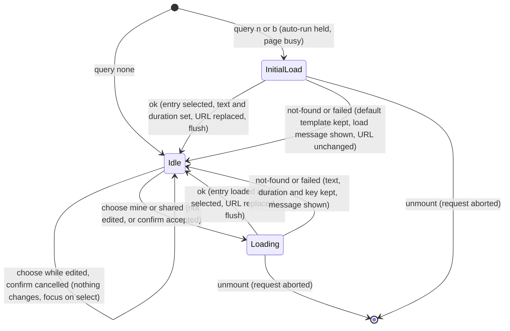

# SGS-124: Wire the build library into the page: grouped select, edited marker, discard guard and `?n=` / `?b=` loading

- **Type**: Task
- **Component**: aoe4-build-order
- **Milestone / criteria**: M8 / M8.1 (client: templates beside my builds, edited marker, confirm and beforeunload, reopen list, `runName`), M8.6 (no ref write during render, `?b=` load keeps other keys), M8.9 (spec: edited marker, not losing edits)
- **Priority**: high
- **Risk**: high
  <!-- high per the plan outline: about 340 lines of page and component wiring, and `LiveInput.selected`
       changes from a build name to an entry key for every auto-run caller (the controller treats it as
       opaque, and it is not part of the simulate request, so no criticalPaths symbol changes). Not
       lowered: when in doubt pick the higher tier. -->
- **Invariants**: A3 (`selected` is never sent to the simulate route, so which entry is chosen cannot change a result); the page is adjacent to S3 only through the existing duration check, which this ticket does not touch
- **LOC estimate**: 340 (`pages/apps/aoe4-build-order.tsx` about 210 net of the removed `urlBaseline` and `initialB` code, `build-input.tsx` about 45, `build-library.ts` entry builders about 25, `pin-name.ts`, `save-build.tsx` and `saved-build-loader.ts` type changes about 20; tests, specs and docs excluded)
- **Depends on**: SGS-114, SGS-122, SGS-123
- **On merge**: none
- **Source**: `design/M8.md` C6 (the `PrebuiltBuild` and `pinName` paragraphs), C7, "Library, select and edits (M8.1)", "Debt (M8.6, M8.8)" `?b=` row and Criteria map M8.1 client, M8.6, M8.9; `plans/M8-20261110.md` outline M and its design answers (`pinName` moves to `runName`; `savedBuildName` stays in `pin-name.ts`, retyped, until the Save panel rewrite deletes it)

## Context

Today the build select lists the four shipped builds plus one opened `?b=` build, re-choosing a build or
reloading drops edits silently, `initialB` is written during render, and every `router.replace` drops the other
query keys. This ticket puts the pure modules from SGS-122 and SGS-123 to use: the select becomes a library with
groups, shows when the build is edited, asks before discarding edits, and `?n=` and `?b=` links load into it.
The snapshot Save panel keeps working until the Save panel rewrite replaces it.

## Scope

All paths are under `components/apps/aoe4-build-order/` unless given. Read at `origin/main`; SGS-114 (`browser-storage.ts`),
SGS-119 (named-build names), SGS-122 (`loadNamedBuild`, `build-fetch.ts`) and SGS-123 (`build-library.ts`,
`my-builds-storage.ts`, `build-query.ts`, `use-discard-guard.ts`) are not integrated: use the end states in those
tickets and read their branch tips for final names. Before touching `useRouter` code read the router guide in
`node_modules/next/dist/docs/` (this Next.js version differs from older ones).

- **Entries replace names.** `PrebuiltBuild` is deleted from `build-input.tsx` and replaced by `LibraryEntry`
  everywhere (the page, `BuildInput`, `SaveBuild`, `saved-build-loader.ts`, `pin-name.ts`, the unit tests). The page's
  static props keep `{ name, text }[]`; the page turns them into `templateEntries(...)`. State is
  `entries: LibraryEntry[]` (templates, then `mine` entries read once after hydration, then opened entries in
  open order) and `selected`, which is an entry **key** (`entryKey.template(name)` for the first template on first
  paint). `LiveInput.selected`, `useAutoRun` and `auto-run.ts` are not edited: they treat it as opaque. The
  `buildName` field is gone: `LibraryEntry.name` is the stored name and `entryLabel` makes the select text.
- **Entries from fetched builds (new, in `build-library.ts`).** `linkEntry(id: string, saved: SavedBuild): LibraryEntry`
  replaces `savedBuildOption` (deleted from `saved-build-loader.ts` with its test): key `entryKey.link(id)`, kind
  `link`, `name` `saved.buildOrder.name`, `id`, `loaded` `{ text: formatBuildOrderText(saved.buildOrder), duration: String(saved.durationSeconds), revision: null }`.
  `namedEntry(kind: 'mine' | 'shared', build: NamedBuild): LibraryEntry`: key `entryKey.named(build.id)`, that kind, `name` `build.buildOrder.name`, `id` `build.id`,
  `loaded` `{ text: formatBuildOrderText(build.buildOrder), duration: String(build.durationSeconds), revision: build.revision }`.
  For a `mine` entry that is already in the list the page keeps the stored `name` and only replaces `loaded`.
- **Select (`build-input.tsx`).** `BuildInput` props: `entries`, `selected` (key), `edited: boolean`, `onBuildSelect(key)`
  replace `builds`, `selected` (name) and `onBuildSelect(name)`. The label reads "Build" (was "Prebuilt build"). One
  `<optgroup label>` per `LIBRARY_GROUPS` element that has entries, in that order; empty groups are not rendered. Each
  `<option value={entry.key}>` reads `entryLabel(entry, edited && entry.key === selected)`. The `<select>` has
  `data-edited="true"` while `edited` and `data-edited="false"` otherwise. `disabled` and `aria-busy` follow the existing
  `busy` prop.
- **Edited, live.** `edited = isEdited(selectedEntry, { text, duration })` over the **live** text and duration
  (not the settled input), so the marker shows before the 500 ms pause ends. It is passed to `BuildInput` and to
  `useDiscardGuard(edited)`.
- **Choosing an entry (page).** The select's `onChange` calls `chooseEntry(key)`. While `edited`, it first asks
  `confirmDiscard(entryLabel(selectedEntry, false))`, a page-level function that calls `window.confirm` with exactly
  `Discard your edits to "<label>"?` and is the only discard point besides the unload guard. Cancel keeps the text,
  duration and select value (the controlled select shows the old key again) and calls `.focus()` on the select. A
  non-edited choice and an accepted confirm continue:
  - `template`: text becomes `loaded.text`, the duration is kept, `selected` becomes the key, then
    `autoRun.flush({ text, duration, selected: key })` as today.
  - `link`: text and duration become `loaded.text` and `loaded.duration`, then flush.
  - `mine` or `shared`: `loadNamedBuild(id, signal)` always, so the latest version loads. While it is in flight the page
    is busy: select, duration, editor, step table and Save are disabled with `aria-busy="true"` (the existing `busy`
    prop, now true for any load), and nothing edits the input, so the auto-run controller sees no change and posts
    nothing (no controller API change). `ok`: `namedEntry` replaces or adds the entry, text, duration and `selected` are set,
    then flush. `not-found` shows `saved-build-error` with `That build was not found. The current build is unchanged.`;
    `failed` shows `That build could not be loaded. The current build is unchanged.`. Both keep the text, duration,
    `selected` and the entry. The controller for a load is aborted on unmount and at the next choose; a response of an
    aborted load changes nothing.
  - Any choose clears `saved-build-error` when it starts. `editText` (open rows merge) is used for every text change as now.
  - After every successful choose the URL is replaced:
    `router.replace({ pathname, query: nextBuildQuery(router.query, entry) }, undefined, { shallow: true })`. The URL follows the
    selected entry, not the edited state, and every other query key is kept.
- **Initial query (replaces `initialB`).** The page keeps `initialQuery: InitialBuildQuery | null` in state, set from an
  effect that runs once `router.isReady` (`initialBuildQuery(router.query)`); nothing is written to a ref during render
  (`initialB` and its render-time assignment are deleted). The auto-run `hold` is true while `initialQuery` is `null`, and
  while it is not `none` and its load has not ended; `busy` follows the same condition. In that effect:
  - `kind: 'link'`: `loadSavedBuild` as today (SGS-122's `loadJson` underneath), then `linkEntry` is prepended to the opened
    entries and selected.
  - `kind: 'named'`: read `readMyBuilds(browserStorage())` (not available: `[]`); an id in that list loads as `mine` and keeps its
    stored name; any other id loads as `shared` through `loadNamedBuild`. Entries from the stored list are already in
    `entries` after hydration, so the selected key is `entryKey.named(id)` either way.
  - `ok`: the entry is selected, text, duration and `loaded` set, `awaitingLoadTab` runs as today (Results selected after the
    first successful run in the tabs layout), and the URL is replaced with `nextBuildQuery(router.query, entry)` (so `b` is
    dropped when `n` and `b` are both present, and `utm` stays).
  - `not-found` or `failed`: the default template stays selected, `saved-build-error` shows the existing texts
    (`That saved build was not found. Showing the default build.` / `That saved build could not be loaded. Showing the default build.`)
    for both `?n=` and `?b=`, and the URL is left as it is.
  - A load in flight is aborted on unmount. A later change of `n` or `b` in the address (back and forward) loads nothing
    (only the first value is read, as now).
- **`urlBaseline` is deleted** with its effect (the divergence-drops-`b` rule of M6 is superseded: the URL follows the selected
  entry). A snapshot save (`recordSave`) does `router.replace({ pathname, query: nextBuildQuery(router.query, { kind: 'link', id: response.id }) }, ...)`
  and changes neither `selected` nor the entries, so the other query keys survive a save as well.
- **My builds and the guard.** After hydration an effect reads `mineEntries(readMyBuilds(storage))` from `browserStorage()` when
  `myBuildsAvailable(storage)` is true and adds them to `entries`; nothing writes the list in this ticket (the Save panel rewrite
  does). `useDiscardGuard(edited)` is called once in the page.
- **Run names.** `pinName` is deleted from `pin-name.ts`; the page's `Run.name` is `runName(entries, shown.text, shown.selected)`.
  For an opened link this is the stored name without the ` (<id>)` of the select label (changed from `pinName`); where the selected
  entry and another entry have the same text, the selected one's name wins.
- **`pin-name.ts` keeps `savedBuildName`**, retyped to `savedBuildName(entries: readonly LibraryEntry[], text: string, selectedKey: string): string`
  (it still imports `SAVED_NAME_MAX_CHARS` from `lib/aoe4-build-order/saved-builds`). Rule as today with `name` in place of
  `buildName`: the first entry with `loaded?.text === text` gives its `name`; otherwise the selected entry's `name` (`Custom build` when
  `selectedKey` is not an entry, and when `entries` is empty) with one trailing ` (edited)` stripped, cut so the result with
  ` (edited)` appended is at most `SAVED_NAME_MAX_CHARS` (100) characters, then ` (edited)`. `SaveBuild` takes `entries` instead of
  `builds` and passes the key it already gets as `settled.selected`; its behavior is otherwise unchanged. The Save panel rewrite deletes
  `pin-name.ts` and `pin-name.test.ts`.
- **Docs.** `docs/aoe4-build-order.md`, "Page" and "Saving a build and opening it by link". Fix every sentence this makes untrue; find
  them by grepping for `prebuilt builds, plus the saved build`, `leaves the select as it is`, `Choosing a prebuilt build`, `go away on the first settled change`,
  `a save puts` and `?b=`. Describe: the select is labelled "Build" and groups its entries (My builds, Opened links, Templates) with
  empty groups omitted; the selected option reads `<label> (edited)` and the select has `data-edited` while the live text or an opened
  build's duration differs from the loaded version (a template's duration never counts); choosing another entry while edited asks for
  confirmation with the text above and cancelling keeps everything; reloading or closing an edited page asks the browser to confirm
  and an unedited page does not; choosing a `mine` or `shared` entry fetches the latest version and the page is busy while it loads,
  with the two failure messages above; `?n=<id>` loads like `?b=<id>` (`n` wins when both are present; the first value is read);
  the URL follows the selected entry (`n` for my and shared builds, `b` for opened links, neither for a template) and keeps other query
  keys; the link and any save error still go away on the first settled change but the `b` in the address bar no longer does. Do not
  document Save as copy or Save a new version (the Save panel rewrite does). No measured values.
- **Specs.** New `acceptance/aoe4-my-builds.spec.ts` (first part; the Save panel rewrite extends it) and edits to
  `acceptance/aoe4-save-open.spec.ts`. The `?n=` cases stub `GET /api/aoe4-build-order/named-builds/<id>` with `page.route`
  (the routes are another ticket) and seed My builds with `addInitScript` writing the `MY_BUILDS_STORAGE_KEY` value. Rule for existing
  tests: a test that asserts the old behavior changed here (`b` dropped by the first settled edit, the select's value being a build
  name, a build selected after an edit with no dialog handler) gets the new expected value or a dialog handler; every other test keeps
  its expected values. The implementer lists every test it edits. Existing specs select by label, by index or by a string that
  matches the label, which still work.

**Out of scope:** `save-build.tsx` behavior (Save as copy, Save a new version, the name form, `my-builds-unavailable`), anything that writes
`MY_BUILDS_STORAGE_KEY`, the `storage` event handling for other tabs, `save-build-client.ts` and `postSavedBuild`, deleting `pin-name.ts`, the
routes and OpenAPI, the split-scroll heading, chart layout and step-table changes (other M8 tickets edit this page and `build-input.tsx` in
other hunks), guarding in-app navigation through `next/link`, the editor `scrollLeft` reset, `useBuildLibrary` as a separate hook (an
implementer's choice provided the C6 functions are the ones used).

## Diagrams

The select and load flow is a state machine this change rewrites.

## Acceptance criteria

- [ ] `aoe4-my-builds.spec.ts` (new), select structure: the label of `build-order-select` reads `Build`; with no stored list the select has one `optgroup` (`Templates`) holding the shipped builds in order, each option's value is its entry key (`template:<name>`); with a valid stored list of two entries seeded by `addInitScript` the groups are `My builds` (the two names, newest `updatedAt` first, the seed is written oldest first so a sort that is missing fails) then `Templates`; an invalid stored value (non-JSON text) shows no `My builds` group and no alert.
- [ ] Same spec, edited marker: with the run paused by `page.clock` (as `aoe4-save-open.spec.ts` does), typing one character into `build-order-text` makes the selected option read `<template name> (edited)` and `data-edited` become `"true"` before the pause ends; restoring the text makes it read `<template name>` and `"false"`. Changing the duration alone leaves a template unedited (`data-edited="false"`); the same duration change on a build opened through a stubbed `?b=` link makes it edited. It fails if the marker follows the settled input, or if a template's duration counts.
- [ ] Same spec, discard confirm: with edited text, choosing another template raises a `confirm` dialog whose message is exactly `Discard your edits to "<name>"?` (name of the entry being left, without ` (edited)`); dismissing it leaves the textarea text, the duration and the selected option unchanged, `document.activeElement` is the select, and no simulate POST is sent for the other build; accepting it replaces the text with the other build's text and clears the marker. With unedited text, choosing another entry raises no dialog (the test fails on any `dialog` event). It fails if cancel still switches, or if the confirm runs when not edited.
- [ ] Same spec, unload guard: reloading the page while edited raises a `beforeunload` dialog (the test accepts it and sees the page reload); reloading an unedited page raises none; after editing and then restoring the text no dialog is raised.
- [ ] Same spec, `?n=` (stubbed GET): a 200 `NamedBuild` for an id not in My builds selects `<name> (shared)` under `Opened links`, shows its text and duration, runs it once, and keeps the URL `?n=<id>`; the same id present in a seeded My builds list selects the stored name under `My builds` instead (no ` (shared)`); with `n` and `b` both in the URL the `n` build loads, no `GET` for the `b` id is made, and the URL ends with `n` only; a stubbed 404 and a stubbed 500 show exactly the two `Showing the default build.` messages from Scope, keep the default template selected and leave the URL as typed. It fails if `b` wins, or if a not-found `?n=` selects an entry.
- [ ] Same spec, choosing a `mine` entry (stubbed GET held by a gate): while the response is held the select, duration, `build-order-text` and `save-build` are disabled with `aria-busy="true"` and no simulate POST is sent; after the gate opens the text is the stubbed version (not any cached text), the entry is selected and exactly one POST follows; a 404 reply shows `That build was not found. The current build is unchanged.`, a 500 reply shows `That build could not be loaded. The current build is unchanged.`, each keeps the old text and the old selected option, and the next successful choose removes the message. The stubbed text differs from the text before the choose (asserted first).
- [ ] `aoe4-save-open.spec.ts`: `/apps/aoe4-build-order?b=<id>&utm=1` loads the build and the URL after the load still has `utm=1` and `b=<id>`; choosing a template afterwards leaves `utm=1` and has no `b`; a snapshot save from the UI on a page opened as `?utm=1` gives a URL with both `utm=1` and the new `b`. It fails if `router.replace` is called with `query: {}` or `{ b }` only. A settled text edit after a load no longer removes `b` (changed expectation); a build selection does.
- [ ] No ref is written during render: `git grep -n "initialB" -- pages components` finds nothing, and `git grep -n "urlBaseline" -- pages components` finds nothing. The existing `aoe4-save-open.spec.ts` case that holds the first run during a `?b=` load still passes (no simulate POST before the load ends), and a new `?n=` case with a gated stub shows the same hold: `data-status="loading"`, controls disabled and `aria-busy`, no POST until the gate opens, then exactly one.
- [ ] Unmount aborts: a case in `aoe4-my-builds.spec.ts` navigates away through the landing link while a `?n=` stub is held and sees the request fail (`requestfailed`) with no console error or page error, as the existing `?b=` case does.
- [ ] `pin-name.test.ts` is rewritten for `savedBuildName(entries, text, selectedKey)` over `LibraryEntry` values (table style) and its `pinName` rows are deleted (`runName` is pinned by the library tests): same text as a template gives the template's name; same text as an opened `link` entry gives its stored `name`, not the select label with its id; edited text on a template gives `<name> (edited)`; a selected name already ending ` (edited)` is not stacked; a 100-character selected name with edited text gives the first 91 characters plus ` (edited)` (100 characters, never more); a `selectedKey` that is no entry gives `Custom build` plus nothing else (`Custom build` when `entries` is empty); an entry with `loaded: null` is never matched by any text. A rule that cut to 93 characters, or returned the select label, fails a row. Every result has at most 100 characters.
- [ ] `build-library.test.ts` (from SGS-123) gains rows for the two entry builders: `linkEntry` gives key `link:<id>`, kind `link`, the stored `name`, `loaded.duration` as the string of `durationSeconds` and `loaded.revision` `null`; `namedEntry('mine', build)` and `namedEntry('shared', build)` give key `named:<id>`, the kind passed, the build's `revision` in `loaded`; `loaded.text` equals `formatBuildOrderText` of the build order. The `savedBuildOption` test in `saved-build-loader.test.ts` is removed with the function, and `save-build.test.ts` passes `entries` (a `LibraryEntry[]`) with otherwise unchanged expectations.
- [ ] Run names: in `aoe4-build-order-pin-compare.spec.ts` or `aoe4-my-builds.spec.ts`, pinning the run of an edited template reads `Pinned: <template name> (edited), <time>`, pinning an unedited template reads `Pinned: <template name>, <time>`, and pinning a run opened through a stubbed `?b=` link reads the stored name with no ` (<id>)`. Every existing test that pins and then selects another build while edited handles the confirm dialog (accept) and still asserts its old label.
- [ ] Types and search end state: `git grep -n "PrebuiltBuild" -- pages components` finds nothing; `git grep -n "pinName" -- pages components` finds nothing; `git grep -n "buildName" -- pages components` finds nothing; `git grep -n "Prebuilt build</label>" -- components` finds nothing.
- [ ] The snapshot Save still works end to end: `aoe4-save-open.spec.ts` tests that save through the UI, copy the link and open it in a fresh context pass, and the saved name is `savedBuildName`'s result (an unedited template saves under its own name, an edited one with ` (edited)`).
- [ ] `docs/aoe4-build-order.md` has the select, edited, confirm, unload, `?n=` and URL-rule text from Scope, and `git grep -n "go away on the first settled change" -- docs` finds no sentence that still says the `b` in the address bar goes away on a settled change; no sentence still says editing leaves the select as it is.
- [ ] `npx tsc --noEmit`, `npm run lint:dup` and `npm test` pass; the acceptance specs `aoe4-my-builds`, `aoe4-save-open`, `aoe4-auto-run`, `aoe4-build-order-pin-compare`, `aoe4-step-table` and `aoe4-small-screen` pass. The report lists every existing test it edited and each reason.
- [ ] No INVARIANTS.md regressions

## Open questions

- designer: Two page behaviors between this ticket and the Save panel rewrite are not in the design: (1) a failed `?n=` or `?b=` load leaves the URL as typed (the ticket's default, so a reload can retry), and a snapshot save writes `b` without selecting or adding an entry; (2) the entry builders `linkEntry` and `namedEntry` (names chosen here, in `build-library.ts`) are the way the Save panel rewrite builds its `mine` entry. Confirm both or give other rules; the Save panel ticket reuses the names.
- designer: C6 says `savedBuildName` cuts the name to 93 characters before ` (edited)`, but 93 plus the 9-character suffix is 102, over `SAVED_NAME_MAX_CHARS`; "same rule as today" cuts to 91. This ticket uses 91 (the result is at most 100). Correct the design text.
