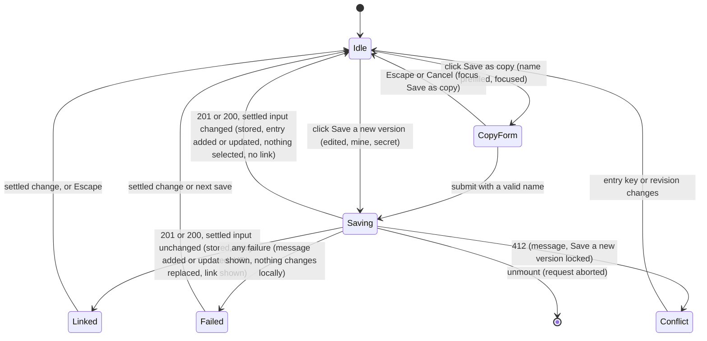

# SGS-125: Rewrite the Save panel for named builds: Save as copy, Save a new version, and remove the snapshot Save

- **Type**: Task
- **Component**: aoe4-build-order
- **Milestone / criteria**: M8 / M8.1 (client: named copy, versions, reopen after reload, snapshot save removed), M8.9 (build workflow doc; specs: start-a-copy, reopen from my builds, `?n=` read-only in another context, 412 from a second tab)
- **Priority**: high
- **Risk**: high
  <!-- high per the plan (outline N): about 330 lines of save-flow logic that issues and stores bearer edit secrets in localStorage, decides what a late response may change, and deletes the snapshot Save and its client code. Not lowered: when in doubt pick the higher tier. No criticalPaths symbol changes. -->
- **Invariants**: A3 (a save never reaches the simulate route, and `selected` is not part of the simulate request); S3 only through the 128kb body and the write budget the routes already enforce
- **LOC estimate**: 330 (`save-build.tsx` rewrite about 230, page `onCreated`, `onUpdated`, secrets and the `storage` effect about 70, `build-input.tsx` about 20, `build-library.ts` `savedMineEntry` about 8; deletions of `pin-name.ts`, `recordSave`, `postSavedBuild` not counted; tests, specs, docs, CSS excluded)
- **Depends on**: SGS-118, SGS-121, SGS-124
- **On merge**: none
- **Source**: `design/M8.md` C8, C6 (`savedMineEntry`, "Interim snapshot save"), C4a (the `postSavedBuild` deletion), Behavior rules "Library, select and edits" (Save as copy, Save new version, link panel, cross-tab, snapshot save rows), Owner decisions 1 to 3, Criteria map M8.1 client and M8.9; `plans/M8-20261110.md` outline N and design question 3

## Context

The Save panel still creates immutable `?b=` snapshot links. After this ticket the UI only creates named builds: Save as copy makes a new build with a secret kept in this browser, and Save a new version updates a build this browser made. The snapshot Save and its client code are deleted; the `saveBuild` route and old `?b=` links keep working.

## Scope

All paths are under `components/apps/aoe4-build-order/` unless given. Read at `origin/main`, with SGS-114 (`browser-storage.ts`), SGS-118 (`holdNextSimulate` in `acceptance/helpers.ts`), SGS-119, SGS-121 (routes), SGS-122 (`named-build-client.ts`), SGS-123 (`my-builds-storage.ts`, `build-library.ts`, `build-query.ts`) and SGS-124 (the page's entries, `edited`, `chooseEntry`, `confirmDiscard`, `linkEntry`, `namedEntry`, `savedBuildName`) described as end states: none is integrated, so read their branch tips for final names. Contract names are exactly those of `design/M8.md` C4, C5, C6, C8.

- **`save-build.tsx` is rewritten** to the C8 props: `status`, `settled`, `conversion`, `busy`, `entry: LibraryEntry | undefined`, `editSecret: string | null`, `edited`, `onCreated(response: CreateNamedBuildResponse, input: LiveInput, name: string)`, `onUpdated(response: UpdateNamedBuildResponse, input: LiveInput)`. `builds` and `onSaved` are gone. Test ids are exactly the C8 list: `save-build`, `save-build-copy`, `save-copy-form`, `save-copy-name`, `save-copy-name-error`, `save-copy-submit`, `save-copy-cancel`, `saved-build-link`, `copy-saved-link`, `save-build-error`, `my-builds-unavailable`; `copy-saved-link-hint` (the hand-copy hint) is kept. Labels: `save-build` reads `Save a new version`, `save-build-copy` reads `Save as copy`, `save-copy-submit` reads `Save copy`, `save-copy-cancel` reads `Cancel`; the name input has `aria-label="Name of the copy"`.
  - **Save as copy.** `save-build-copy` is shown for every entry and enabled when `status === 'current'`, `conversion.ok`, not `busy` and not saving. A click opens `save-copy-form` with `save-copy-name` prefilled `copyName(entry.name)` (`copyName('Custom build')` when `entry` is undefined), focused with its text selected. `save-copy-form` is a `div` with `role="group"`, never a `form`: the run bar is already a `<form>` and forms do not nest. A name whose trimmed length is 0 or over `SAVED_NAME_MAX_CHARS` (100) disables `save-copy-submit` and shows `save-copy-name-error` reading `Enter a name of 1 to 100 characters.` under the input, with `aria-invalid="true"` and `aria-describedby` naming it. Enter in the input submits when the name is valid (and in every case never submits the run bar form); Escape closes the form and focuses `save-build-copy`. Tab order is name, submit, cancel.
  - **Create.** Submit calls `createNamedBuild({ buildOrder: { ...conversion.order, name: <trimmed name> }, durationSeconds: Number(settled.duration) }, signal)` on the settled input captured at the click. On `{ ok: true }`: the panel runs `upsertMyBuild(storage, { id, name, editSecret, revision: 1, updatedAt: response.updatedAt })` when `myBuildsAvailable(browserStorage())` (`browserStorage()` from `browser-storage.ts`), then calls `onCreated(response, input, name)`. The upsert runs even when the settled input has since changed, so an issued secret is never lost.
  - **Save a new version.** `save-build` is rendered only when `entry.kind === 'mine'` and `editSecret !== null`. It is enabled under the Save-as-copy conditions **and** `edited`, and not locked by a conflict (below). A click calls `updateNamedBuild(entry.id, editSecret, entry.loaded.revision, { buildOrder: { ...conversion.order, name: entry.name }, durationSeconds }, signal)`. On `{ ok: true }` it runs `upsertMyBuild(storage, { id, name: entry.name, editSecret, revision: response.revision, updatedAt: response.updatedAt })` under the same availability rule, then `onUpdated(response, input)`.
  - **In flight.** Both buttons are disabled while a request is in flight and a repeat click sends nothing. Unmount aborts the request (the existing `mounted` and `AbortController` pattern). A result of an aborted or unmounted request changes nothing.
  - **Link panel.** After a 200 or 201 the panel shows `saved-build-link` (value `window.location.origin + response.path`, focused with its text selected) and `copy-saved-link` as today, only while the settled input equals the saved input with `selected` set to the saved entry's key (`entryKey.named(response.id)`; a create selects the new entry, so the key differs from the one at click time); a change drops it, as the M6 rule does. Escape in the panel hides it and focuses the button that saved. A failed copy shows `copy-saved-link-hint` with the existing text. The link panel and the error follow the existing "first settled change drops them" effect.
  - **Persistence warning.** When `myBuildsAvailable` is false or `upsertMyBuild` returns `persisted: false`, the save still succeeds and `my-builds-unavailable` shows with the text `This browser could not store the edit key, so you can edit this build only until you close the page.`, for as long as the link panel shows.
  - **Failures.** A `NamedSaveFailure` shows `failure.message` in `save-build-error` (`role="alert"`, hidden when the settled input changes, as today); nothing else changes locally. Kind `conflict` also locks Save a new version (it stays disabled) until the selected entry's key or `loaded.revision` differs from the locked one; Save as copy stays available for every kind. `forbidden` and `not-found` keep the stored secret (no removal). A later success clears the message.
- **Entry builder (`build-library.ts`).** Add `savedMineEntry(id, name, input: { text: string; duration: string }, revision)` per C6: key `entryKey.named(id)`, kind `mine`, `name`, `id`, `loaded: { text: input.text, duration: input.duration, revision }`, with the saved text as is (not reformatted) so `isEdited` is `false` right after a save. `build-library.test.ts` gets rows for it.
- **Page (`pages/apps/aoe4-build-order.tsx`).**
  - `recordSave` is deleted with `onSaved`. The page keeps `secrets: Record<string, string>` (id to edit secret), seeded after hydration from the `readMyBuilds` list it already reads, and passes `editSecret={secrets[entry.id] ?? null}` for a `mine` entry.
  - `onCreated(response, input, name)`: adds `secrets[response.id] = response.editSecret`; adds `savedMineEntry(response.id, name, input, 1)` first in the My builds entries (replacing one with that key); then, **only when `sameInput(input, settled-now)`** (settled input read through a ref set in an effect, never during render), sets `selected` to the new key and calls `autoRun.flush({ text: input.text, duration: input.duration, selected: key })` and replaces the URL with `router.replace({ pathname, query: nextBuildQuery(router.query, selectedEntry) }, undefined, { shallow: true })` (`n=<id>`, `b` dropped, other keys kept). When the input changed meanwhile, the entry exists and nothing is selected or replaced.
  - `onUpdated(response, input)`: replaces `loaded` of the entry with key `entryKey.named(response.id)` by `{ text: input.text, duration: input.duration, revision: response.revision }`, keeping key, kind and `name`; the URL is replaced with the same `nextBuildQuery(router.query, selectedEntry)` call only when that entry is the selected one. No flush: the key and the text are unchanged.
  - A `storage` event listener (added in an effect, removed on cleanup) for `MY_BUILDS_STORAGE_KEY` re-reads `readMyBuilds(storage)`: the `mine` entries become `mineEntries(list)` except the selected entry, which is kept as is with its `loaded`; `secrets` takes the list's secrets over any other value for the same id and keeps secrets for ids not in the list (this tab's unpersisted saves).
  - The page passes `entry`, `editSecret`, `edited`, `onCreated`, `onUpdated` through `BuildInput` to `SaveBuild` (`build-input.tsx`; its `builds` and `onSaved` props to `SaveBuild` are removed).
  - `savedBuildName` and `pinName` are gone; `Run.name` stays `runName(...)`.
- **Deleted.** `pin-name.ts` and `pin-name.test.ts` (nothing imports `savedBuildName` any more); in `save-build-client.ts` `postSavedBuild` and `isSaveBuildResponse` (`saveFailureMessage` stays, SGS-122 uses it), and the `describe('postSavedBuild')` cases of `save-build-client.test.ts` (the `saveFailureMessage` cases stay); the imports they leave unused. `SaveBuildResponse` in `lib/` and the `saveBuild` route, OpenAPI entry and smoke script do not change.
- **Unit tests.** `save-build.test.ts` is rewritten for the new props over `renderToStaticMarkup`, using `LibraryEntry` values and `templateEntries`/`savedMineEntry` for the entries (table style): which test ids render for each entry kind and secret, and the enabled or disabled state of each button across `status`, `busy` and `edited`. The save flow itself is pinned by the specs below.
- **CSS.** `workbench.module.css` gets the classes the copy form needs; at 390 px the run bar with the form open neither widens the page nor lets the run bar cover the editor.
- **Specs.** Extend `acceptance/aoe4-my-builds.spec.ts` (from SGS-124) with the named save flow against the live routes of SGS-121: each test uses its own client through `uniqueClient`, the `x-forwarded-for` fixture and `holdNextSimulate` from `acceptance/helpers.ts` (no local hold route). Edit `acceptance/aoe4-save-open.spec.ts`: a test whose subject is the snapshot Save button (the save, copy and open round trips through the UI, same content giving the same link, `b` after a save, Save enabled only while current, a late save, save errors, the Copy tests, the link-panel layout) is deleted when it pinned snapshot-only behavior, and moved to `aoe4-my-builds.spec.ts` with named-build expectations when its point also holds for Save as copy or Save a new version. A test of opening a `?b=` link that got its link through the UI Save gets it through `apiSave` (the `postBuild` request helper) instead. Helpers left unused (`clickSave`, `saveThroughUi`, `isBuildsPost`, `expectLinkId` and the like) are deleted. The implementer lists every test it deletes, moves or edits.
- **Docs.** `docs/aoe4-build-order.md`: "Page" (the run bar holds Save a new version and Save as copy, not a Save build button) and the section "Saving a build and opening it by link", rewritten as the build workflow in rules: Save as copy names a new build (prefilled `<name> (copy)`, 1 to 100 characters) and is available for every entry; Save a new version is shown only for a build this browser made and is enabled only while the build is edited; a save stores the parsed build order and the duration; the edit secret is returned once and kept only in this browser's My builds list (the newest 50; the 51st save evicts the oldest, which then opens read-only here, its link still works); the link is the page origin plus `?n=<id>`; opening it elsewhere is read-only, and Save as copy still works there; a second tab or browser that saved first makes the update fail with the conflict message, which locks Save a new version until the build is chosen again; the failure messages; the `my-builds-unavailable` text; the link panel, Copy link and Escape rules. The page no longer creates `?b=` links, and the `saveBuild` route and old links still work (keep "Saving a build from a script"). Fix every sentence this makes untrue; find them with `git grep -n -w "Save build" -- docs` and `git grep -n "?b=" -- docs`. No measured values.

**Out of scope:** the `saveBuild` route, OpenAPI, the smoke script, `named-build-client.ts` behavior, the select, `chooseEntry` and the initial-load code from SGS-124, My-builds removal or rename controls, a "Share snapshot" button, any server delete, guarding in-app navigation.

## Diagrams

The save flow decides what a late or failed response may change. States of the panel, with the transitions this ticket adds:

## Acceptance criteria

- [ ] `aoe4-my-builds.spec.ts`, Save as copy from a template: with the status `current`, `save-build-copy` is enabled and `save-build` is absent; a click opens `save-copy-form` with `save-copy-name` holding `<template name> (copy)`, focused and fully selected (`document.activeElement` and the selection range are asserted); submitting posts one `POST` to `/api/aoe4-build-order/named-builds` whose `buildOrder.name` is the typed name and `durationSeconds` the settled duration, and no `POST` to `/api/aoe4-build-order/builds` is made; afterwards the select shows the typed name under `My builds` selected with no ` (edited)`, the URL has `n=<22-char id>` and no `b`, `saved-build-link` matches `^http://localhost:\d+/apps/aoe4-build-order\?n=[A-Za-z0-9_-]{22}$` and is focused, and `localStorage` at `MY_BUILDS_STORAGE_KEY` holds the id with `revision: 1` and a 43-character `editSecret`. A `?utm=1` in the opened URL survives the save. It fails if the snapshot route is still called or `b` is written.
- [ ] Same spec, name rules: an empty name, a name of spaces only and a 101-character name each disable `save-copy-submit` and show `save-copy-name-error` with `Enter a name of 1 to 100 characters.` (`aria-invalid="true"`); a 100-character name and a name with surrounding spaces (posted trimmed) are accepted; Enter in the input submits a valid name and sends no simulate POST and no navigation; Escape closes the form and `save-build-copy` has focus; Tab from the name reaches `save-copy-submit` and then `save-copy-cancel`. A 100-character name posted as 101, or an untrimmed name, fails a row.
- [ ] Same spec, reopen after reload: after the copy, reloading the page lists the build under `My builds`; choosing it from another template (accepting the discard dialog if edited) fetches `GET /api/aoe4-build-order/named-builds/<id>` and `save-build` (`Save a new version`) is now present and disabled while the text is unedited. After editing the text it is enabled (asserted before the edit as disabled, so the test can fail).
- [ ] Same spec, Save a new version: on a build this browser created, with edited text, a click sends one `PUT` to `/api/aoe4-build-order/named-builds/<id>` whose `Authorization` is `Bearer <the stored secret>` and `If-Match` is `"1"`, with `buildOrder.name` the stored name; afterwards the option reads without ` (edited)`, `data-edited` is `"false"`, `save-build` is disabled again, stored `revision` is `2` and `updatedAt` equals the response's, the URL has `n` only, and `saved-build-link` is shown. A second edit and save sends `If-Match: "2"`. The edit secret never appears in the page URL, the page's HTML (`page.content()`), or any console message (a spy on `console` and the `pageerror` event).
- [ ] Same spec, `?n=` in another context: a fresh context (no stored list) opening the `n` link of a build made elsewhere shows the build under `Opened links` as `<name> (shared)`, `save-build` has count 0 and `save-build-copy` is enabled; a copy made there gets a different id and a stored secret, and the original build is unchanged (`GET` returns the original text). It fails if a shared build offers Save a new version.
- [ ] Same spec, 412 from a second tab: two pages in one browser context open the same `n` build (stored in My builds); page A edits and saves a new version (200); page B, still on revision 1, edits and clicks `Save a new version` and gets `save-build-error` with `This build changed somewhere else. Choose it again to get the latest version, or save a copy.`, `save-build` is disabled, `save-build-copy` is enabled, and a `GET` of the build still returns page A's text (the old save did not overwrite). B then chooses another template and the build again: it loads A's version and, after an edit, `save-build` is enabled. It fails if 412 leaves Save enabled or overwrites.
- [ ] Same spec, failures (routes stubbed with `page.route`, one row each): a `PUT` of 403, 404, 400 with an issue, 413, 429 with `Retry-After: 90`, 503, 500 and an aborted request, and a `POST` of 400, 429 and 503 show `save-build-error` with the message of `named-build-client` for that status (the exact text `saveFailureMessage` gives, or the conflict, forbidden and not-found texts of SGS-122), keep the text, the selected entry and `localStorage` as they were (the 403 keeps the stored secret), leave `save-build-copy` enabled, and a following real save clears the message. The message disappears on the first settled edit.
- [ ] Same spec, storage unavailable: with `addInitScript` making `localStorage.setItem` throw, a Save as copy still creates the build, selects it, shows the link and shows `my-builds-unavailable` with `This browser could not store the edit key, so you can edit this build only until you close the page.`; `Save a new version` works for it in this page session (a `PUT` with the secret from the create response), and after a reload the build is not under `My builds`.
- [ ] Same spec, in flight and late answers (gated stub or `route` hold on the named `POST`): while the request is held both buttons are disabled and a second click sends no second request; leaving the page through the landing link aborts it with a `requestfailed` and no console or page error. Releasing a held create after the text was edited past the settle pause stores the build in `localStorage` and lists it under `My builds`, but selects nothing, shows no `saved-build-link` and leaves the URL without the new `n`; releasing it with no edit selects it and shows the link. It fails if a late answer replaces the user's text.
- [ ] Same spec, cross tab list: with page A and page B in one context, a copy saved in A adds the new name under `My builds` in B without a reload, and B's selected entry and text are unchanged (B's selected build is `mine`, with edits in the textarea).
- [ ] Same spec, link panel and layout: Escape in the link panel hides it and focuses the button that saved (Save as copy or Save a new version); with clipboard permission `copy-saved-link` reads `Copied` until the settled input changes, without permission `copy-saved-link-hint` shows `Could not copy. Select the link and copy it by hand.` and the link is selected; at 390 px with the copy form open and again with the link shown, the page does not scroll sideways and the run bar does not cover the editor (rects read in one `page.evaluate`).
- [ ] The snapshot Save is gone: `git grep -n "recordSave\|savedBuildName\|pinName\|postSavedBuild\|isSaveBuildResponse" -- pages components acceptance docs` finds nothing, `pin-name.ts` and `pin-name.test.ts` do not exist, `git grep -n -w "Save build" -- components docs acceptance` finds nothing, and a spec case opens a template, makes a Save as copy and a Save a new version and asserts no request to the `/api/aoe4-build-order/builds` path is a `POST`.
- [ ] `build-library.test.ts` has rows for `savedMineEntry`: key `named:<id>`, kind `mine`, the given `name`, `id`, and `loaded` equal to the given text, duration and revision; `isEdited(savedMineEntry(id, name, { text, duration }, 1), { text, duration })` is `false` for a text a formatter would reflow (a text with a comment and blank lines), and `true` for the same text plus one character. A builder that formatted the text fails the reflow row.
- [ ] `save-build.test.ts` pins, per row: `save-build` is rendered for a `mine` entry with a secret and not for a `mine` entry without one, a `shared` entry, a `link` entry, a `template` entry or an undefined entry; `save-build-copy` is rendered for every one of those; both are disabled for every status but `current` and while `busy`; `save-build` is disabled when `edited` is `false` and enabled when `true` (current status, not busy); `save-build-copy` is enabled regardless of `edited`. A panel that showed Save a new version for a shared entry, or enabled it while unedited, fails a row.
- [ ] `save-build-client.test.ts` still pins every `saveFailureMessage` case with unchanged expected values, and contains no `postSavedBuild` case.
- [ ] `docs/aoe4-build-order.md` describes the workflow in Scope, and no sentence still says Save build exists, that a save returns the same link for the same content, that the saved name is the build's name with ` (edited)`, or that a save puts `b` in the address.
- [ ] Every existing test this ticket edits, moves or deletes is listed in the report with the reason; every existing `aoe4-save-open.spec.ts` test about opening a `?b=` link, and the chart, step-table and auto-run specs, pass with their expected values unchanged.
- [ ] `npx tsc --noEmit`, `npm run lint:dup` and `npm test` pass; the acceptance specs `aoe4-my-builds`, `aoe4-save-open`, `aoe4-auto-run`, `aoe4-small-screen` and `aoe4-build-order-pin-compare` pass.
- [ ] No INVARIANTS.md regressions

## Open questions

- designer: C8 gives `onCreated(response, input, name)` but not what the page does when the settled input changed while a create was in flight. This ticket stores the secret and adds the entry to My builds but selects nothing, replaces no URL and shows no link, so the user's edits are never replaced and an issued secret is never lost. Confirm, or give another rule.
- designer: C8 fixes the test ids but not the visible wording. This ticket chose `Save a new version`, `Save as copy`, `Save copy`, `Cancel`, `Enter a name of 1 to 100 characters.` and the `my-builds-unavailable` text above. Confirm the wording or give other text.
