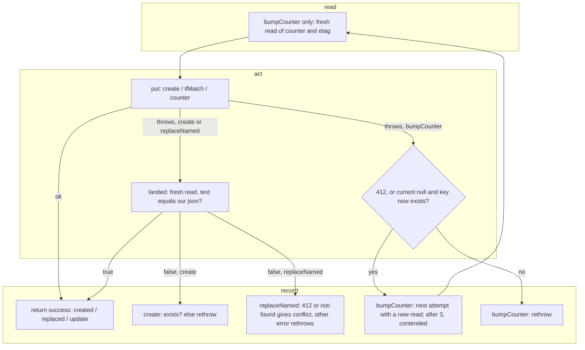

# SGS-130: Blob store: cap SDK retries, treat a landed build write as success, verify the missing-key rule live

- **Type**: Task
- **Component**: aoe4-build-order
- **Milestone / criteria**: M9 / M9.10
- **Priority**: high
- **Risk**: high
  <!-- strongModelTriggers: changes shared mutable state and the order of operations a result depends on: the Blob create and compare-and-swap writes decide whether a save is reported as stored, conflicting or failed, and the counter write decides whether a save passes the rate limit. No criticalPaths symbol applies. -->
- **Invariants**: none
- **Unverified assumptions**: `@vercel/blob` 2.9.0 reads `VERCEL_BLOB_RETRIES` from `process.env` on every `put`, `head` and `del` request (through `requestApi`), so setting it at store creation takes effect, and `1` means one retry (two HTTP attempts); `get` is a single `fetch` that the SDK never retries, so `read` and `landed` make one request each; a 412 and a 404 are not retried but a 5xx and a lost response are; a lost response to a `put` that landed makes the SDK's retry answer 412 (conditional) or "already exists" (create), which `landed` absorbs for build writes and which sends `bumpCounter` to its next attempt; `put` with `allowOverwrite: true` and `ifMatch` on a missing key raises `BlobNotFoundError` or `BlobPreconditionFailedError` and creates nothing (the in-memory fakes in `blob-build-store.test.ts`, `blob-lost-writes.acceptance.test.ts` and `named-build-store.acceptance.test.ts` assume `BlobNotFoundError`; only the live test, run by the owner, shows the real class); the stored JSON text read back from Blob equals the text that was put (no re-encoding)
- **LOC estimate**: ~55 (`blob-build-store.ts`: `landed`, the retry cap, and the failure branches of `create`, `bumpCounter` and `replaceNamed`; business logic only, tests and the live test excluded)
- **Depends on**: SGS-127, SGS-128
- **On merge**: BACKLOG.md: delete the bullet beginning "`lib/aoe4-build-order/blob-build-store.ts`: during a Blob outage"; BACKLOG.md: delete the bullet beginning "Verify once against a real Vercel Blob store"
- **Source**: `design/M9.md` C10, Behavior rules "Blob store (M9.10)", owner decisions 4A, 5A and 7 (Q59 A); criterion M9.10 (Blob half); BACKLOG.md bullets on SDK retries multiplying and on `ifMatch` for a missing key; tech-lead finding `reports/batch-SGS-130-SGS-140-tech-lead-1.md` (counter read-back lets parallel saves pass `SAVE_RATE_LIMIT`)

## Context

`@vercel/blob` retries each `put`, `head` and `del` up to 10 times, and a conditional `put` whose response is lost but whose write landed is retried into a 412, so `replaceNamed` reports `conflict` (and `create` reports `exists`) for a save that succeeded, while `bumpCounter` multiplies the retries by its 3 attempts during an outage. The change caps the SDK retries and, when a build write (`create`, `replaceNamed`) throws, reads the key back and reports success if our JSON is what is stored. `bumpCounter` does not read back (owner decision 7): the counter JSON `{windowStart, count}` carries nothing that tells writers apart, so parallel saves from one client write identical text and a read-back would count every losing writer as landed, letting them all pass `SAVE_RATE_LIMIT` while the counter rises by one. It also ships an opt-in live test that records what a real store does for `ifMatch` on a missing key, which the `'conflict'` mapping in `replaceNamed` currently assumes.

## Scope

All in `lib/aoe4-build-order/blob-build-store.ts` unless noted. Read it at the end state of SGS-127 (`read` requests the blob uncompressed and throws on a weak etag). Contract names are those of `design/M9.md` C10. The branch `sgs-130-blob-landed-write-retry-cap` already implements the earlier version of this ticket, in which `bumpCounter` also called `landed`; the rework removes that call and fixes the tests and docs that pin it.

- Export `BLOB_SDK_RETRIES` (value 1). `createBlobBuildStore` sets `process.env.VERCEL_BLOB_RETRIES` to its string form only when it is unset or empty; an explicit value is left alone (owner decision 4A). The cap applies to `put`, `head` and `del`; `get` is not retried by the SDK whatever the value.
- Add module-private `landed(key, json)`: a fresh `read` of the key; true only when it returns a value whose `JSON.stringify` equals `json` as text (not a deep compare); false for null, and false for any throw, including the weak-etag throw SGS-127 adds. A throw from `landed` is never propagated. The `read` it uses must not return a weak etag either, so keep the SGS-127 uncompressed request on that path.
- Apply `landed` where a build `put` throws, with the outcomes in the Blob store rules table of `design/M9.md`:
  - `create` (used by `putBuild` and `createNamed`): landed gives `'created'`; else the existing `exists(key)` check gives `'exists'`; else rethrow the put error.
  - `replaceNamed`: a precondition or not-found error with `landed` gives `'replaced'`, without it `'conflict'`; any other error with `landed` gives `'replaced'`, without it rethrow (routes answer 503). Still no retry that re-reads the blob for a new etag; `landed` compares content only and never feeds an etag back into a write.
- `bumpCounter` never calls `landed` and makes no read after a failed `put` (owner decision 7): a 412, or a key that now exists when `current === null` (the existing `exists(key)` check), goes to the next attempt, which starts with its own fresh read; any other error rethrows; after the 3 attempts it returns `'contended'`. Parallel bumps over the same count therefore give one update and send each loser to a re-read, so the counter rises once per accepted save; a counter write that landed with its response lost costs at most one extra count. Keep a short comment at the `bumpCounter` catch saying why it has no read-back (identical counter JSON from parallel writers), since that is the rejected alternative a reader would otherwise reintroduce.
- Retry worst cases this gives (from the design's rules table, for comments and docs that quote them): `put`, `head` and `del` at most 2 HTTP attempts per call, `get` 1; `bumpCounter` at most 3 × (read 1 + put 2 + head 2, the head only when `current === null`); `replaceNamed` put 2 + landed read 1; `create` the same plus head 2.
- `blob-build-store.live.test.ts` (new, same directory) and `package.json` script `test:blob-live` (`BLOB_LIVE=1 vitest run lib/aoe4-build-order/blob-build-store.live.test.ts`), per C10. `vitest.config.mts` is not changed: `npm test` matches the file and reports it skipped.
  - Gated by `describe.skipIf(process.env.BLOB_LIVE !== '1')` and nothing else.
  - `beforeAll` loads `.env.local` with `process.loadEnvFile` when it exists (it does not override set variables), then throws a message that names `BUILDS_STORE_ID` and `vercel env pull .env.local` when `BUILDS_STORE_ID` is unset or empty.
  - Every key it writes starts with a random `live-check-<uuid>` segment (store env argument and a raw probe key); `afterAll` deletes them, ignoring `BlobNotFoundError`, and a failed cleanup fails the run.
  - It records and `console.log`s the error class name `put(key, json, {allowOverwrite: true, ifMatch: '"0"'})` raises on a missing key, and asserts `replaceNamed` on a missing id returns `'conflict'` and creates no blob.
- Replace the "Which error the SDK raises ... is unverified" comment on `replaceNamed` with the recorded class and date once the owner's run is available (see the human-gated criterion). If the recorded class is neither `BlobNotFoundError` nor `BlobPreconditionFailedError`, add it to the conflict mapping in a follow-up commit on the same PR, not a new ticket.
- Docs, each checked against the end state:
  - `ARCHITECTURE.md` AoE4 saved-build storage row: on the branch it says the store reads back after a throwing `put` "in `create`, `bumpCounter` or `replaceNamed`" and so counts a landed counter write as done; that is untrue for `bumpCounter`. The row must say which writes read back, what `bumpCounter` does on a failed put, the retry cap and which SDK calls it covers. (The exact sentence in Rework 1's required fixes is superseded where it names `bumpCounter`.)
  - The seam comments in `blob-build-store.ts` (the retry-cap comment above `BLOB_SDK_RETRIES`, the comment on `landed`) and the `BuildStore` comment on `replaceNamed` in `build-store.ts` ("never retries") are checked and fixed if untrue; none may say or imply that a counter write is read back or that `get` is retried.
  - `docs/aoe4-build-order.md` is grepped for statements about save conflicts, retries and the save limit; none is expected to change.
- Existing tests: a test of a changed behavior gets the new expected value; any other test keeps its expected value. Changed behaviors include `replaceNamed` mapping a put failure "after one put and no read", `create` reporting `exists`, and every test that pins a read-back after a failed counter `put` or a counter update returned from one: in `blob-build-store.test.ts` the "returns the update after one put for %s when the read-back shows the JSON it sent" table and the `get` call counts and the "Each failed put is followed by a read-back" note in the counter tests; in `lib/aoe4-build-order/blob-lost-writes.acceptance.test.ts` the "the save rate counter when its Blob write fails" cases (examples; the rule decides). Tests that rely on the first `get` call being the only read pin that with their mock setup. The implementer lists every test it edits.
- New tests go in `lib/aoe4-build-order/blob-build-store.test.ts` (mocks `@vercel/blob`) and follow the shared helpers and the stricter duplication gate from SGS-128; route-level counter cases stay in `blob-lost-writes.acceptance.test.ts`.

**Out of scope:** changing `BuildStore`, `PutResult`, `ReplaceResult`, `nextCounter`, the stored counter shape (no per-write nonce) or any route status or body; the memory and file stores; retrying a build write; SGS-127's etag handling itself; making the live test part of `npm test` or CI; the `design/M8.md` and `design/M9.md` text (already applied); the rest of the BACKLOG bullet that mentions the memory-store env-isolation test.

## Diagrams

The write path of the Blob store, grouped into read, act, record:

## Acceptance criteria

- [ ] After a store is created with `VERCEL_BLOB_RETRIES` unset, `process.env.VERCEL_BLOB_RETRIES` equals the string form of the exported `BLOB_SDK_RETRIES`; with it already set to another value, creating a store leaves that value unchanged (a test fails if the env value is overwritten or never set).
- [ ] `replaceNamed`: a `put` that throws `BlobPreconditionFailedError` while a fresh read returns the same JSON text that was put gives `'replaced'`; the same throw while the read returns different JSON gives `'conflict'`; a network-style error with the same JSON stored gives `'replaced'`; the same error with different or no stored JSON rejects with the original error (tests fail if the comparison is skipped, always true, or the error is swallowed).
- [ ] `replaceNamed` with a `put` rejecting `BlobNotFoundError` and nothing stored still gives `'conflict'`, and the `put` is called once with the caller's etag as `ifMatch`, never with an etag read back by `landed`.
- [ ] `create` (a case each for `putBuild` and `createNamed`): a throwing `put` with our JSON stored gives `'created'`; with other content stored and `head` finding the key gives `'exists'`; with nothing stored, `head` not finding the key and the original error rethrown unchanged.
- [ ] (respec 1) `bumpCounter` never reads the key back after a failed `put`: a 412 while the stored value is the exact JSON the `put` sent still goes to the next attempt (a fresh read and a new `put` with that read's etag), and `get` is called once per attempt, never between a failed `put` and the next attempt's read. A test fails if `bumpCounter` calls `landed` or returns the update from a failed `put`.
- [ ] (respec 1) Two `bumpCounter` calls run in parallel over the same stored count, against a fake whose `put` honors `ifMatch` and `allowOverwrite: false`, give one update after one `put` and one retry: the loser's first `put` fails, it re-reads, and its update counts past the winner's, so the stored count rises by two and the two returned updates differ. The same holds when the counter does not exist yet (both create; the loser finds the key and goes to the next attempt). A test fails if both calls return the same count.
- [ ] (respec 1) `bumpCounter` failure paths: a non-412 error on an update (`current` present) rethrows after one `put` even when the stored value equals the JSON it sent; on a create (`current === null`) an error with the key now present goes to the next attempt and with the key absent rethrows after one `put`; every attempt failing with 412 gives `'contended'` after the attempt limit.
- [ ] (respec 1) Route level (`blob-lost-writes.acceptance.test.ts`): a save whose counter write lands but whose response is lost (the SDK retry hits the landed write, or the connection drops) on a first save is answered 201 and the stored count is above the accepted saves by at most one; a dropped response on a counter update (counter already present) answers 503 and stores no build; a counter that loses to a concurrent bump on every attempt answers 429 with `Retry-After` 1 and stores no build.
- [ ] `landed` returning false for a read that throws (a test where the `get` mock throws, including the weak-etag error) leaves the outcome the original `put` error would have given, and the throw from the read is not what the caller sees.
- [ ] Text equality, not deep equality: a stored value with the same data but a different key order or whitespace than the JSON that was sent is not treated as landed (a test fails if `landed` parses and deep-compares).
- [ ] No existing `BuildStore` method signature, `PutResult`, `ReplaceResult` or route status changes; the `build-store` and routes tests keep passing unedited, except where Scope's rule for existing tests applies.
- [ ] `npm test` runs `blob-build-store.live.test.ts` and reports its tests skipped when `BLOB_LIVE` is unset; with `BLOB_LIVE=1` and no `BUILDS_STORE_ID` (after `.env.local` loading) the run fails in `beforeAll` with a message naming `BUILDS_STORE_ID` and `vercel env pull .env.local`, and it never passes silently without credentials.
- [ ] The live test writes only keys under its `live-check-` segment and deletes them in `afterAll`.
- [ ] (respec 1) `ARCHITECTURE.md` and the seam comments Scope names match the end state: the read-back applies to `create` and `replaceNamed` only, `bumpCounter` retries a 412 or a created-meanwhile key with a new read and rethrows anything else, the retry cap covers `put`, `head` and `del` and `get` is not retried, and the `conflict` rules. No doc or comment in the diff says a counter write is read back or that `get` is retried.
- [ ] Human-gated, live behavior the unit gates cannot reach (owner runs on this ticket's PR branch: `vercel env pull .env.local`, then `npm run test:blob-live`): the live test passes, and its output, the recorded error class for `ifMatch` on a missing key, is pasted into the PR. The `replaceNamed` comment then states the recorded class and the date. A class outside the two mapped ones is added to the conflict mapping in a follow-up commit on the same PR.
- [ ] No INVARIANTS.md regressions

## Open questions

none

## Rework 1 - 2026-11-11 (review, text)

Review bounced tip 0144aca (report reports/SGS-130-review-1.md); no other gate has passed it. Code and tests are correct; two wording fixes, both `(text)`.

### Findings
- `ARCHITECTURE.md:24` (text): the storage row wrongly says "otherwise the put error decides the outcome" (wrong for `create`, `blob-build-store.ts:65-67`) and wrongly says `@vercel/blob` reads the retries as a "per-call retry count" (`get` makes one request in 2.9.0).
- `lib/aoe4-build-order/blob-build-store.ts:9-10` (text): "every request" is wrong; `get` is not retried.

### Required fixes
- [ ] In `ARCHITECTURE.md` replace the two sentences ("When a Blob `put` throws ... otherwise the put error decides the outcome. Creating the store sets ... a value already set is kept.") with exactly: "When a Blob `put` throws (in `create`, `bumpCounter` or `replaceNamed`), the store makes a fresh read of the key and counts the write as done when the stored value, serialized with `JSON.stringify`, is the exact text it sent, since a write whose response was lost may have landed before the SDK's retry failed. Otherwise `create` gives `exists` when `head` finds the key and rethrows the put error when it does not; `replaceNamed` gives `conflict` for a precondition or not-found error and rethrows any other; `bumpCounter` tries again after a 412 or when the counter it was creating now exists, rethrows any other error, and gives `contended` after its third attempt. Creating the store sets `VERCEL_BLOB_RETRIES` to `BLOB_SDK_RETRIES` (1) when that variable is unset or empty (`@vercel/blob` reads it as the retry count of each `put`, `head` and `del` call, default 10; `get` makes a single request); a value already set is kept."
- [ ] In `lib/aoe4-build-order/blob-build-store.ts` lines 9-10 replace the comment with exactly:
  `// @vercel/blob reads VERCEL_BLOB_RETRIES from process.env on every put, head and del call (default 10; get is`
  `// not retried), and bumpCounter's attempts multiply those retries during an outage.`
- [ ] Change nothing else; run unit tests, tsc, lint:dup.

## Re-spec 1 - 2026-11-11

- Underspecified: Scope told `bumpCounter` to call `landed`, copying the build-write rule to the counter without checking that counter JSON is identical across same-client parallel writers; the tech-lead gate showed that lets parallel saves pass `SAVE_RATE_LIMIT`, and the owner answered Q59 A (design owner decision 7).
- Changed: `bumpCounter` has no read-back (412 or created-meanwhile key goes to the next attempt, else rethrow, `contended` after 3); new criteria for no read-back, two parallel bumps, counter failure paths and the route-level counter cases; the docs criterion now forbids saying a counter write or `get` is retried or read back; Rework 1's exact ARCHITECTURE sentence is superseded where it names `bumpCounter`.
- Still stands on `sgs-130-blob-landed-write-retry-cap` (stack tip 73693ef): the retry cap, `landed`, `create` and `replaceNamed` with their tests, the live test and `test:blob-live`, and the retry-cap comment; the rework removes the `landed` call from `bumpCounter` and fixes the counter tests in `blob-build-store.test.ts` and `blob-lost-writes.acceptance.test.ts` and the ARCHITECTURE row.
