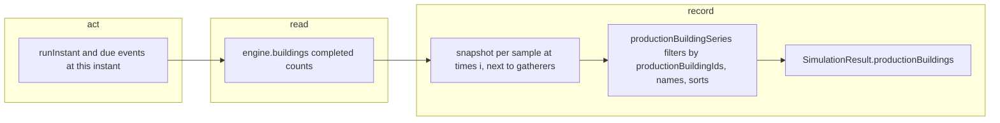

# SGS-136: Emit production buildings over time from the simulator (OpenAPI 2.6.0)

- **Type**: Task
- **Component**: aoe4-build-order
- **Milestone / criteria**: M9 / M9.6 (simulator half)
- **Priority**: medium
- **Risk**: high
  <!-- criticalPaths: simulateBuildOrder gains a result field and a sampling step; public API response and OpenAPI version change. -->
- **Invariants**: A1 (building set comes from data only), A3 (same inputs give the same series; ordering is deterministic)
- **Unverified assumptions**: none
- **LOC estimate**: 80 (new `production-buildings.ts` about 50, sampling in `simulate.ts` about 15, `model.ts` types about 10; tests, OpenAPI JSON and docs excluded)
- **Depends on**: SGS-128
- **On merge**: none
- **Source**: design/M9.md C9 and the M9.6 criteria row (simulator half); owner decision 1A (any building that produces a unit counts)

## Context

The Units produced chart's second view (a later ticket, M9.6 view half) plots production buildings over time, so the simulator must return that series. The result gains `productionBuildings`, one series per production building baseId, sampled where `gatherers` is sampled. The change lands in `simulateBuildOrder` (a critical path) and in the public simulate response, so the A3 determinism tests must stay green and the OpenAPI version goes from 2.5.0 to 2.6.0.

## Scope

All contract names are design/M9.md C9.

- `lib/aoe4-build-order/model.ts`: add `BuildingSeries` (`baseId`, `name`, `counts`) and `SimulationResult.productionBuildings: BuildingSeries[]`, placed after `unitsProduced`.
- New `lib/aoe4-build-order/production-buildings.ts`, exporting `productionBuildingIds(data)` and `productionBuildingSeries(data, samples)` per C9:
  - A baseId is a production building when it appears in `producedBy` of an entry with `type === 'unit'` in the civ's `GameData` and `data.byBaseId` has an entry of `type === 'building'` for it. The set comes from data only (A1); `CivRules.villagerProducer` is not consulted.
  - Each baseId is its own series; the starting `capital-town-center` and a built `town-center` are separate. `name` is the first `type === 'building'` entry's name in `data.byBaseId.get(baseId)` (lowest age).
  - `samples[i]` is the completed-instance count per baseId at `times[i]`; `counts.length === times.length`, `counts[0]` includes starting buildings.
  - Series are sorted by the first sample index with `count > 0` ascending, ties by `baseId` ascending by code-unit comparison. A production building that is never completed (count 0 at every sample) gets no series.
- `lib/aoe4-build-order/simulate.ts` (`simulateBuildOrder`): in the sampling loop, where `gatherers` is pushed per sample, record a snapshot of `engine.buildings` (completed instances only; `addBuildingInstance` is the place a completed building is counted, so under-construction buildings are not in it), and return `productionBuildingSeries(data, samples)` as `productionBuildings`. A building completing at time t is counted at a sample at t, because the sample is taken after the instant's events. How the snapshot is kept (a per-sample copy or a change log) is the implementer's choice as long as A3 holds and the series stay in lockstep with `times`.
- `docs/api/openapi.json`: `info.version` 2.5.0 to 2.6.0; new `BuildingSeries` schema (`additionalProperties: false`, all three fields required); `productionBuildings` required on `SimulationResult`; add the field to every response example in the document that shows a full `SimulationResult` (the examples that carry `unitsProduced`). `info.description` is not changed.
- `acceptance/openapi-schemas.ts` follows the OpenAPI change.
- Version pins: every acceptance spec that asserts `info.version` is `2.5.0` moves to 2.6.0 (examples: the specs for builds, named-builds, gathered-resources and the issue-shape check; find them by grepping the version string).
- `acceptance/aoe4-simulate-api-contract.spec.ts`: the exhaustive `Record<keyof SimulationResult, true>` key list gains the new key, and the response is validated against the 2.6.0 `BuildingSeries` schema.
- Existing code that builds a `SimulationResult` literal (examples: the `result()` fixture in `components/apps/aoe4-build-order/result-series.test.ts`) gets the new required field so it still type-checks. No component reads the field in this ticket.
- Docs: `docs/aoe4-build-order.md`, the `SimulationResult` field list (the section that lists `unitsProduced`, `gatherers` and the other series) is incomplete once the field exists; add `productionBuildings` there with its rules (which buildings count, per-baseId series, name rule, ordering, completed instances only, no series for a never-completed building). Also any statement elsewhere in that doc or in `ARCHITECTURE.md` that lists the result series or the module's files as complete. Describe behavior, not measured counts.
- Tests: new `lib/aoe4-build-order/production-buildings.test.ts` (Vitest, pure functions, design/M9.md test levels) and cases in `lib/aoe4-build-order/simulate.test.ts` (or the nearest simulate series test file) using the `test-helpers.ts` fixture. Follow the shared test helpers from SGS-128 and keep `npm run lint:dup` clean under both configs it adds.

**Out of scope:** the chart view toggle, `buildingSeries` in `result-series.ts` and anything in `results.tsx` (the view ticket); a civ-rule override of the producer set (design Extension points: a later optional parameter); changes to existing series or to simulation rules; requests or the response shape of any other route.

## Diagrams

Changes a core control loop (the sampling loop in `simulateBuildOrder`), read, act, record:

## Acceptance criteria

- [ ] `productionBuildingIds` on the English game data contains `capital-town-center`, `town-center` and `barracks`, and contains neither `house` nor any `producedBy` id that has no building entry (the `wynguard-*` ids). Every id in the set has a building entry in `byBaseId` and appears in the `producedBy` of a unit entry; a test over the whole set checks both rules.
- [ ] For a run of the English default fixture order, `productionBuildings` starts with `capital-town-center` at count 1 at t=0 and `counts.length === times.length` for every series; the last count is at `durationSeconds`, including when the duration is not a multiple of `sampleSeconds`.
- [ ] A building under construction is not counted, and one completing at time t is counted at the sample at t: a test with a `barracks` step finds the series 0 before completion and 1 at the completion sample, and fails if the count rises when construction starts.
- [ ] The starting `capital-town-center` and a built `town-center` are two series with their own names. Age tiers of one baseId are one series named by its lowest-age building entry.
- [ ] Series order is by first sample with a positive count ascending, then `baseId` ascending by code-unit comparison; a test with two series first positive at the same sample (and unsorted input) fails if the tie-break is dropped or uses locale comparison.
- [ ] A production building that never completes in the run has no series.
- [ ] Two runs of the same order, data and inputs return deeply equal `productionBuildings`, and the existing A3 determinism tests pass unchanged.
- [ ] `docs/api/openapi.json` is version 2.6.0, defines `BuildingSeries` closed with all three fields required, requires `productionBuildings` on `SimulationResult`, and every full-result example in it includes the field. No acceptance spec asserts 2.5.0 any more. The simulate API contract spec fails if the key is missing from the response and if the response has a key the schema lacks.
- [ ] `docs/aoe4-build-order.md` documents `productionBuildings` as above.
- [ ] Every existing series in the result is unchanged for any input (the same tests pass without edited expectations, apart from fixtures that now carry the new field).
- [ ] `npx tsc --noEmit`, `npm test`, `npm run lint:dup` and the acceptance command pass.
- [ ] No INVARIANTS.md regressions

## Open questions

none
