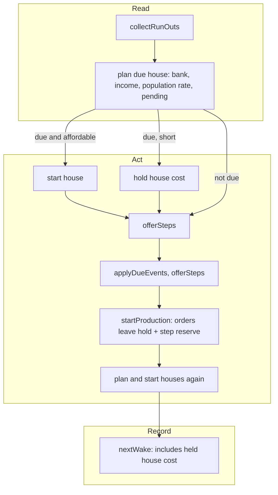

# SGS-156: Auto-houses plan ahead for wood and hold their cost back from steps and orders

- **Type**: Bug
- **Component**: aoe4-build-order
- **Milestone**: none
- **Priority**: high
- **Risk**: high
- **Invariants**: A2 (resources never go negative: new hold on step and order payments), A3 (same build and data give the same timings: changes the order of work inside an instant)
- **Unverified assumptions**: none
- **LOC estimate**: 180 (due-house projection in `houses.ts`; hold plumbing, instant order and wake needs in `simulate.ts`; the step affordability checks in `produce`, `build` and `research`; business logic only)
- **Depends on**: none
- **On merge**: none
- **Source**: BACKLOG.md item "AoE4 auto-houses: plan ahead for wood" (owner request, 2026-11-13)

## Context

With thin wood, the Town Center gets supply-capped even with `autoHouses` on: steps and unit orders spend the wood first, and a house starts only the instant wood reaches its cost, after the TC is already housed (one more wood villager does not help, since steps take the extra wood first).

### Cause

- `planAutoHouse` in `lib/aoe4-build-order/houses.ts` projects population over the lead (walk plus build time) only. It ignores the time needed to gather the house's cost, so a house is never due before it is affordable.
- `startAutoHouses` in `lib/aoe4-build-order/simulate.ts` runs last in `runInstant`, after `offerSteps` and `startProduction`, and reserves nothing. Step handlers (`produce`, `build`, `research`) and `orderNeed`/`payOrder` pay from the bank without holding anything back for a house.
- Tests did not catch it because they pin it: `simulate-construction.test.ts` ("wake when the house becomes affordable") expects the house to start when wood reaches the cost, and `docs/aoe4-build-order.md` "Houses and supply" documents that auto-houses ignore reservations.
- Same defect elsewhere: every payment path (step handlers, order payments, reaction offers) and `nextWake`, which must wake for the held amount.

### Evidence

Fixture (default inputs; 4-5 villagers on wood, a council hall making longbows nonstop, food floating 2,000+). Today the TC is housed at pop 50, 60 and 70, at 10:00-10:35, 12:00-12:40 and 14:05-14:40:

```
start -> sheep
produce villager from capital-town-center
at 7 vils rally capital-town-center -> gold
at 8 vils build mining-camp from gold then gold
at 10 vils rally capital-town-center -> wood
at 15 vils rally capital-town-center -> sheep
@2:30 build council-hall with 3 from sheep then sheep
build mill from sheep then sheep
@4:30 produce longbowman from council-hall
@5:00 build farm from sheep then farm
build farm from sheep then farm
build farm from sheep then farm
build farm from sheep then farm
build farm from sheep then farm
build farm from sheep then farm
```

## Scope

Changes the documented house contract and every saved build's simulated result.

1. **Due house** (`planAutoHouse`, `houses.ts`). A house is due when the projected shortfall is positive within lead plus gather time. Gather time is, per resource of the house cost, `max(0, cost - banked) / current income`, and the largest of them applies. A resource of the cost with zero income and a shortfall makes the house not due (no gather time exists). With the cost fully banked, gather time is 0 and the rule equals today's. The planner needs the bank and the current income as inputs (extend `HouseDemand` or its parameters), built in `houseDemand` in `simulate.ts` from `incomePerSecond`.
2. **House reserve.** While a house is due, its cost is held back from: step payments, unit orders other than villagers, and the step-reserve check in `orderNeed`/`payOrder` (an order must leave the due house's cost on top of a waiting step's reserve). Villager payments ignore it, as they ignore the step reserve. The hold is released when the house starts or stops being due. Auto-houses still ignore step reserves. A held step's `reserve` outcome stays its own cost; the hold is applied where the bank is compared, in every step handler that pays (`produce`, `build` and `research` in `research.ts` as examples; a handler registered through `stepHandlers` sees the same bank), and `nextWake` accounts for it so a held payment or the house wakes the loop when affordable.
3. **Order.** In `runInstant`, a due, affordable house starts before steps are offered in that instant. The pass after production stays, so a house made due by a payment in the same instant starts in that instant, not at a later wake.
4. **No deadlock.** With no income of a resource the house costs (and not banked), no reserve is held; an order never waits forever on a reserve that cannot be met. Explicit `build house` steps are unchanged: they start as ordered, are not held back by the house reserve, and keep counting toward the planner's headroom.
5. **Docs.** `docs/aoe4-build-order.md` "Houses and supply": the statements that the lead is walk plus build time only, that auto-houses are planned only "after production starts", and that auto-houses "ignore a waiting step's resource reservation" for payment become untrue or incomplete; the section also needs the due-house rule, the reserve and the order. Check the "Extension points" paragraph on `productionModifier` ("when auto houses estimate supply demand") still reads true.
6. **Tests.** Update every test that pins the old contract, e.g. `simulate-construction.test.ts` ("wake when the house becomes affordable", "ignore a waiting step reserve" keeps its assertion since auto-houses still ignore step reserves), `houses.test.ts`, and `build-move.acceptance.test.ts` ("pays the research while an auto-house is building"). A test of the changed behavior gets the new expected value; any other test keeps its expected value and pins the old setting in its setup (for example `autoHouses: false` or banked wood). List every edited test in the report. Search the Playwright specs under `acceptance/` (the `house-gate`, `house-rule`, `waits`, `spend-population` specs) for dependence on the old timing, and state in the report which depend on it.
7. **Changelog.** Every saved build's result shifts. No changelog file exists on `main`; the PR description states the shift, and the report notes this.

**Out of scope:** explicit `build house` semantics, `autoHouses: false` behavior, how many houses cover a shortfall (whole-house rounding and the `maxPopCap` room), other civs' supply rules, holding resources for anything but houses, UI changes.

## Diagrams



## Acceptance criteria

- [ ] The fixture above, with default inputs, has no instant from 9:30 to 15:00 at which the TC is supply-capped (its villager production blocked because population plus the unit would pass supply). The test is written so it fails at the base (where the TC is capped in that window); fewer longbows than today is expected and not asserted.
- [ ] A house is due ahead of affordability: with thin wood and a short bank, the house is held and starts in time for supply, not when wood first reaches its cost; a house whose gather time still leaves slack is not yet due (a test fails if due-ness ignores gather time, and one fails if it ignores the bank).
- [ ] With the cost fully banked the due-house result equals the previous planner (gather time 0).
- [ ] While a house is due and unaffordable, a non-villager unit order and a step payment (`build`, `produce`, `research`) that would take the bank below the house cost wait; a villager order still pays. Once the house starts, or stops being due, the hold is gone and the next payment goes through.
- [ ] A due, affordable house starts before the step that would have spent its wood in the same instant (a test fails if steps are offered first).
- [ ] No reserve is held while income of a short resource of the house cost is 0, and an order with no wood income finishes its run without a step or order stuck on the hold.
- [ ] A waiting step's reserve still does not hold back an auto-house (the existing assertion stays).
- [ ] An explicit `build house` step starts as ordered and is not held by the house reserve.
- [ ] Resources never go negative in any of the above runs, and the same build and data give identical results twice.
- [ ] Every test that pins the old house timing is updated per Scope 6, and the report lists them. `docs/aoe4-build-order.md` "Houses and supply" describes the due-house rule, the reserve and the order, with no sentence left saying auto-houses ignore all reservations or plan only after production.
- [ ] No INVARIANTS.md regressions

## Open questions

- owner: When the house is due and affordable but no builders are available (`houseBuilderSource` finds fewer than `houseBuilders` gatherers), should its cost stay held? Holding can stall a step that frees no builders; releasing lets the step spend the wood and delays the house. Recommended: release the hold while the house cannot start for lack of builders (it is resource-affordable, so nothing is saved by holding), pending your answer.
