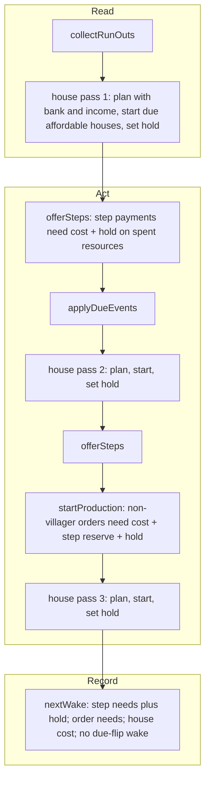

# SGS-156: Auto-houses plan ahead for wood and hold their cost back from steps and orders

- **Type**: Bug
- **Component**: aoe4-build-order
- **Milestone**: none
- **Priority**: high
- **Risk**: high
- **Invariants**: A2 (resources never go negative: new hold on step and order payments), A3 (same build and data give the same timings: changes the order of work inside an instant and the wake times)
- **Unverified assumptions**: none
- **LOC estimate**: 220 (due-house projection in `houses.ts`; the hold field, the shared held-affordability helper, the three house passes in `runInstant` and the wake needs in `simulate.ts`; the step checks in `produce`, `build` and `research`; business logic only)
- **Depends on**: none
- **On merge**: none
- **Source**: BACKLOG.md item "AoE4 auto-houses: plan ahead for wood" (owner request, 2026-11-13)

## Context

With thin wood, the Town Center gets supply-capped even with `autoHouses` on: steps and unit orders spend the wood first, and a house starts only the instant wood reaches its cost, after the TC is already housed (one more wood villager does not help, since steps take the extra wood first).

### Cause

- `planAutoHouse` in `lib/aoe4-build-order/houses.ts` projects population over the lead (walk plus build time) only. It ignores the time needed to gather the house's cost, so a house is never due before it is affordable.
- `startAutoHouses` in `lib/aoe4-build-order/simulate.ts` runs last in `runInstant`, after `offerSteps` and `startProduction`, and reserves nothing. Step handlers (`produce`, `build` in `simulate.ts`, `researchHandler` in `research.ts`) call `canAfford(state.resources, cost)` directly, and `orderNeed`/`payOrder` add only the waiting step's `engine.reserve`; nothing holds wood back for a house.
- Tests did not catch it because they pin it: `simulate-construction.test.ts` ("wake when the house becomes affordable") expects the house to start when wood reaches the cost, and `docs/aoe4-build-order.md` "Houses and supply" documents that auto-houses ignore reservations.
- Same defect elsewhere: every payment path (step handlers, including reaction steps offered by `offerReactions`, and order payments) and `nextWake`, which must wake for the held amount.

### Evidence

Fixture (default inputs; 4-5 villagers on wood, a council hall making longbows nonstop, food floating 2,000+). Today the TC is housed at pop 50, 60 and 70, at 10:00-10:35, 12:00-12:40 and 14:05-14:40:

```
start -> sheep
produce villager from capital-town-center
at 7 vils rally capital-town-center -> gold
at 8 vils build mining-camp from gold then gold
at 10 vils rally capital-town-center -> wood
at 15 vils rally capital-town-center -> sheep
@2:30 build council-hall with 3 from sheep then sheep
build mill from sheep then sheep
@4:30 produce longbowman from council-hall
@5:00 build farm from sheep then farm
build farm from sheep then farm
build farm from sheep then farm
build farm from sheep then farm
build farm from sheep then farm
build farm from sheep then farm
```

## Scope

Changes the documented house contract and every saved build's simulated result.

1. **Due house** (`planAutoHouse`, `houses.ts`). (respec 2) Let `lead` be today's lead (walk plus build time) and `G` the gather time of one house's cost: for each resource of the cost, `max(0, cost - banked) / income`, the largest of them, where `banked` is the real bank (step reserves are not subtracted) and `income` the current per-second income from the current gatherers (`incomePerSecond` over `gatherRatesOf`, at the moment of planning). A resource with a positive shortfall and zero income gives no finite `G`: the house is not due (the planner returns 0). Otherwise the planner uses the window `W = lead + G` everywhere today's code uses `lead`: pending buildings count toward headroom when they complete by `time + W`, and `shortfall = population + populationPerSecond * W - (supply + supply of those pending)`. A house is due when that shortfall exceeds `RESOURCE_TOLERANCE`. The count (whole-house rounding, the `maxPopCap` room) is computed from that shortfall as today. With `G = 0` (cost fully banked) the result equals today's planner exactly, `arriving` window included. The bank and the income reach the planner as inputs (extend `HouseDemand` or its parameters), built in `houseDemand` in `simulate.ts`. The due state may flip (due, not due, due) as the bank grows and steps spend it; that is intended, with no hysteresis.
2. **How much is held.** (respec 2) While any due house is not started (short of resources, or short of builders), the hold is one house's cost, whatever count the planner returns. Each started house drops out (it is pending and counts toward headroom by its completion time); when the planner still reports a house due after the starts, the hold stays one house's cost. With no due house, or with `autoHouses` off, the hold is zero. (respec 1) The hold is kept while the house is due and affordable but no builders are available (`houseBuilderSource` finds fewer than `houseBuilders` gatherers): owner decision, the house starts the moment builders free up, and holding may stall steps and orders meanwhile; no release for lack of builders.
3. **When the hold is computed.** (respec 2) One house pass plans the due house, starts every due house it can afford with builders available (as `startAutoHouses` does today, ignoring step reserves), and then sets the hold from what is left. `runInstant` runs that pass three times: after `collectRunOuts` and before the first `offerSteps`; after `applyDueEvents` and before the second `offerSteps` (population, supply and builders change there); and after `startProduction` (a house made due by a payment this instant starts in this instant). The hold is constant between passes: a payment inside `offerSteps` or `startProduction` does not recompute it. `engine.reserve` keeps being reset in `offerSteps`; the hold is a separate field and is not reset there. `nextWake` reads the hold left by the last pass.
4. **How the hold applies.** (respec 2) The hold is a field on `EngineState`, read through one shared affordability helper that every paying step handler uses in place of `canAfford(state.resources, cost)` (`produce`, `build`, `researchHandler` are the current ones; a handler registered through `stepHandlers` uses the same helper). The helper requires, for each resource where the payment's cost is positive, `bank >= cost + hold` (mirroring `orderNeed`); a resource the payment does not spend is not held, so a food-only step never waits on a wood hold. Orders other than villagers need `cost + step reserve + hold` on each resource the unit costs (`orderNeed`); villager orders ignore both, as they ignore the step reserve today. A held step's `reserve` outcome stays its own cost; `payCost` still pays the real cost (A2). Explicit `build house` steps skip the hold: they start as ordered and keep counting toward the planner's headroom. Auto-houses still ignore step reserves.
5. **Wakes.** (respec 2) In `nextWake`, every step need (the cursor step's `engine.reserve` and each of `engine.reactionNeeds`) is evaluated as its cost plus the hold on each resource it spends, so a held step wakes at the instant the bank covers both. Order needs already include the hold when pushed to `engine.needs`; a due, unaffordable house keeps pushing its cost as today. No wake is added for the instant a house stops being due as `G` shrinks: the release takes effect at the next wake the loop already has (sample time, event, run-out, trigger, or an affordability need).
6. **No deadlock on resources.** With no income of a resource the house costs and that resource short, the house is not due and no hold is held; a payment then waits only on its own cost (plus the step reserve for an order). (respec 1) A hold for lack of builders is not released, because the cost is banked and builders return as gatherers free up; the "no income" rule only covers a resource that is short and cannot be gathered.
7. **Docs.** `docs/aoe4-build-order.md` "Houses and supply": the statements that the lead is walk plus build time only, that auto-houses are planned only "after production starts", and that auto-houses "ignore a waiting step's resource reservation" for payment become untrue or incomplete; the section also needs the due-house rule, the hold (one house, the resources it applies to) and the passes in the instant. Check the "Extension points" paragraph on `productionModifier` ("when auto houses estimate supply demand") still reads true.
8. **Tests.** Update every test that pins the old contract. A test of the changed behavior gets the new expected value; any other test keeps its expected value and pins the old setting in its setup (for example `autoHouses: false` or banked wood). Likely dependents found by search, as examples: `simulate-construction.test.ts` ("wake when the house becomes affordable"; "project the demand at the modified production speed"; "ignore a waiting step reserve" keeps its assertion since auto-houses still ignore step reserves), `simulate-house-gate.test.ts` ("auto-houses at 120, 220 and 320 s" pins exact house times), `houses.test.ts`, the `paces auto-houses` test in `research.test.ts`, and `build-move.acceptance.test.ts` ("pays the research while an auto-house is building"). List every edited test in the report. Search the Playwright specs under `acceptance/` for dependence on the old timing (examples: `house-gate`, `house-rule`, `waits` with `autoHouses: true`, `spend-population` "counts an auto-house under buildings", `triggers`), and state in the report which depend on it.
9. **Changelog.** Every saved build's result shifts. No changelog file exists on `main`; the PR description states the shift, and the report notes this.

**Out of scope:** explicit `build house` semantics, `autoHouses: false` behavior, how many houses cover a shortfall (whole-house rounding and the `maxPopCap` room), other civs' supply rules, holding resources for anything but houses, UI changes.

## Diagrams



## Acceptance criteria

- [ ] (respec 2) The fixture above, with default inputs, keeps the Town Center producing villagers from 9:30 to 15:00: in the result's villager unit series, the count never stays flat for longer than one villager production time (from the data) plus one sample interval. The test first asserts that food stays above a villager's cost and villagers stay under the villager target in that window, and it fails at the base (where the count stays flat while the TC is housed). Fewer longbows than today is expected and not asserted.
- [ ] (respec 2) A house is due ahead of affordability: with thin wood and a short bank, the house is due once the shortfall is positive within lead plus gather time, the hold applies, and the house starts when wood covers it, in time for supply; a house whose gather time still leaves slack is not yet due. Tests fail if due-ness ignores gather time, if it ignores the bank, and if a pending building completing after lead but within lead plus gather time is left out of headroom.
- [ ] (respec 2) With the cost fully banked the due-house result equals the previous planner, including which pending buildings count toward headroom.
- [ ] (respec 2) When the planner returns two or more houses and none can start, the hold is one house's cost: a step that leaves exactly one house's cost of wood in the bank pays (a test fails if the hold is the count times the cost).
- [ ] (respec 2) While a house is due and unaffordable, a non-villager unit order and a step payment (`build`, `produce`, `research`, and a reaction step) that would take a resource it spends below the house cost wait; a step that spends none of the house's resources pays; a villager order still pays. Once the house starts, or stops being due, the hold is gone and the next payment goes through.
- [ ] (respec 2) A step held by the house wakes and starts at the instant the bank covers its cost plus the hold (or the house starts), not at a later sample (a test fails if its wake ignores the hold).
- [ ] (respec 2) A house that becomes due through events applied in the instant (a completed unit or building) holds its cost from the second step offer of that instant (a test fails if the hold is computed only at the start of the instant).
- [ ] A due, affordable house with builders available starts before the step that would have spent its wood in the same instant (a test fails if steps are offered first).
- [ ] (respec 1) A due, affordable house with fewer available builders than `houseBuilders` keeps its cost held: a step or non-villager order that would take the bank below the cost waits, and the house starts at the instant builders become available (a test fails if the hold is released for lack of builders, and one fails if the house does not start once builders free up).
- [ ] (respec 2) With zero wood income and wood below the house cost, a wood-costing step and a non-villager order each pay as soon as the bank meets their own cost (plus the waiting step's reserve for the order); no house hold is applied.
- [ ] A waiting step's reserve still does not hold back an auto-house (the existing assertion stays).
- [ ] An explicit `build house` step starts as ordered and is not held by the house reserve.
- [ ] Resources never go negative in any of the above runs, and the same build and data give identical results twice.
- [ ] Every test that pins the old house timing is updated per Scope 8, and the report lists them. `docs/aoe4-build-order.md` "Houses and supply" describes the due-house rule, the hold and the passes in the instant, with no sentence left saying auto-houses ignore all reservations or plan only after production.
- [ ] No INVARIANTS.md regressions

## Open questions

none

## Re-spec 1 - 2026-11-13

- Underspecified: whether the house cost stays held when the house is due and affordable but builders are unavailable.
- Changed: owner chose to keep holding; Scope 2 and 4 and the criteria now say so, with a new criterion for it; the zero-income rule stays (house not due) and is reconciled with it.
- Stands: all other Scope, diagram and criteria unchanged.

## Re-spec 2 - 2026-11-13

- Underspecified: the due formula and its window, the hold amount for 2+ houses, where in the instant the hold is computed, which resources it binds and how handlers see it, wakes when a house stops being due, and the behavioral signals for the no-income and supply-capped criteria.
- Changed: Scope 1-6 now state the formula (`W = lead + G` for the pending window and the projection), a one-house hold, three house passes per instant, a per-resource hold through one shared helper on engine state, step wakes with the hold and no due-flip wake; criteria rewritten or added for each; Scope 8 names the likely-affected tests and specs.
- Stands: no branch work exists yet; the owner's builder-hold decision and every other rule are unchanged.
