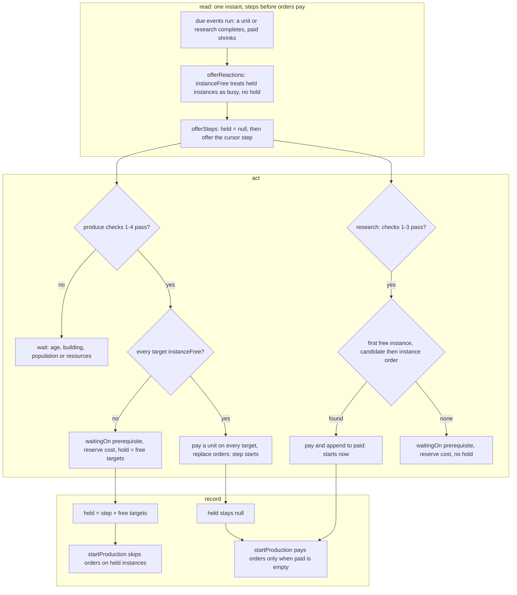

# SGS-190: Steps wait for a free building (produce and research)

- **Type**: Feature
- **Component**: aoe4-build-order
- **Milestone**: M11
- **Priority**: medium
- **Risk**: high
- **Invariants**: A2 (a held step still reserves its cost, and resources never go negative while it waits); A3 (the hold and the free test must be deterministic: no dependence on `Set` or `Map` insertion order beyond the engine's existing order, two runs deep-equal); A1 (no game number is written into the engine; research time and cost come from the data)
- **Unverified assumptions**: none
- **LOC estimate**: 150 (business logic: `instanceFree` in `engine-common.ts` about 5, `produce` check 5 and `offerSteps` hold and `startProduction` skip in `simulate.ts` about 50, `researchTarget` and the busy check in `research.ts` about 40, the held state in `createEngine`; the rest is the build edit, docs and tests)
- **Depends on**: SGS-189
- **On merge**: BACKLOG.md: delete the item "AoE4 build order: research occupies its building"
- **Source**: design/M11.md M11.5a (B-B1..B-B13, C7 `hold`, C7c, C7d, C7e, OD3 option A, OD3b option B Spear/Longbow row); plans/M11-20261116.md outline B

## Context

Today no step ever waits for a building to be free. `produce` in `lib/aoe4-build-order/simulate.ts` pays a unit on every targeted instance at once and appends to `paid` even while the instance trains (the old order is replaced, a "switch"). `researchTarget` in `lib/aoe4-build-order/research.ts` always takes instance 1 of the first candidate building, "queue length not consulted", and appends the research behind any unit, so a research's `startedAt` is its payment, not when it runs. The owner decided (OD3, option A) that a `produce` and a `research` both wait until their building instance is fully idle, and that a running research pauses that building's production. This is the one timing change of M11 and it also closes the owner's backlog item "research occupies its building". Because it changes what a run computes and the order of operations a result depends on, the ticket is high risk (strong model).

Under the rule, three prebuilt builds miss their bars as they stand (design B-B13): each blacksmith research blocks every later step for up to 60 s. SGS-189 reordered the Knight/Longbow and Council Hall builds; this ticket removes the four Castle blacksmith researches from `english-spear-longbow-maa-crossbow` (OD3b option B), which the design measured only under the new rule. A reordering of the other two builds is not part of this ticket and stands from SGS-189.

## Scope

**Engine (`lib/aoe4-build-order/`)**

- `engine-common.ts`: add exported `instanceFree(state, instance, step)` (C7c). An instance is free for step `step` when its `paid` list is empty and it is not held for a different step. `EngineState` and `BuildingInstance` are type imports (value imports from `simulate.ts` would cycle with `research.ts`; see design C7c). It is the one "free" test for both handlers, and no module besides `startProduction` reads `held`.
- `simulate.ts`:
  - `EngineState` gains `held: { step: number; instances: ReadonlySet<BuildingInstance> } | null` (C7d), set to `null` in `createEngine`. `StepStart`'s failure variant gains an optional `hold?: readonly BuildingInstance[]` (C7). No new `StepWait` value (C7e): a busy wait reports `waitingOn: 'prerequisite'` and accrues to `waitBreakdown.prerequisite`.
  - `produce` handler: keep checks 1 to 4 (unit unknown or above the age, no targeted instance, population, resources with `reserve`). Add check 5 after resources: when any target is not free, return `waitingOn: 'prerequisite'`, `reserve` of the total cost, and `hold` = the targets that are free (possibly none). The step starts only when every target is free at one offer, and then behaves as today (B-B4).
  - `offerSteps`: set `held = null` just before the cursor loop; when the cursor step returns `hold`, set `held = { step: cursor, instances: new Set(hold) }` (`null` when `hold` is empty). Reactions are offered before the loop and see the previous offer's hold; they never set one and treat held instances as busy (B-B5, B-B6).
  - `startProduction`: does not pay an order on an instance in `held.instances`.
- `research.ts` `researchTarget`: candidates are `[step.at]` when `at` is given, else `entry.producedBy` in snapshot order. Order of checks in `researchHandler`: tiers above the age, then no candidate has an instance (both `prerequisite`, no reserve), then resources (`reserve` the cost), then the first free instance in candidate order and then instance number takes the research; none free is `waitingOn: 'prerequisite'` with `reserve` of the cost and no `hold` (B-B7). A research never holds a building (B-B9). Update the `researchTarget` comment, which says queue length is not consulted.
- A running research pauses its instance's production and nothing else queues behind it (B-B8). This follows from `instanceFree` plus the existing `startProduction` rule that an order pays only when `paid` is empty; a test pins it, the code adds nothing for it.
- The "exports exactly the seam names" test in `simulate.test.ts` stays unchanged: this ticket adds no export to `simulate.ts`.

**Prebuilt build and README**

- `data/aoe4-build-order/builds/english-spear-longbow-maa-crossbow.json`: remove the four Castle-age blacksmith research steps `wedge-rivets`, `balanced-projectiles`, `decarbonization`, `insulated-helm` (consecutive steps near the blacksmith research block). Nothing is added, and no other step or trigger changes (the blacksmith trigger stays 950 s).
- `data/aoe4-build-order/README.md`, Spear/Longbow entry (respec 1): two statements become untrue. "A blacksmith at 950 s researches the Feudal and Castle attack and armor upgrades" (the Castle upgrades are gone) and "Nothing is omitted." (four techs now are). The entry must name the four dropped techs as omitted and must not say nothing is omitted; the wording is the implementer's. Any other sentence of that entry the busy rule makes untrue (for example the transcription note on when the men-at-arms and crossbowman steps start and replace the barracks and range orders, if they now wait for the building) is corrected too. The Knight/Longbow and Council Hall entries were handled by SGS-189 and are not touched.

**Tests**

- `lib/aoe4-build-order/test-helpers.ts` gains `startingWith` and `tierCountAt`, moved out of `research.test.ts` (which imports them), so `lint:dup` stays clean.
- New `lib/aoe4-build-order/simulate-busy-buildings.test.ts`: one table per rule, inline orders via `test-helpers.ts` (`run`, `noAutoVillagers`, `at`, `countAt`, `startingWith`, `tierCountAt`). Cases below under Acceptance criteria.
- Re-baseline existing tests. The design measured these 22 on a prototype of exactly this rule; each moves to the value the rule (and the build edit) gives, with no other edit. They are examples of the rule "a test whose expected value depends on a step not waiting for a free building gets the new value; no other test changes an assertion":
  - `research.test.ts`: "runs the research after the spearman already paid, for its 60 s", "reads the tier at spawn, not at payment", "keeps the cost and popcap of the tier paid", "paces auto-houses by the build time of the upgraded tier", "takes instance 1 of the named building without looking at queue length" (rewritten for B-B7), "starts when six gold miners have gathered its 100 gold", "reports every waiting second as resources", "starts at the instant the gold arrives, despite rounding in the gathered amount", "holds the villager order until the research ends, then resumes it", "converts nothing when a lower upgrade completes after a higher one", "leaves the units at the highest tier when two upgrades complete at one instant, listing no series for the tier passed through". Two upgrades at one barracks now run one after the other; to keep "at one instant" the test starts with two barracks.
  - `research.acceptance.test.ts`: "pays the research at its step start and queues it behind the spearman already paid" (retitled; it now waits for the spearman), "starts at the instant five gold miners reach 100 gold", "lets the villager paid at 0 spawn at 20, pays nothing during the 20 s research, and resumes the order at 40", "holds 20 tier-2 longbowmen just before completion and moves them all to tier 3 at it" (Knight/Longbow; respec 1). SGS-189 re-pins this test on today's engine, where `veteran-longbowmen` completes at about 838 s, outside the base's (840, 845] window, so this ticket does not assume that window or SGS-189's counts survive. Under the busy rule the completion moves again (the design's prototype measured about 841 s; that is a measurement, not a bound). The test keeps its rule: `veteran-longbowmen` completes within the horizon, the whole tier-2 stock is tier 2 at the last sample before completion and tier 3 at the first sample at or after it, and no tier-2 longbowman is left after completion. Sample times derive from the result's `completedAt`, not fixed second literals (if SGS-189 already left them derived, keep that form). Its counts are re-pinned to what the engine returns under the rule, and the report records the completion time and counts.
  - `simulate-construction.test.ts`: "keeps paid items and offers next-age units at the age-up instant". `simulate.test.ts`: "sets the standing rally from a villager produce with rally", "lets the villager in production finish and keeps the scout cost when switching", "completes a continuous produce when a later produce on the same producer starts".
  - `simulate-house-gate.test.ts`: the two "timeline matches the pinned digest" rows (`ENG 1TC`, `ENG Spear/Longbow into MAA/Crossbow`), re-pinned; they are regression digests, not bars. `builds.test.ts`: "runs its first two gold deposits dry at pinned times by 1800 s and keeps the third stocked" (Spear/Longbow regression pin). The design did not measure its run-out times under the Spear/Longbow edit, so the implementer measures them and re-pins the test, retitling it if a deposit's dry or stocked state changes.
  - Where a research test means to test resources or tiers, not the busy wait, it may use `noAutoVillagers` or an idle building instead of a new expected time; the PR says which.
  - A test outside this list that fails is a defect to explain, not to re-baseline. The implementer lists every test it edits.
- Acceptance specs: the run covers every `aoe4-simulate-api-*` spec and every spec that loads a prebuilt build (`-knight-longbow-build`, `-spear-longbow-build`, `-prebuilt-plans`, `-prebuilt-farms`, `-veterancy-conversion`, `aoe4-marker-labels`, `aoe4-build-order-knight-longbow-page`). An assertion that moves (likeliest in `-research`, `-veterancy-conversion`, `-production-buildings`, `-markers`, `-waits`, `-spear-longbow-build`; examples, not a closed list) is updated to the new value, with the rule or build edit that moves it named in the PR. Floors, the floating cap and bars are not touched: `production-floors.ts` and `MAX_FLOATING_AT_1200` stay as they are, and a floor, cap or bar failure stops the ticket and goes in the report (B-B13).

**Docs (same PR)**

- `docs/aoe4-build-order.md`, Model rules, rewritten to the behavior above for the statements that become untrue: in **Priority**, "While it waits on resources only, it reserves its cost" (respec 1: a step waiting for a busy building also reserves its cost), the sentence listing what reserves nothing ("a building instance that does not exist reserves nothing" must now also say a step waiting for a busy building reserves its cost, and that a held instance is not paid for) and the sentence on "steps start before orders pay"; in **Queues**, "shared by production and research", "a `produce` step on a busy producer replaces its order (a switch)", and the paragraph that a `produce` pays on every targeted instance and that a switch lets paid units finish; in the research paragraphs, "appended to its instance's paid units, behind any unit already paid", "resumes when the research ends", "the first building ... lowest-numbered instance (instance 1 first)", "Queue length is not consulted", "it reserves resources only when it is short of resources alone" (respec 1: a research waiting for a free instance reserves its cost too), and the Tiers statement "occupies its building's queue". The implementer states the busy-building rules B-B1..B-B12 as the behavior (free test, produce check order and hold, reactions, research target, research pausing production, same-instant ordering, failure at the horizon).
- `docs/aoe4-build-order-format.md`, the wait-reasons section (respec 2): three statements become untrue. The `prerequisite` row of the `waitingOn` table lists only a missing instance or an above-age entry for `produce` and `research` (a busy target is now a `prerequisite` cause too); the `resources` row says "this is the only reason that reserves" (a step waiting for a busy building reserves its cost too); and the sentence "The order is `prerequisite`, then `villagers` or `population`, then `resources`." (for `produce` and `research` the busy check runs after the resources check, so a single fixed order no longer holds). Any other sentence of that section the busy rule makes untrue (for example the lead-in listing why a step waits, or "A handler checks in a fixed order") is corrected too. Wording is the implementer's; the doc keeps no new `StepWait` value (C7e).
- No API field, no wording change in any message, no OpenAPI change, no UI change.

**Out of scope:** the `waitingFor` and `waitDetails` fields and `wait-detail.ts` (later ticket); annotation text; changing floors, caps or bars; the Knight/Longbow and Council Hall reorders (SGS-189); researches queueing behind researches (design Extension points); a new `StepWait` value.

## Diagrams

Changes the core `offerSteps`/`startProduction` control loop (B-B5, B-B9):

## Acceptance criteria

- [ ] `instanceFree` is the only function that decides "free" for both handlers, and a unit test of it fails if either half of its rule is dropped: an instance with a paid item is not free; an empty instance held for another step is not free; held for the same step it is free.
- [ ] Single busy target: a `produce` on a producer that trains a unit starts when that unit completes, with its wait accrued to `waitBreakdown.prerequisite` and its cost not charged before it starts. Design sample: `produce scout from capital-town-center x1` at 10 s gives `startedAt` 20, `completedAt` 43, `waitBreakdown.prerequisite` 10, food at 10 s not yet charged.
- [ ] Several targets: with instances whose units finish at different times `a < b` (the test first asserts `a < b`), the step starts at `b`, and the instance free at `a` pays nothing in `(a, b)` (the hold). A test fails if `startProduction` pays a held instance, and a second case fails if the hold outlives the step's start.
- [ ] `instance: k` waits only for instance k; other busy instances do not delay it.
- [ ] Check order: a busy target with short resources reports `waitingOn: 'resources'` until affordable, then `prerequisite`; the busy check is last. A waiting busy-target step reserves its cost (a later order cannot spend it).
- [ ] Reactions: a reaction `produce` or `research` treats instances held for the cursor step as busy, never sets a hold, and reserves nothing. A test fails if a reaction can take an instance held for the cursor step.
- [ ] Research at a building training a unit waits until the unit completes, then runs for its research time. Design sample: `startingWith(3, ['capital-town-center','barracks', ...houses], plenty)`, `produce spearman from barracks`, `research veteran-spearmen` at 5 s gives `startedAt` 15, `completedAt` 75, `waitBreakdown.prerequisite` 10. A research waits behind another research: two researches at one blacksmith run one after the other (design sample, `steeled-arrow` then `fitted-leatherwork`: first `startedAt` 0, `completedAt` 60; second `startedAt` 60, `completedAt` 120, `waitBreakdown.prerequisite` 60), and with two blacksmiths both start at 0.
- [ ] Research candidate choice: with an archery range training longbowmen and an idle council hall, `research veteran-longbowmen` goes to the council hall (design sample: `startedAt` 5, `completedAt` 65, no wait); armed at 0 it takes the archery range, whose first longbowman is not yet paid at the first offer (B-B9). With every candidate busy it takes whichever frees first, candidate order then instance number on a tie. `at` restricts the candidates to that building.
- [ ] While a research runs on an instance its order pays nothing, and the order pays its next unit at the research's end unless a waiting `produce` or `research` takes the instance first at that instant. A chain of researches at one building runs back to back with no gap.
- [ ] Missing target is unchanged: no instance (or `instance: k` not built) gives `prerequisite`, with nothing held or reserved. A target never free by the horizon leaves the step `waiting`, the `step-stuck` warning unchanged, later steps `not-reached` with `earlier-step`. `pause`, `rally`, `build` and `move` never wait on a building.
- [ ] Determinism and resources: on the several-target and research-at-busy-building cases, every floating-resource sample is at least 0 (A2) and two runs deep-equal (A3).
- [ ] The "exports exactly the seam names" test passes unchanged. Every test in the Scope re-baseline list moves only to the value the rule gives, with a table or per-test note in the PR; no other unit test changes an assertion. A re-baselined test's changed assertion fails at the base code (it asserts the old timing is gone), not only passes at the new one.
- [ ] (respec 1) The Knight/Longbow "holds 20 tier-2 longbowmen ..." test asserts, with sample times derived from `veteran-longbowmen`'s `completedAt` rather than fixed seconds, that the research completes within the horizon, that the whole tier-2 longbowman stock is tier 2 at the last sample before completion and tier 3 at the first sample at or after it, and that no tier-2 longbowman remains after it; its counts are the ones the engine returns under the rule, and the report records the completion time and counts. It fails if the tier conversion stops moving the whole stock, and it does not assert the base's (840, 845] window.
- [ ] After the Spear/Longbow edit, that build's steps are the base steps minus exactly the four named research steps (compared by content in the implementer's report), no trigger changed.
- [ ] Every `builds.test.ts` case passes for every prebuilt build with floors, the floating-resource cap and the no-waiting bars at their existing horizons and `production-floors.ts` unchanged, except the Spear/Longbow gold run-out pin, which is re-pinned to the measured values. The Spear/Longbow bars ("reaches Castle ...", "leaves no villager arriving at an empty resource and no stuck step through 1800 s") pass unchanged. A floor, cap or bar failure stops the ticket and is reported instead of lowering a bound.
- [ ] The acceptance run for the specs named in Scope passes, with each moved assertion updated and named in the PR.
- [ ] `docs/aoe4-build-order.md` states the busy-building rules; no statement in it says queue length is not consulted, that a produce on a busy producer replaces its order as a switch, or that a research is appended behind a unit already paid (a search over `docs/` for `Queue length is not consulted` and `replaces its order (a switch)` finds nothing; both match today). (respec 1) No sentence in the doc says a `produce` or `research` step reserves its cost only while it waits on resources alone (a search over `docs/aoe4-build-order.md` for `While it waits on resources` and `short of resources alone` finds nothing; both match today), and the doc says a step waiting for a busy building reserves its cost. (respec 1) The Spear/Longbow README entry names `wedge-rivets`, `balanced-projectiles`, `decarbonization` and `insulated-helm` as omitted, no longer says the build researches the Castle upgrades, and does not say nothing is omitted.
- [ ] (respec 2) `docs/aoe4-build-order-format.md`'s wait-reasons section matches the busy rule: the `waitingOn` table's `prerequisite` row names a busy (not free) target building as a cause for `produce` and `research`; no sentence says `resources` is the only reason that reserves (a search over `docs/aoe4-build-order-format.md` for `only reason that reserves` finds nothing; it matches today), and the section says a step waiting for a busy building reserves its cost; the section no longer states one fixed check order that puts every `prerequisite` cause before `resources` (a search over the same file for `` The order is `prerequisite`, then `` finds nothing or the sentence that matches says the busy check comes after resources; it matches today).
- [ ] No INVARIANTS.md regressions

## Open questions

none

## Re-spec 1 - 2026-11-16

- Underspecified: the doc lists left out two reserve statements in `docs/aoe4-build-order.md` and the Spear/Longbow README's "Nothing is omitted.", and the Knight/Longbow tier test was assumed to sit in (840, 845] after SGS-189, which completes it at about 838 s on today's engine.
- Changed: Scope and criteria now name both reserve sentences (with search criteria verified against origin/main 87f0cd7), require the README entry to list the four techs as omitted, and re-pin the tier test by its rule with sample times derived from `completedAt` instead of a fixed window.
- No branch work exists for this ticket; engine scope, other criteria and the re-baseline list are unchanged.

## Re-spec 2 - 2026-11-16

- Underspecified: the Docs scope covered only the model doc and the README; the format doc's wait-reasons section (the `prerequisite` row, "only reason that reserves", and the fixed check-order sentence) goes untrue under the busy rule and no ticket owned it.
- Changed: Scope Docs adds `docs/aoe4-build-order-format.md`'s wait-reasons section, and a new criterion pins the three statements with searches verified against origin/main 87f0cd7.
- No branch work exists for this ticket; everything else is unchanged.

## Rework 1 - 2026-11-16 (review, text)

Gates: review bounced at tip 613c38d; no earlier gate passed. Every finding is text only; no assertion or code changes.

### Findings
- `docs/aoe4-build-order.md:227`: the `research textiles` capital example omits that the capital must be idle too (probe: capital training a scout sends textiles to town center 1).
- `lib/aoe4-build-order/simulate-construction.test.ts:235`: title claims the step is offered at the age-up instant; it starts at 102.55 s.
- `lib/aoe4-build-order/simulate.test.ts:420`: title claims a kept scout cost on a switch; assertions show nothing charged at 10 s and an idle town center.

### Required fixes
- [ ] (text) `docs/aoe4-build-order.md:227`: replace that sentence and the one after it with: "With an idle capital town center and two idle town centers, `research textiles` goes to the capital town center and `research textiles at town-center` to town center 1; with town center 1 busy and town center 2 idle, `research textiles at town-center` goes to town center 2."
- [ ] (text) `simulate-construction.test.ts:235`: retitle to `'keeps the unit paid before the age-up, then starts the next-age unit when that unit completes'`.
- [ ] (text) `simulate.test.ts:420`: retitle to `'waits for the villager in production, charges nothing before it starts, then trains the scout and resumes villagers at its spawn'`.
