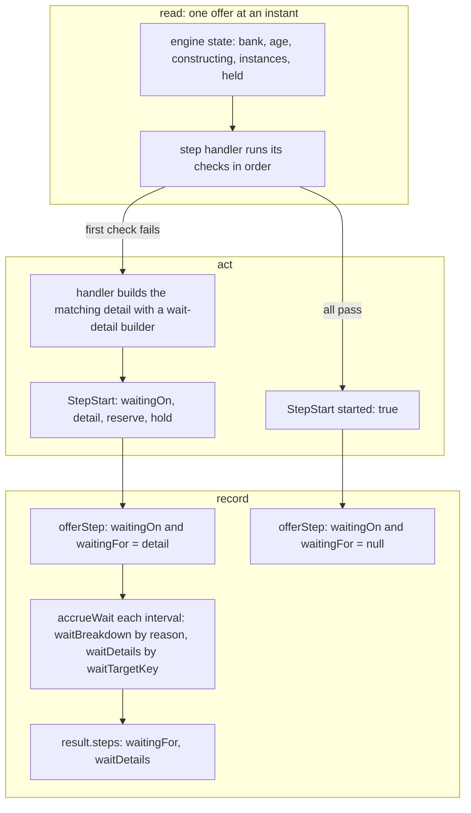

# SGS-192: Record what a waiting step waits for (`waitingFor`, `waitDetails`)

- **Type**: Feature
- **Component**: aoe4-build-order
- **Milestone**: M11
- **Priority**: medium
- **Risk**: high
- **Invariants**: A2 (resource shortfalls are reported, never altered: `resourceWait` only reads the bank, and no handler's check order or reserve changes); A3 (every detail is derived from engine state at the offer: no clock, no randomness, no `Set` or `Map` order beyond the engine's own, two runs deep-equal); A1 (names in details come from the snapshot data; no game number is written into the engine)
- **Unverified assumptions**: none
- **LOC estimate**: 300 (business logic: new `wait-detail.ts` about 150, handler details plus `offerStep` and `accrueWait` about 100, `model.ts` types about 30, `constructing` moved to `EngineState`; the rest is OpenAPI, docs and tests)
- **Depends on**: SGS-190
- **On merge**: none
- **Source**: design/M11.md M11.5b (B-W1..B-W9, B-W11, B-W12; C1, C2, C5, C6, C7 `detail`, C7a, C7b parts); plans/M11-20261116.md outline D

## Context

A waiting step reports only a generic `waitingOn` and a per-reason `waitBreakdown` (`StepTiming` in `lib/aoe4-build-order/model.ts`), so the page can only say `still waiting on prerequisite`. This ticket makes the engine record, beside them, what each wait is for: a typed `waitingFor` (the current wait) and a `waitDetails` list (seconds per distinct target, for example `50 gold` for 30 s, then a free Archery Range for 12 s). The annotation text that prints it is a later ticket; the page keeps today's generic text until then. The ticket adds new result fields to a public API (OpenAPI schema, contract spec) and rewrites every `started: false` return in the two step handlers files, and it moves `constructing` onto the shared engine state, so it is high risk (strong model: over 250 lines of business logic). It changes no timing (B-W2): a run's start times, completions, `waitSeconds`, `waitingOn` and `waitBreakdown` are what they are after SGS-190.

## Scope

All paths in `lib/aoe4-build-order/` unless noted. Read SGS-190's end state: `instanceFree` in `engine-common.ts`, `EngineState.held`, `StepStart.hold`, the `produce` busy check (check 5) and `researchHandler`'s busy check (check 4, `research.ts:52-55`; SGS-190 renamed `researchTarget` to `candidateInstances`). A busy wait is `waitingOn: 'prerequisite'` and accrues to `waitBreakdown.prerequisite`; this ticket adds no `StepWait` value.

**Types (`model.ts`)** (design C1, C2)

- `StepWaitDetail`, a discriminated union on `kind`: `age` (`age: 2 | 3 | 4`, `landmark: { baseId, name } | null`), `building` (`buildings: { baseId, name }[]`, `instance: number | null`), `building-busy` (same fields plus `every: boolean`), `villagers` (`node: NodeRef`, `needed`, `available`), `population` (`needed`, `used`, `supply`), `resources` (`short: Partial<Record<ResourceKind, number>>`). `buildings` has at least one item; `short` has at least one key and every value is a whole number of at least 1; every count is a whole number. `building-busy.every` is true only for a `produce` with no `instance` that targets two or more instances, and then `instance` is null and `buildings` has one item.
- `StepWaitEntry { detail: StepWaitDetail; seconds: number }` and `BreakdownReason` (`resources | villagers | population | prerequisite`); `StepTiming.waitBreakdown` becomes `Partial<Record<BreakdownReason, number>>` (same values). `StepTiming` gains `waitingFor: StepWaitDetail | null` and `waitDetails: StepWaitEntry[]`.

**New `wait-detail.ts`** (design C5, C6; browser-safe: type imports from `simulate.ts`, value imports only from `model.ts`, `engine-common.ts` and `landmarks.ts`, because the page imports it in a later ticket)

- Builders: `ageWait(state, age)` (the landmark is the entry in `state.constructing` that is a landmark (`isLandmark`) of age `state.age` with the earliest `completesAt`, ties by `baseId` in code-unit order, and only when `age === state.age + 1`; else null), `buildingWait(state, baseIds, instance)`, `busyWait(state, baseIds, instance, every)`, `resourceWait(state, need)` (`short[k] = Math.ceil(need[k] - state.resources[k] - RESOURCE_TOLERANCE)` for each kind where that is above 0), `villagerWait(node, needed, available)`, `populationWait(state, needed)` (`used = state.population`, `supply = state.supply`). Names come from the snapshot (`state.data.byBaseId.get(baseId)?.[0]?.name`), falling back to the `baseId`.
- Readers: `waitReasonOf(detail): BreakdownReason` (`age`, `building`, `building-busy` map to `prerequisite`; the others by kind); `waitTargetKey(detail): string` (`resources`, `villagers`, `population`, `age:<age>`, `building:<baseIds joined by ,>#<instance or empty>`, `busy:<baseIds joined by ,>#<instance or empty>`); `waitDetailText(detail): string` in the forms below, which the design fixes. `<a>` is no article when the name starts with `The `, `an` when it starts with A, E, I, O or U, else `a`.

| detail | text | sample |
|--------|------|--------|
| age, landmark null | `<Age> Age` (`AGE_NAMES[age]`) | `Castle Age` |
| age, landmark set | `<Age> Age (<landmark name>)` | `Castle Age (King's Palace)` |
| building, one item, instance null | `<a> <name>` | `an Archery Range`, `a Blacksmith`, `The White Tower` |
| building, several items | each as above joined with ` or ` | `a Barracks or The White Tower` |
| building, instance k | `<name> <k>` (one item) | `Town Center 2` |
| building-busy, `every` false, instance null | `a free <name>` per item, a leading `The ` dropped from the name, joined with ` or ` | `a free Archery Range`, `a free Capital Town Center or a free Town Center` |
| building-busy, instance k | `<name> <k> to be free` | `Barracks 3 to be free` |
| building-busy, `every` true | `every <name> to be free` | `every Barracks to be free` |
| resources | `<n> <kind>` per short kind in `RESOURCE_KINDS` order; two joined with ` and `, three or more as `x, y and z` | `50 gold`, `50 gold and 20 wood`, `30 food, 20 wood and 10 gold` |
| villagers | `<needed - available> more villager(s) at <node>` (`villager` when 1) | `2 more villagers at wood`, `1 more villager at gold#2` |
| population | `<needed> population space (<used>/<supply> used)` | `1 population space (40/40 used)` |

**Engine (`simulate.ts`, `research.ts`)**

- `StepStart`'s failure variant gains required `detail: StepWaitDetail | null`; every `started: false` return in both files names it (design B-W1):
  - `produce`: today's combined first check is split. Unit entry unknown (schema-impossible): `detail` null. Unit entry above the age: `ageWait(state, entry.age)`. No targeted instance: `buildingWait(state, [producer], step.instance ?? null)`. The age is checked before the missing building, so when both hold the age is reported (`waitingOn` stays `prerequisite` either way). Population: `populationWait(state, targets.length x popcap)`. Resources: `resourceWait` of the need the check used (the cost plus the auto-house hold). Busy target (SGS-190's check 5): `busyWait(state, [producer], step.instance ?? null, step.instance === undefined && targets.length > 1)`.
  - `build`: entry above the age: `ageWait`; unknown building (schema-impossible): null; villagers: `villagerWait(step.from, builders, availableAt(state, step.from))`; resources: `resourceWait` of the need it checked (the plain cost for an explicit `build house`, the held cost otherwise).
  - `move`: villagers: `villagerWait(step.from, count, available)`.
  - `researchHandler`: every tier above the age: `ageWait(state, lowest age among the tech's technology and upgrade entries)`; no producing instance: `buildingWait(state, step.at === undefined ? entry.producedBy : [step.at], null)` with `producedBy` order kept; resources: `resourceWait` of the held cost; no free instance (SGS-190's check 4): `busyWait(state, the candidates that have an instance, in candidate order, null, false)`.
  - An action without a handler: null. `rally` and `pause` never wait.
- `offerStep`: sets `timing.waitingFor = outcome.detail` on a failed start and `null` on a start (design B-W3). `createEngine` initializes `waitingFor: null` and `waitDetails: []` on every step. At the horizon a `waiting` step keeps the last failed offer's detail; `completed`, `in-progress` and `not-reached` steps have `waitingFor: null` (B-W4).
- `accrueWait` (signature unchanged): beside `waitBreakdown`, when `waitingFor` is not null, it finds the `waitDetails` entry with the same `waitTargetKey` and adds the interval's seconds, or appends `{ detail: waitingFor, seconds }` when none (B-W5). A repeated key keeps the numbers of the entry's first interval (B-W6). An `age` entry whose later interval has a `waitingFor` with a non-null `landmark` takes that detail; a later null landmark never clears a named one (B-W7). Entries are in first-accrued order and a detail never accrued has no entry (B-W8).
- `constructing` moves from the private `Engine` interface to `EngineState` (design C7a: `readonly constructing: { baseId: string; completesAt: number }[]`): `Engine` no longer declares it, and the `(state as Engine).constructing` casts in `startConstruction` and `completeConstruction` go. `ageWait` reads it. (Because `Engine extends EngineState`, a leftover cast still compiles; review reads the diff for it.)

**OpenAPI and docs (same PR)**

- `docs/api/openapi.json`: new schemas `StepWaitDetail` (`oneOf` of six objects, each `additionalProperties: false`, requiring every property, tagged by a `kind` const, and each variant and property with a description) and `StepWaitEntry` (closed, every property required and described); `StepTiming` gains both fields in `properties` and `required`; the 200 examples that show a `StepTiming` gain the fields.
- `docs/aoe4-build-order-format.md`: the `steps` field list in Outputs, the paragraph that says each reason is reported by `waitingOn` and `waitBreakdown`, and the wait-reasons table (the `prerequisite` row's order for `produce`: the age is reported before a missing building; also any busy-building statement the table lacks after SGS-190). The row's "An action with no handler always reports it" stays true but now gives a null detail; the rewrite says in one clause that every `BuildStep` action has a handler, so every breakdown second has a detail (B-W9). `docs/aoe4-build-order.md`: the sentences that describe why a step waited, so they cover `waitingFor` and `waitDetails` and the check order of B-W2. The implementer states the rules B-W1 to B-W9 and B-W11 as behavior; the replacement wording is theirs. Measured results do not go in the docs. Busy-building wording follows design M11.md (C7e, B-B rules): a busy wait is `waitingOn: 'prerequisite'`, reported in detail as `building-busy`.
- `lib/aoe4-build-order/README.md`: the module list gains a `wait-detail.ts` entry (what it holds and that it is browser-safe); the new-step-action line (today "its type in `schema.ts` and an entry in `stepHandlers`") becomes untrue by omission: it must also say the handler's `started: false` returns name a `detail` built with the `wait-detail.ts` builders.

**Existing consumers that must take the new fields**

- `acceptance/helpers.ts` `Timing` type gains the two fields (and `BreakdownReason`-compatible `Reason`); the exhaustive `Record<keyof StepTiming, true>` in `acceptance/aoe4-simulate-api-contract.spec.ts` gains the two keys.
- `acceptance/aoe4-simulate-api-contract.spec.ts` structure checks cover the new schemas the way they cover their siblings: `StepWaitEntry` joins `RESPONSE_SCHEMAS` (closed, every property required, every property described); `StepWaitDetail` is a `oneOf` like `SimWarning`, so it is not put in `RESPONSE_SCHEMAS` (whose closed check reads the top-level schema) but in `SHARED_SCHEMAS` and the description loop that `SimWarning` joins, and a check like "every SimWarning variant is closed, requires every property and is tagged by a code const" covers its variants, tagged by `kind`.
- A test that pins the closed set of `model.ts` type exports or of OpenAPI schema names takes the new names and nothing else; a count in its title is dropped or derived from the list. Rule, not a closed list; examples the search found: `lib/aoe4-build-order/data.acceptance.test.ts` "model.ts exports exactly the 26 documented types and the shared lists" (gains `StepWaitDetail`, `StepWaitEntry`, `BreakdownReason`) and `acceptance/fight-api-spec-surface.spec.ts` "has exactly the pinned fight and AoE4 schema names and no others" (`AOE4_SCHEMA_NAMES` gains `StepWaitDetail`, `StepWaitEntry`). SGS-191 edits the same lists, the same `Record<keyof ...>` literals and `docs/api/openapi.json`; whichever lands second rebases onto the other's names.
- Unit tests that pin the exact `StepTiming` shape or build one by hand take the new fields and change no other assertion. Rule, not a closed list; examples the search found: `simulate.test.ts` "completes a rally step the instant it arms" and "pauses at once, lets the paid villager spawn and pays no more" (`toEqual` on a whole step), "charges only the steps whose reason is a breakdown reason" (hand-built timings); tests that build or compare a `StepStart` without `detail` (examples: `research.test.ts` outcomes with `toEqual`, `simulate.acceptance.test.ts` and `simulate-construction.test.ts` `withHandler` overrides). The implementer lists every test it edits.
- `components/apps/aoe4-build-order/step-annotations.ts` and its tests are not touched: `StepRun` keeps reading `waitingOn` and `waitBreakdown`, so the page text is unchanged. A fixture there that is typed as `StepTiming` takes the new fields only if `tsc` demands it.

**Tests**

- New `wait-detail.test.ts`: tables for `waitDetailText` (every row of the forms table above, the article rule including a `The ...` name, the three busy forms and the dropped `The `, one, two and three resource kinds, 1 versus 2 villagers), `waitReasonOf` (every kind), `waitTargetKey` (every kind, including `busy:` versus `building:` for the same building), and the builders' name fallback and `ageWait` landmark choice (earliest `completesAt`, tie by `baseId`, null unless the wanted age is the next one).
- New `simulate-wait-details.test.ts`: inline orders via `test-helpers.ts`. Cases under Acceptance criteria. Includes the per-reason sum loop over every prebuilt build at 1200 s (B-W9).
- Acceptance: `aoe4-simulate-api-waits.spec.ts` adds the API fields (a `waiting` step carries `waitingFor`; a started step has null and a `waitDetails` list whose seconds per reason equal `waitBreakdown`). Every other `aoe4-simulate-api-*` spec passes with the OpenAPI change. The run covers every spec that reads `docs/api/openapi.json` or a `StepTiming`: examples, not a closed list, are the contract spec, `fight-api-spec-surface.spec.ts`, and the `-waits`, `-research` and `-production-buildings` specs.

**Out of scope:** `StepRun`, the annotation and popover text, `step-annotations.ts` (the next ticket); trigger details for `not-reached` steps; any timing change; a new `StepWait` value; the unit-line fields (`lineName`, marker `unit`); changing the `step-stuck` warning (message and fields stay, B-W12); `ARCHITECTURE.md` and the UI doc (the docs ticket).

## Diagrams

Changes the core `offerStep` and `accrueWait` path (read, act, record):

## Acceptance criteria

- [ ] Every step of every result carries `waitingFor` and `waitDetails`; a step that never failed an offer has `waitingFor: null` and `waitDetails: []`.
- [ ] `produce` details, one test case each (`simulate-wait-details.test.ts`): no targeted instance gives a `building` detail naming the producer's snapshot name (`produce man-at-arms from barracks x1` with no barracks); unit above the age gives an `age` detail with the wanted age and `landmark: null` (`produce knight from stable x1` at Dark Age gives age 3); both an unbuilt producer and a unit above the age report the age (a test fails if the building is checked first); population gives the needed, used and supply counts; a busy target gives `building-busy`, with `every: true` only for a no-`instance` produce on two or more instances and `instance` set for an `instance: k` produce.
- [ ] Resource details: `short` lists exactly the kinds the check found short, every value is a whole number of at least 1, and a shortfall of a fraction of a unit rounds up (a test with a 0.4 shortfall fails under floor or round); a kind that is covered is absent. The detail uses the need the handler checked, so a wait caused only by an auto-house hold names the held kinds.
- [ ] `build` and `move` details: a `build` with too few villagers at `from` gives `villagers` with the needed and available counts and the node; a `build` above the age gives an `age` detail; a `move` with too few gives `villagers`.
- [ ] `research` details: tiers above the age give an `age` detail with the lowest age among the tech's entries; no producing instance gives `building` naming `step.at` when given and every `producedBy` building in snapshot order otherwise; no free instance gives `building-busy` listing only the candidates that have an instance, in candidate order, with `every: false` and `instance: null` (design sample: a blacksmith running `steeled-arrow` while `fitted-leatherwork` waits names the blacksmith, `waitDetails` one `building-busy` entry for it).
- [ ] Age with a landmark: while a landmark of the current age is under construction and a step above that age waits, the `age` detail names the landmark (earliest `completesAt`); with none under construction, or when the wanted age is more than one above the current, it is null. A test fails if `ageWait` reads a landmark of another age.
- [ ] `waitingFor` lifecycle: it holds the last failed offer's detail while the step waits, so a step that fails twice in one instant keeps the second; it is null once the step starts; at the horizon a `waiting` step has the last failed detail, and `completed`, `in-progress` and both `not-reached` kinds have null. For every offer that fails with a `waitingOn` that is a breakdown reason, `waitReasonOf(waitingFor)` equals `waitingOn` (a loop over the prebuilt builds or a table of the cases above).
- [ ] Accrual: a step that waits on gold, then on a prerequisite, then on gold again has the gold entry once with the summed seconds and the numbers of its first interval, and entries in first-accrued order; a detail that never accrued seconds has no entry; a step that waits for a missing Barracks then a busy one has two entries (`building:barracks#` and `busy:barracks#`) and its `every` and `instance` stay those of the interval that created the entry; an `age` entry created without a landmark takes the landmark when a later interval's `waitingFor` names one, and a later null landmark does not clear it. A test fails if entries merge by detail kind instead of `waitTargetKey`.
- [ ] Invariant over every step of every run: for each breakdown reason r, the sum of the seconds of the entries whose `waitReasonOf` is r equals `waitBreakdown[r]` within float tolerance, and no two entries of one step share a `waitTargetKey`. The test loops over every prebuilt build at 1200 s (the build list the existing `builds.test.ts` uses) and over the cases above, and asserts first that at least one step in the loop has a non-empty `waitDetails` (so it cannot pass on empty lists).
- [ ] (respec 1) Busy-building sample (after SGS-190): with `produce scout from capital-town-center x1` at 10 s then `produce villager from capital-town-center`, the test first asserts the villager step waited more than 0 s under `prerequisite`; then its `waitDetails` is exactly one `building-busy` entry for `capital-town-center` with `every: false` and `instance: null`, whose seconds equal `waitBreakdown.prerequisite` and `waitSeconds`. The seconds are whatever the engine returns; no value is fixed here.
- [ ] (respec 1) No timing changes: every existing unit and acceptance test passes with no changed assertion about timing, `waitSeconds`, `waitingOn` or `waitBreakdown`; the only edits to existing tests are the fixture and shape edits and the pinned-name-list edits in Scope, each listed in the PR. A test outside those rules that fails is a defect to explain.
- [ ] (respec 1) Pinned name lists: the `model.ts` type-export test and the OpenAPI schema-name surface spec pass with exactly the new names added; the contract spec checks `StepWaitEntry` as a closed response schema and checks every `StepWaitDetail` variant is closed, requires every property, is tagged by a distinct `kind` const and, like every new property, carries a description.
- [ ] `step-stuck` warnings have the same message and fields as before for a step stuck on a resource, a prerequisite and a busy building.
- [ ] (respec 1) `constructing` is read through `EngineState`: the field is declared on `EngineState` and not on `Engine`, and a test gives `ageWait` an `EngineState`-typed value with `constructing` set, without the `Engine` interface. (No typecheck claim: a leftover cast still compiles; review reads the diff.)
- [ ] (respec 1) `wait-detail.ts` is browser-safe: a unit test reads the module's import lines and fails if any non-`import type` import names a module outside `model.ts`, `engine-common.ts` and `landmarks.ts` (type imports from `simulate.ts` are allowed). Every `wait-detail.test.ts` table row is a pure function call, with no engine run.
- [ ] `waitDetailText` gives the exact forms of the table in Scope for every detail kind and shape, and `waitTargetKey` and `waitReasonOf` give the values Scope lists.
- [ ] Two runs of the same order deep-equal, `waitingFor` and `waitDetails` included (A3), on a build that waits on resources, an age and a busy building.
- [ ] `docs/api/openapi.json` validates the live result: the contract spec passes with `StepWaitDetail` and `StepWaitEntry` and both new `StepTiming` fields required, and the 200 examples that show a `StepTiming` include them. The exhaustive `Record<keyof StepTiming, true>` in the contract spec fails the typecheck if a `StepTiming` field is missing from it.
- [ ] Docs: the format doc's `steps` field list and wait-reasons paragraph describe `waitingFor` and `waitDetails`, and no sentence in `docs/aoe4-build-order*.md` says `waitingOn` and `waitBreakdown` are the only wait records. A reader can find the rule that the age is reported before a missing building for a `produce`.
- [ ] (respec 1) `lib/aoe4-build-order/README.md` lists `wait-detail.ts` among the modules, and its new-step-action line says the handler's failed starts carry a `detail`.
- [ ] No INVARIANTS.md regressions

## Open questions

none

## Re-spec 1 - 2026-11-16

- Underspecified: the existing-test rule missed the closed name-list pins (`model.ts` exports, OpenAPI schema names) and the contract spec's structure checks for the new schemas; the busy sample fixed an unsourced 10 s; the `constructing` criterion claimed a typecheck that cannot fail; the package README was missing from Scope.
- Changed: Scope adds the name-list rule (with examples), the contract-spec placement of `StepWaitEntry` and `StepWaitDetail`, the README entry, the no-handler clause for the format doc, and `fight-api-spec-surface.spec.ts` in the acceptance run; criteria for the busy sample, `constructing`, browser safety (import lines), name lists and README are restated as properties.
- Branch work: none exists yet (SGS-190 is not integrated); nothing to keep or discard.

## Rework 1 - 2026-11-17 (review)

Review 4 (reports/SGS-192-review-4.md) at tip 7596bde: REQUEST CHANGES, one blocking test finding; production code passed. Earlier gates: none passed yet.

### Findings
- `lib/aoe4-build-order/simulate-wait-details.test.ts:165-172` and `:182-187`: the "snapshot order" (missing building) and "candidate order" (busy) claims are checked only on data already in sorted order, so adding `.sort()` at `research.ts:55` and `:63` leaves all 1875 tests green.

### Required fixes
- [x] Missing-building test: reverse `veteran-longbowmen.producedBy` in the test data (`startingWith(..., edit)`), assert first that the edited order is unsorted, expect `[Council Hall, Archery Range]`.
- [x] Busy-wait test: start with both buildings, keep both busy with longbowman production, send `research veteran-longbowmen` at 1 s; assert first that both produce steps start at 0 and the research step waited under prerequisite; expect the busy entry to list `[Council Hall, Archery Range]`.
- [x] Re-run the two sort mutations from the review report and confirm each test now fails; undo them. Full setup is in the report.
