# SGS-197: Add drag-select zoom, pan and reset to every results chart

- **Type**: Feature
- **Component**: aoe4-build-order
- **Milestone**: M11
- **Priority**: medium
- **Risk**: standard
- **Invariants**: none adjacent (A1 to A3 guard engine results and data; this changes chart UI state and drawing only)
- **Unverified assumptions**: recharts (the pinned version in `package.json`) re-lays out a `LineChart` when `XAxis` `domain` changes to a numeric `[from, to]` with `type="number"`, and with `allowDataOverflow` (or a clipped plot) draws nothing outside the grid; the `.recharts-cartesian-grid` element's bounding rect is the plot box the pointer maps through; pointer capture on a non-button element delivers `pointermove`, `pointerup` and `lostpointercapture` to it. The acceptance spec loads the page in Chromium and reads the real chart DOM, so each is exercised for real
- **LOC estimate**: 250 (`use-chart-zoom.ts` about 150, `line-chart.tsx` about 80, `chart-drag.ts`, `use-chart-drag.ts` and CSS the rest; tests excluded)
- **Depends on**: SGS-195, SGS-196
- **On merge**: none
- **Source**: design/M11.md M11.1 (B-Z1 to B-Z15, C10, C11, C12, C13 zoom parts); plans/M11-20261116.md outline I2 and design question 2 (owner answer Q129: the y axis counts the two edge rows `rowsInWindow` adds)

## Context

Each Results chart shows the whole game, so a 30-second stretch is unreadable on a 25-minute build (M11.1). This ticket gives every chart its own time window: drag on the plot to select a range, pan with buttons or Shift+drag, reset in a zoom bar. It wires the window math and `ChartZoomBar` that SGS-196 added into `line-chart.tsx`, on the marker control (SGS-195) and the chart table tbody shape (SGS-194, reached through SGS-195). Zoom is per chart, never stored, and changes no series, marker visibility or other chart.

## Scope

All paths under `components/apps/aoe4-build-order/` unless noted. Read at the end state of the Depends-on tickets: `SeriesChart` is a `tbody` (`chart-header-row`, then `chart-body-row` with one `td colSpan=4` holding `div[data-testid=chart-body]`); it takes `markerView` and draws `visibleMarkers`; `placeMarkers` lives in `chart-markers.ts`; `chart-zoom.ts` exports `TimeWindow`, `MIN_ZOOM_SECONDS`, `zoomTo`, `clampWindow`, `panWindow`, `panStepSeconds`, `timeAtX`, `rowsInWindow`; `chart-zoom-bar.tsx` exports `ChartZoomBar`. Use the design's names exactly. The rule table is design M11.1 (B-Z1 to B-Z15); this list gives the files and the decisions around it.

- New `use-chart-zoom.ts` (C11): `useChartZoom(end, plot)` with `PlotBox = { left, top, width, height }` in the plot wrapper's own coordinates (null before the chart has a width), returning `{ window, shown, selection, onPointerDown, panBy(direction), reset() }` where `shown = clampWindow(window, end) ?? { from: 0, to: end }`. State is per chart (one hook call in `SeriesChart`), nothing stored. `onPointerDown` implements B-Z1, B-Z2, B-Z3, B-Z5 (select) and B-Z9 (Shift+drag pan, only while zoomed), modelled on `use-chart-drag.ts`: pointer capture, a document `keydown` listener in the capture phase for Escape, cleanup of every listener on finish and on unmount. The window is re-clamped on every render through `clampWindow` and a `null` result clears the stored window (B-Z12). How the plot box is read (from the chart width and the layout constants in `line-chart.tsx`, or from the grid's rect) is the implementer's choice as long as the box is the grid area (the `.recharts-cartesian-grid` rect, the same one `plotPoint` in `acceptance/helpers.ts` uses).
- `chart-drag.ts` gains `export const DRAG_THRESHOLD_PX = 4`; `use-chart-drag.ts` imports it and drops its private copy (C11 imports it from `chart-drag.ts`).
- `line-chart.tsx` `SeriesChart` (C13, zoom parts only; do not add `upgradeDots` or `pinnedUpgradeDots`, which the unit-lines ticket owns):
  - Holds the hook; wraps the `ResponsiveContainer` in `div[data-testid=chart-plot]` with the pointer-down handler; renders `ChartZoomBar` (from SGS-196) first inside `chart-body` only while zoomed; sets `data-zoom-from` and `data-zoom-to` (whole seconds) on the tbody only while zoomed.
  - While zoomed: the X axis domain is `[from, to]`; the rows given to recharts are `rowsInWindow(rows, shown)`; nothing is drawn outside the plot box (lines reaching the edge rows are clipped at the grid); the y axis is computed from those same rows, edge rows included (owner answer Q129, C10 read literally), and `wholeNumberAxis` is given those rows too. Ticks keep `m:ss`. Unzoomed the chart draws exactly what it draws today.
  - While zoomed: a `chart-marker` outside `[from, to]` and a pinned age-up outside it are not drawn; `placeMarkers` runs over the window (positions relative to `from`, width `to - from`) so label placement, `data-label-rows` and the measured label widths follow the window; the step band (`chart-step-band`) is clipped to the window and absent when wholly outside it.
  - During a selection draws `ReferenceArea[data-testid=chart-zoom-selection]` spanning start to `timeAtX(pointer)`.
  - Reset moves focus to that chart's `chart-collapse` caret (the reset button unmounts). A chart without `layout` has no caret; then nothing is focused.
  - Pan buttons call `panBy`, which uses `panStepSeconds` and `panWindow`; the zoom bar's `aria-disabled` edge rule from SGS-196 is the only disabling.
- `results.module.css`: the selection fill (the `ReferenceArea` colour may be set inline like the step band) and the cursor over the plot while selecting or panning; `user-select` off on the plot during a drag so the page text is not selected; `touch-action` is not changed (touch is not in scope).
- Tests the change can break (search for others that pointer-down inside a plot; found: `acceptance/aoe4-chart-readability.spec.ts` and `acceptance/aoe4-chart-views.spec.ts` only hover inside a plot with `plotPoint`, and `aoe4-chart-layout.spec.ts` presses the mouse on drag handles, so none is expected to move): every test of unzoomed behavior keeps its expected value. Unit tests of `SeriesChart` server renders gain no zoom markup (zoom state starts empty), so they keep their assertions; add rows to `line-chart.test.ts` only for logic extracted into pure functions.
- New `acceptance/aoe4-chart-zoom.spec.ts` (B-Z1 to B-Z14), default build, shared setup from `acceptance/helpers.ts` (`openPage`, `waitForRun`, `plotPoint`, `readLayout`, `CHART_IDS`, viewports; no local copy of a chart helper), pointer input through `plotPoint` and `page.mouse`, every layout or coordinate comparison read in one `evaluate` under `expect.poll` or `toPass` (LESSONS, exemplar `aoe4-chart-views.spec.ts`). The layout case runs at `MIN_SUPPORTED_VIEWPORT` and `WIDE_VIEWPORT`. The spec states which chart end and which fractions it uses and asserts the preconditions it relies on (the chart's end from the API duration, a selected span of at least 30 s, a window narrow enough that a marker or the step band falls outside it) before the action.
- Docs: no doc describes zoom, so none becomes untrue (searched `docs/` for `zoom`, `time window`, `drag-select`); `docs/aoe4-build-order-ui.md` keeps its statement that a drag starts after 4 px of movement, which still holds for the reorder handle. The M11 docs ticket writes the zoom description and the `ARCHITECTURE.md` entry.

**Out of scope:** the window math and the zoom bar markup (SGS-196); marker control, upgrade dots and unit lines (their own tickets); storing the window; zoom linked across charts; keyboard selection of a range; touch gestures; engine and API; docs.

## Diagrams

Single-component change outside the core control loop; no diagram required.

State of one chart's pointer interaction (a UI state machine, this ticket's own):

```mermaid
stateDiagram-v2
    [*] --> Idle
    Idle --> Armed: primary down in plot box (Shift and zoomed: pan, else select)
    Armed --> Idle: up before 4 px (nothing changes)
    Armed --> Dragging: moved 4 px
    Dragging --> Idle: up (select: window = zoomTo or unchanged; pan: window kept)
    Dragging --> Idle: Escape, pointercancel, lostpointercapture (window as at pointer down)
```

## Acceptance criteria

- [ ] Select (B-Z1 to B-Z3): on an unzoomed chart, a primary-button drag of at least 4 px inside the plot box that spans at least 30 s zooms that chart; `data-zoom-from` and `data-zoom-to` on its tbody hold whole seconds near the pointer times (within the rounding of one pointer pixel), `chart-zoom-selection` is drawn while the button is down and gone after release, and `chart-zoom-bar` appears. A drag under 30 s, one that selects the full game, one starting outside the plot box (axis, label rows, legends, zoom bar), one with another button, and one on a collapsed chart leave the chart unzoomed; the selection is gone after each. Movement under 4 px never draws a selection.
- [ ] Zoom in a zoomed chart (B-Z4): a second selection inside the window narrows it; Reset returns to the full game, not to the earlier window.
- [ ] Cancel (B-Z5): Escape during a selection removes `chart-zoom-selection` and leaves the window as it was, and the pointer release after Escape changes nothing; a `pointercancel` (dispatched in the test) does the same. A test fails if the release after Escape still zooms.
- [ ] Shown range (B-Z6): while zoomed the x axis spans the window, nothing is drawn outside the plot box, and tick labels keep `m:ss`. The y axis is computed from the rows `rowsInWindow` returns, edge rows included (owner answer Q129): the spec picks a chart and a window where a value on an edge row outside the window exceeds every value inside it (asserted from the API result first), and asserts the y axis top reaches that edge value, which fails if the axis were fitted to the rows strictly inside the window. For the Buildings chart the whole-number axis is computed from the same rows.
- [ ] Markers, band, pinned (B-Z7): while zoomed, a `chart-marker` and a `chart-pinned-marker` whose `data-at` is outside the window are not in the DOM, and one inside is; labels do not overlap and `data-label-rows` follows the window; `chart-step-band` is clipped to the window and absent when its step is wholly outside it. A test fails if `placeMarkers` is still given the full game's `end`.
- [ ] Pan buttons (B-Z8): each click moves the window by `panStepSeconds` keeping its span (a test fails if the span changes), clamped at both edges; at `from = 0` the earlier button has `aria-disabled="true"`, looks disabled (computed style) and a click leaves the window unchanged and focus on the button; the same for later at `to = end`. Enter and Space activate a pan button.
- [ ] Shift+drag (B-Z9): zoomed, Shift held at pointer down, the window moves after 4 px by the dragged fraction of the plot width times the span, from the window at pointer down, through `panWindow` (clamped, span kept), live while dragging; release keeps it, Escape restores the window at pointer down. Not zoomed, Shift+drag does nothing. Releasing Shift mid-drag does not switch to selecting.
- [ ] Reset (B-Z10): click, Enter or Space on `chart-zoom-reset` returns the chart to the full game, removes `chart-zoom-bar` and the `data-zoom-*` attributes, and focus is on that chart's `chart-collapse` button.
- [ ] Independence (B-Z11): zooming one chart changes no other chart's `data-zoom-*`, and changes no series line, hidden series, marker-kind visibility or the step band of another chart.
- [ ] Survives (B-Z12): the window is kept across collapse and expand, reorder, a view toggle, a new run, and a pin or unpin, and is re-clamped against the new end. A `clampWindow` result of `null` (the new end is at or before `from`, or leaves a span under 30 s, or equals the full game) unzooms the chart and the old window does not return when the end grows again. A spec case shortens the duration below the window start and asserts the chart is unzoomed, then lengthens it and asserts it is still unzoomed.
- [ ] Reload (B-Z13): after a reload every chart shows the full game; nothing is written to storage for zoom (the layout storage value is the same before and after zooming).
- [ ] Keyboard (B-Z14): in a zoomed chart the Tab order is handle, caret, view toggle, range text skipped, Show earlier, Show later, Reset zoom, then the rest of the chart as today; the range text is not focusable; `aoe4-split-tab-order` passes unchanged. Escape with no drag in progress does nothing.
- [ ] Dimmed results (B-Z15): zoom, pan and reset still work while `results-last-good` is dimmed from stale or invalid input.
- [ ] A drag of any kind leaves no listener behind: after a finished or cancelled selection or pan, and after the chart unmounts mid-drag, a later Escape or pointer move changes nothing and a following drag works.
- [ ] `DRAG_THRESHOLD_PX` is defined once, in `chart-drag.ts`, and `use-chart-drag.ts` and `use-chart-zoom.ts` import it; deleting the old private constant in `use-chart-drag.ts` leaves no reference (the typecheck passes). `aoe4-chart-layout` reorder cases, `aoe4-chart-readability`, `aoe4-chart-views`, `aoe4-build-order-step-band`, `aoe4-build-order-pin-compare` and `aoe4-split-tab-order` pass with no changed assertion.
- [ ] An unzoomed chart draws as it does without this change: the same `chart-marker` set, `data-label-rows`, axis domain and step band (the existing specs above cover it).
- [ ] No INVARIANTS.md regressions

## Open questions

none
