# SGS-197: Add drag-select zoom, pan and reset to every results chart

- **Type**: Feature
- **Component**: aoe4-build-order
- **Milestone**: M11
- **Priority**: medium
- **Risk**: standard
- **Invariants**: none adjacent (A1 to A3 guard engine results and data; this changes chart UI state and drawing only)
- **Unverified assumptions**: recharts 3.10.1 (pinned in `package.json`) re-lays out a `LineChart` when `XAxis` `domain` changes to a numeric `[from, to]` with `type="number"`, and with `allowDataOverflow` (or a clipped plot) draws nothing outside the grid; the `.recharts-cartesian-grid` element's bounding rect is the plot box the pointer maps through; pointer capture on a non-button element delivers `pointermove`, `pointerup`, `pointercancel` and `lostpointercapture` to it while it stays in the document. The acceptance spec loads the page in Chromium and reads the real chart DOM, so each is exercised for real
- **LOC estimate**: 260 (`use-chart-zoom.ts` about 160, `line-chart.tsx` about 80, `chart-drag.ts`, `use-chart-drag.ts` and CSS the rest; tests excluded)
- **Depends on**: SGS-195, SGS-196
- **On merge**: none
- **Source**: design/M11.md M11.1 (B-Z1 to B-Z15, C10, C11, C12, C13 zoom parts); plans/M11-20261116.md outline I2 and design question 2 (owner answer Q129: the y axis counts the two edge rows `rowsInWindow` adds)

## Context

Each Results chart shows the whole game, so a 30-second stretch is unreadable on a 25-minute build (M11.1). This ticket gives every chart its own time window: drag on the plot to select a range, pan with buttons or Shift+drag, reset in a zoom bar. It wires the window math and `ChartZoomBar` that SGS-196 added into `line-chart.tsx`, on the marker control (SGS-195) and the chart table tbody shape (SGS-194, reached through SGS-195). Zoom is per chart, never stored, and changes no series, marker visibility or other chart.

## Scope

All paths under `components/apps/aoe4-build-order/` unless noted. Read at the end state of the Depends-on tickets: `SeriesChart` is a `tbody` (`chart-header-row`, then `chart-body-row` with one `td colSpan=4` holding `div[data-testid=chart-body]`, whose content is not rendered while collapsed, as today); it takes `markerView`, draws `visibleMarkers`, and `pinnedLegendShown` counts only the pinned age-ups drawn; `placeMarkers` lives in `chart-markers.ts`; `chart-zoom.ts` exports `TimeWindow`, `MIN_ZOOM_SECONDS`, `zoomTo`, `clampWindow`, `panWindow`, `panStepSeconds`, `timeAtX`, `rowsInWindow`; `chart-zoom-bar.tsx` exports `ChartZoomBar`. Use the design's names exactly. The rule table is design M11.1 (B-Z1 to B-Z15); this list gives the files and the decisions around it.

"Inside the window" means `from <= t <= to` throughout (the same test `rowsInWindow` applies), for markers, pinned age-ups and the step band.

- New `use-chart-zoom.ts` (C11), state per chart (one hook call in `SeriesChart`), nothing stored:
  - (respec 1) Plot box: the hook takes the plot box as a getter, `useChartZoom(end, readPlot)` with `readPlot: () => PlotBox | null`, and calls it once at pointer down. `PlotBox` is C11's `{ left, top, width, height }`, the `.recharts-cartesian-grid` rect (the same rect `plotPoint` in `acceptance/helpers.ts` uses), in whatever frame the hook compares pointer coordinates in. `SeriesChart` supplies the getter, reading the grid rect inside its `chart-plot` wrapper; `null` (no grid rendered yet) starts nothing. Decision: C11 passes `plot: PlotBox | null` as a render-time value, but the box's `top` and `height` depend on the label rows, which depend on `placeMarkers` over `shown`, which the hook returns, so a render-time value is circular. Reading the grid rect at pointer down is the design's own allowed option (design "left to the implementer": the grid's rect) and breaks the cycle. The box read at pointer down serves the whole drag; only its `left` and `width` map pointer x (through `timeAtX` and the Shift+drag fraction), and label rows never change those.
  - Returns C11's `{ window, shown, selection, onPointerDown, panBy(direction), reset() }` with `shown = clampWindow(window, end) ?? { from: 0, to: end }`.
  - `onPointerDown` implements B-Z1, B-Z2, B-Z3, B-Z5 (select) and B-Z9 (Shift+drag pan, only while zoomed), modelled on `use-chart-drag.ts` `useChartDrag`: one session at a time, pointer capture, a document `keydown` listener in the capture phase for Escape, a `finish` that removes every listener.
  - (respec 1) A session also ends when the plot element leaves the document: collapsing the chart (the `chart-body` content unmounts) and unmounting `SeriesChart` both remove the capture holder, and a listener on a removed element gets no `lostpointercapture`. Ending it there is a cancel (B-Z5): the selection clears, a pan returns to the window at pointer down, every listener is removed, and the next pointer down can start a new session. How the hook learns the plot is gone (a ref callback, an effect on `collapsed`, a check in the listeners) is the implementer's choice.
  - (respec 1) Re-clamp (B-Z12): whenever `end` changes, the stored window is replaced by `clampWindow(window, end)`. A `null` result clears it; a capped result (`to` lowered to the new `end`, span still at least 30 s) is stored, so a later longer `end` does not bring the old `to` back. Keep the render-time `shown` as C11 defines it.
- `chart-drag.ts` gains `export const DRAG_THRESHOLD_PX = 4`; `use-chart-drag.ts` imports it and drops its private copy (C11 imports it from `chart-drag.ts`).
- `line-chart.tsx` `SeriesChart` (C13, zoom parts only; do not add `upgradeDots` or `pinnedUpgradeDots`, which the unit-lines ticket owns):
  - Holds the hook; wraps the `ResponsiveContainer` in `div[data-testid=chart-plot]` with the pointer-down handler; renders `ChartZoomBar` (from SGS-196) first inside `chart-body` only while zoomed; sets `data-zoom-from` and `data-zoom-to` (whole seconds) on the tbody only while zoomed.
  - While zoomed: the X axis domain is `[from, to]`; the rows given to recharts are `rowsInWindow(rows, shown)`; nothing is drawn outside the plot box (lines reaching the edge rows are clipped at the grid); the y axis is computed from those same rows, edge rows included (owner answer Q129, C10 read literally), and `wholeNumberAxis` is given those rows too. Ticks keep `m:ss`. Unzoomed the chart draws exactly what it draws today.
  - While zoomed: a `chart-marker` or pinned age-up (`chart-pinned-marker`) outside the window is not drawn; `placeMarkers` runs over the window (positions relative to `from`, width `to - from`) so label placement, `data-label-rows` and the measured label widths follow the window.
  - (respec 1) `pinnedLegendShown` keeps SGS-195's rule (it counts the pinned age-ups drawn), so while zoomed it counts the pinned age-ups inside the window.
  - (respec 1) Step band while zoomed: a band with `from < to` (`ReferenceArea`) is drawn over its overlap with the window and is absent when that overlap has no width (wholly outside, or touching the window only at an edge); a one-point band (`from === to`, the `ReferenceLine` form) is drawn when its time is inside the window, edges included, and absent otherwise. `data-from` and `data-to` keep the step's own times in both forms.
  - During a selection draws `ReferenceArea[data-testid=chart-zoom-selection]` spanning start to `timeAtX(pointer)`.
  - Reset moves focus to that chart's `chart-collapse` caret (the reset button unmounts). A chart without `layout` has no caret; then nothing is focused.
  - Pan buttons call `panBy`, which uses `panStepSeconds` and `panWindow`; the zoom bar's `aria-disabled` edge rule from SGS-196 is the only disabling.
- `results.module.css`: the selection fill (the `ReferenceArea` colour may be set inline like the step band) and the cursor over the plot while selecting or panning; `user-select` off on the plot during a drag so the page text is not selected; `touch-action` is not changed (touch is not in scope).
- (respec 1) Existing tests: every existing assertion keeps its expected value. The `chart-plot` wrapper adds a `div` inside `chart-body` on every chart, zoomed or not; the search found no test that asserts the children of `chart-body` (examples checked: `line-chart.test.ts`, the specs that read `chart-body`), so none is expected to change; a test that does is given the new structure and named in the report. `acceptance/aoe4-chart-readability.spec.ts` and `acceptance/aoe4-chart-views.spec.ts` only hover inside a plot with `plotPoint`, and `aoe4-chart-layout.spec.ts` presses the mouse on drag handles, so none is expected to move. Add rows to `line-chart.test.ts` only for logic extracted into pure functions.
- New `acceptance/aoe4-chart-zoom.spec.ts` (B-Z1 to B-Z14), default build, shared setup from `acceptance/helpers.ts` (`openPage`, `waitForRun`, `plotPoint`, `readLayout`, `CHART_IDS`, `setDurationInPlace`, viewports; no local copy of a chart helper), pointer input through `plotPoint` and `page.mouse`, every layout or coordinate comparison read in one `evaluate` under `expect.poll` or `toPass` (LESSONS, exemplar `aoe4-chart-views.spec.ts`). The layout case runs at `MIN_SUPPORTED_VIEWPORT` and `WIDE_VIEWPORT`. The spec states which chart end and which fractions it uses and asserts the preconditions it relies on (the chart's end from the API duration, a selected span of at least 30 s, a window narrow enough that a marker or the step band falls outside it) before the action. (respec 1) Cases that change the duration run with no pinned run, since the chart's `end` also counts `pinned.times`.
- Docs: no doc describes chart zoom, so none becomes untrue (searched `docs/` for `zoom`, `time window`, `drag-select`; the one `zoom` hit, `docs/aoe4-build-order-ui.md` on browser zoom below 1200 px, is unrelated); `docs/aoe4-build-order-ui.md` keeps its statement that a drag starts after 4px of movement, which still holds for the reorder handle. The M11 docs ticket writes the zoom description and the `ARCHITECTURE.md` entry.

**Out of scope:** the window math and the zoom bar markup (SGS-196); marker control, upgrade dots and unit lines (their own tickets); storing the window; zoom linked across charts; keyboard selection of a range; touch gestures; engine and API; docs.

## Diagrams

Single-component change outside the core control loop; no diagram required.

State of one chart's pointer interaction (a UI state machine, this ticket's own):

```mermaid
stateDiagram-v2
    [*] --> Idle
    Idle --> Armed: primary down in plot box (Shift and zoomed: pan, else select)
    Armed --> Idle: up before 4 px (nothing changes)
    Armed --> Idle: Escape, pointercancel, lostpointercapture, plot unmounts (nothing changes)
    Armed --> Dragging: moved 4 px
    Dragging --> Idle: up (select: window = zoomTo or unchanged; pan: window kept)
    Dragging --> Idle: Escape, pointercancel, lostpointercapture, plot unmounts on collapse (window as at pointer down)
```

## Acceptance criteria

- [ ] Select (B-Z1 to B-Z3): on an unzoomed chart, a primary-button drag of at least 4 px inside the plot box that spans at least 30 s zooms that chart; `data-zoom-from` and `data-zoom-to` on its tbody hold whole seconds near the pointer times (within the rounding of one pointer pixel), `chart-zoom-selection` is drawn while the button is down and gone after release, and `chart-zoom-bar` appears. A drag under 30 s, one that selects the full game, one starting outside the plot box (axis, label rows, legends, zoom bar), one with another button, and one on a collapsed chart leave the chart unzoomed; the selection is gone after each. Movement under 4 px never draws a selection.
- [ ] (respec 1) Plot box: the press point is mapped through the grid rect read at pointer down, at both layout viewports: a drag whose start and end fractions come from `plotPoint` yields a window whose `from` and `to` match those fractions of the shown range (within one pointer pixel). A press in the label rows above the grid starts nothing on a chart that has label rows (asserted from `data-label-rows` first); a test fails if the box's top ignores the label rows.
- [ ] Zoom in a zoomed chart (B-Z4): a second selection inside the window narrows it; Reset returns to the full game, not to the earlier window.
- [ ] Cancel (B-Z5): Escape during a selection removes `chart-zoom-selection` and leaves the window as it was, and the pointer release after Escape changes nothing; a `pointercancel` (dispatched in the test) does the same. A test fails if the release after Escape still zooms.
- [ ] Shown range (B-Z6): while zoomed the x axis spans the window, nothing is drawn outside the plot box, and tick labels keep `m:ss`. The y axis is computed from the rows `rowsInWindow` returns, edge rows included (owner answer Q129): the spec picks a chart and a window where a value on an edge row outside the window exceeds every value inside it (asserted from the API result first), and asserts the y axis top reaches that edge value, which fails if the axis were fitted to the rows strictly inside the window. For the Buildings chart the whole-number axis is computed from the same rows.
- [ ] (respec 1) Markers, band, pinned (B-Z7): while zoomed, a `chart-marker` and a `chart-pinned-marker` whose `data-at` is outside the window are not in the DOM, and one inside it (`from <= at <= to`) is; labels do not overlap and `data-label-rows` follows the window; a `chart-step-band` area is clipped to the window and absent when its step is wholly outside it. A test fails if `placeMarkers` is still given the full game's `end`. The pinned legend shows only when a pinned age-up is drawn in the window or a pinned line is shown.
- [ ] Pan buttons (B-Z8): each click moves the window by `panStepSeconds` keeping its span (a test fails if the span changes), clamped at both edges; at `from = 0` the earlier button has `aria-disabled="true"`, looks disabled (computed style) and a click leaves the window unchanged and focus on the button; the same for later at `to = end`. Enter and Space activate a pan button.
- [ ] Shift+drag (B-Z9): zoomed, Shift held at pointer down, the window moves after 4 px by the dragged fraction of the plot width times the span, from the window at pointer down, through `panWindow` (clamped, span kept), live while dragging; release keeps it, Escape restores the window at pointer down. Not zoomed, Shift+drag does nothing. Releasing Shift mid-drag does not switch to selecting.
- [ ] Reset (B-Z10): click, Enter or Space on `chart-zoom-reset` returns the chart to the full game, removes `chart-zoom-bar` and the `data-zoom-*` attributes, and focus is on that chart's `chart-collapse` button.
- [ ] Independence (B-Z11): zooming one chart changes no other chart's `data-zoom-*`, and changes no series line, hidden series, marker-kind visibility or the step band of another chart.
- [ ] (respec 1) Survives (B-Z12): the window is kept across collapse and expand, reorder, a view toggle, a new run, and a pin or unpin, and is re-clamped against the new end. With no run pinned: shortening the duration so the end falls inside the window with at least 30 s left after `from` (asserted from the API result first) leaves the chart zoomed with `data-zoom-from` unchanged and `data-zoom-to` at the new end; lengthening it again keeps that capped window (a test fails if the old `to` returns). Shortening the duration so the end is at or before the window start unzooms the chart; lengthening it again leaves it unzoomed.
- [ ] Reload (B-Z13): after a reload every chart shows the full game; nothing is written to storage for zoom (the layout storage value is the same before and after zooming).
- [ ] Keyboard (B-Z14): in a zoomed chart the Tab order is handle, caret, view toggle, range text skipped, Show earlier, Show later, Reset zoom, then the rest of the chart as today; the range text is not focusable; `aoe4-split-tab-order` passes unchanged. Escape with no drag in progress does nothing.
- [ ] Dimmed results (B-Z15): zoom, pan and reset still work while `results-last-good` is dimmed from stale or invalid input.
- [ ] (respec 1) No listener outlives its drag: after a finished selection, a finished Shift+drag pan, and a selection cancelled by Escape, a later Escape or pointer move changes nothing and a following drag zooms. Collapsing the chart while a selection is held past 4 px (the button still down) ends it: after expanding, the window is as it was before the press, no `chart-zoom-selection` is drawn, the release and a later Escape change nothing, and a following drag zooms. A test fails if a session left by the collapse blocks the next drag.
- [ ] (respec 1) `DRAG_THRESHOLD_PX` is exported from `chart-drag.ts` and imported by `use-chart-drag.ts` and `use-chart-zoom.ts`; the private constant in `use-chart-drag.ts` is deleted, so a leftover reference fails the typecheck. The `aoe4-chart-layout` reorder cases that start a drag only after 4px ("a press and release with under 4px of movement changes nothing" and the arrow-key case across the threshold, as examples) pass unchanged, as do `aoe4-chart-readability`, `aoe4-chart-views`, `aoe4-build-order-step-band`, `aoe4-build-order-pin-compare` and `aoe4-split-tab-order`.
- [ ] An unzoomed chart draws as it does without this change: the same `chart-marker` set, `data-label-rows`, axis domain and step band (the existing specs above cover it).
- [ ] No INVARIANTS.md regressions

## Open questions

none

## Re-spec 1 - 2026-11-16

- Underspecified: C11's render-time `plot` argument was circular with the label rows; collapse mid-drag left a session behind (the capture holder unmounts and gets no `lostpointercapture`), and the unmount case could not be reached from the page; what a capped (non-null) re-clamp stores; pinned-legend and one-point step band edges; "inside" bounds; the threshold criterion was a code search.
- Changed: the plot box is the grid rect read at pointer down through a getter (deviation from C11's argument form only); plot unmount ends the session as a cancel, tested by collapse mid-drag; the clamped window replaces the stored one, with a capped-window spec case run without a pin; band, pinned legend and `from <= t <= to` rules stated; threshold proven by the typecheck and the existing layout 4px cases; existing-test rule reworded.
- No branch work exists yet; nothing to keep or discard.

## Rework 1 - 2026-11-17 (review)

Review 4 (reports/SGS-197-review-4.md) at tip 8a7ce31: REQUEST CHANGES, four blocking test findings, all in `acceptance/aoe4-chart-zoom.spec.ts`; production code passed. Earlier gates: none passed yet.

### Findings and required fixes (details, measured numbers and the production break each must fail on are in the report)
- [ ] `:189-200` collapsed-chart drag presses at (400, 300), which is `build-order-select`. Press inside the collapsed RATES tbody, assert with `elementFromPoint` in the same evaluate that the point is on it.
- [ ] `:589` reorder check holds before the key press. Assert previous sibling is `chart-units-produced` before ArrowDown and `chart-gathered-resources` after, then check the window stays.
- [ ] `:381-409` (B-Z7): add a case zooming 600 s to 790 s on `chart-gather-rates` asserting the Castle label stays inside the grid rect; it must fail if `line-chart.tsx:120` drops the origin.
- [ ] `:433-456`: add a step-band case crossing `shown.from` and check its position against the grid; it must fail if the call site loses the clip (`line-chart.tsx:126,197`).
