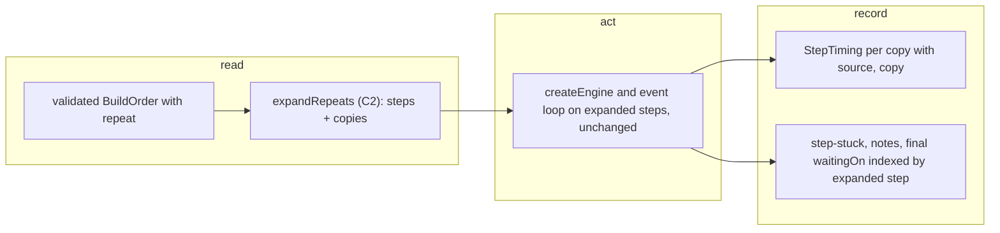

# SGS-208: Repeat a build or move step: schema, expansion, simulator copies, OpenAPI 2.7.0

- **Type**: Feature
- **Component**: aoe4-build-order
- **Milestone**: M12
- **Priority**: high
- **Risk**: high
- **Invariants**: A1 (no game numbers in code: the repeat bound is a request cap in `SIM_INPUT_BOUNDS`, not game data), A2 (resources never go negative: each copy pays its own cost through the unchanged payment path), A3 (same input, same timings: `simulateBuildOrder` now expands first), S3 (the step cap now also bounds the expanded count)
- **Unverified assumptions**: none
- **LOC estimate**: 150 (`repeat.ts` ~40, `schema.ts` ~40, `simulate.ts` and `model.ts` ~35, `FIELD_LABELS` and bound lines; business logic only)
- **Depends on**: none
- **On merge**: none
- **Source**: design/M12.md (C1, C2, C4, Behavior rules "Repeat: validation and parsing" and "Repeat: simulation"), criteria M12.1 and M12.3; reports/M12-planner-5.md outline A and Design questions rows 2 and 3

## Context

M12.1 lets a `build` or `move` step carry an optional integer `repeat`. This ticket is the server half: the schema
accepts and bounds it, `simulateBuildOrder` expands the order once at its top into consecutive copies, and each
copy gets its own `StepTiming` with `source` and `copy`. A repeat therefore gives exactly the timings of the step
written out N times. Today `schema.ts` `stepUnion` is a zod object per action, so a `repeat` key on any step is
silently dropped, and `StepTiming` has one entry per submitted step.

Interim state until the paste and table ticket lands (settled in the planner's design questions, rows 2 and 3):
the API accepts and expands `repeat`; the page cannot enter it (no `xN` in the paste text, no table field); a
save or named-build body carrying `repeat` gets the existing round-trip 400 (`reopening it as text would change
the build`) because `parse-text.ts` `formatAction` does not print it yet. Specs in this ticket must not save a
repeated build. `docs/api/openapi.json` `info.version` becomes 2.7.0 here and in the rename-API ticket; the two
edits are identical, so whichever lands second rebases cleanly and neither depends on the other.

## Scope

All paths under `lib/aoe4-build-order/` unless noted. Names follow design/M12.md C1, C2, C4.

- **New `repeat.ts`** (browser-safe: imports only types and `model.ts` values): `REPEATABLE_ACTIONS` (`build`,
  `move`), `repeatCount(step)` (`step.repeat ?? 1`), `expandedStepCount(steps)` (sum of `repeatCount`),
  `StepCopy { source, copy }` (`copy` 1-based), `ExpandedOrder { order, copies }` and `expandRepeats(order)`. It keeps
  `civ`, `name`, `source`, `start`; replaces step `j` by `repeatCount` consecutive copies, each without its `repeat` key
  and with `trigger` and `reaction` kept (design D2); `copies[i]` describes `order.steps[i]`. Pure, never throws on a
  validated order, never mutates its input; an order with no `repeat` gives deep-equal `steps` and
  `copies[i] = { source: i, copy: 1 }`. New `repeat.test.ts`.
- **`schema.ts`**:
  - `common` gains `repeat: count('repeat').optional()`; `SIM_INPUT_BOUNDS.repeat` is 1..200, integer (its position
    among the `SIM_INPUT_BOUNDS` keys is the implementer's choice; the tests that enumerate the keys follow it, see
    Existing tests). Not a number is `syntax`; a non-integer or outside 1..200 is `out-of-range`. `repeat: 1` is valid
    and means once.
  - `crossFieldProblems` (tier 2): `repeat` present on an action not in `REPEATABLE_ACTIONS` (`produce`, `research`,
    `rally`, `pause`) is one `invalid` issue on that step. The wording names the action and says only build and move
    repeat. It runs only when the step's fields passed, like the other cross-field rules.
  - `withCrossChecks` (tier 3), beside `crossStepProblems`: when every step's fields passed and
    `expandedStepCount(steps)` exceeds `SIM_INPUT_BOUNDS.steps.max`, one `out-of-range` issue with path `['steps']`
    (label `steps`, no `step`, no `line`) and the message `steps: <n> steps after repeats, more than 200` (design
    C1 fixes this text; `<n>` is the expanded count). It sorts at the step-count-cap position (the rank of `steps`
    in `rankOf`), so before every step issue. It is not run under `skipWholeOrderRules`. Suppression is the same
    condition that skips `crossStepProblems`: the `failed('steps')` check in `withCrossChecks`, true when any issue
    under `steps` has no `scope` (a field issue on any step, or the written-array step-count issue). A tier-2
    `cross-field` issue on a step (including the non-repeatable-action `repeat` rule above) and any `start` issue do
    not suppress it; `expandedStepCount` counts `repeatCount` of every step whatever its action. A written array over
    200 steps still gets only today's step-count issue.
  - `OPTIONAL_STEP_FIELDS`: `repeat` is added to `build` and `move`.
- **`model.ts`**: `StepTiming` gains required `source: number` (index into the submitted `steps`) and `copy: number`
  (1-based within that source; 1 for an unrepeated step), placed after `step`.
- **`simulate.ts`** (`simulateBuildOrder`, a `criticalPaths` symbol): the first statement is
  `expandRepeats(order)`; every later use of the order in `simulateBuildOrder` and `createEngine` uses the expanded
  order (`createEngine`, `runRefs`, the final `waitingOn` loop with `isReaction`, `researchNotes(order, data)`,
  `stepStuckWarning`'s `engine.order.steps[...]` lookup). Each `StepTiming` is created with `source` and `copy` from
  `copies` (whether `createEngine` takes `copies` or `simulateBuildOrder` sets them is the implementer's choice).
  `result.steps` has one entry per copy in expanded order and `result.steps[i].step === i`. `BuildOrderNote.step` and
  `step-stuck.step` index `result.steps`. The `step-stuck` message form depends on how many copies the source
  has, `n` being the number of `copies` entries with that `source` (not the `repeat` key, which the copies no longer
  carry). Both forms number the step by its submitted position, `source + 1`, never by the expanded index
  (`stepStuckWarning` today prints the timing's `step + 1`, which after expansion is the expanded index). A source
  with one copy (no `repeat`, or `repeat: 1`) gets the plain form `step <source+1> (<action>) was still waiting on
  ...`, which is today's text whenever no earlier step repeats; a copy of a source with n >= 2 copies reads
  `step <source+1> (<action>, copy <copy> of <n>) was still waiting on ...` (design C4).
  No other engine change.
- **`components/apps/aoe4-build-order/step-table-model.ts`**: add `FIELD_LABELS.repeat` (`Repeat`, design C7) only. The
  existing test "labels every field a row can render" fails once `repeat` is in `OPTIONAL_STEP_FIELDS` without a
  label, and the test that pins the label count changes once it is added (Existing tests rule); the Repeat table
  field and `changeAction` rule stay with the paste and table ticket.
- **OpenAPI `docs/api/openapi.json`**:
  - `repeat` (`integer`, 1..200) in every `BuildStep` branch, described as valid only on build and move (else
    `invalid`); the `BuildStep` description keeps "unknown extra keys are ignored" (`repeat` is now a known key).
  - `StepTiming` gains `source` and `copy`, both in `required`, with descriptions (C4).
  - Every `StepTiming` in the `/api/aoe4-build-order/simulate` 200 response examples (today `buildOrder` and
    `goldRunOut`) gains `source` and `copy`. Their request examples carry no `repeat`, and the contract spec checks
    each response example against the live response, so each entry's `source` equals its `step` and `copy` is 1.
  - Descriptions made untrue (name, not replacement text): `StepTiming.step` ("index into buildOrder.steps"),
    `BuildOrderNote.step` ("index of the research step"), `SimWarning` `step-stuck` `step` ("index of the waiting
    step") now index `steps` of the result (the expanded order); `SimulationResult.steps` ("one timing per build
    order step, in step order") is one per copy in expanded order; the `SimulationResult.warnings` ordering
    "step-stuck by step" is by expanded index; `SimulateRequest.buildOrder` ("at most 200 steps") and
    `BuildOrder.steps` ("at most 200") also cap the expanded count.
  - `info.version` is `2.7.0`.
- **Docs made untrue** (name the statement, the implementer writes the replacement):
  - `docs/aoe4-build-order.md` "Ordering and triggers" (today it says only "Steps run in list order") is the home of
    the copy rule, written as behavior: a `build` or `move` with `repeat` N runs as N consecutive copies in list
    order; each copy keeps the step's trigger and `reaction` and arms by the ordinary rules, so each re-checks its
    own trigger when it is reached (D2); copies of a `reaction` step all arm when their trigger holds (a `depleted`
    run-out arms them at that instant); the result is the same as the step written out N times, apart from each
    entry's `source` and `copy` and the `step-stuck` message. No other doc restates the rule.
  - `docs/aoe4-build-order-format.md`: the step table's `build` and `move` rows (they gain `repeat?`; no other row
    does) and the text beside the table says in one line what `repeat` does and links to "Ordering and triggers"
    for the rule; the sentences around the table that name the optional keys every step takes (`trigger` before it,
    `reaction` after it); the
    `invalid` rule lists (a new rule: `repeat` on an action other than build and move); the "Checks run in three
    tiers" list and the "Issues come in this order" sentence (the expanded cap runs with the cross-step rules and
    sorts at the step-count cap); the request sentence "`buildOrder` (JSON, at most 200 steps)"; the Outputs `steps`
    bullet "one `StepTiming` per step" (now per copy, with `source` and `copy`); the Outputs `notes` bullet ("one per
    research step ... in step order": a note's `step` indexes the expanded order); the `warnings` bullet's
    `step-stuck` message sentence (the copy form; its "1-based step number" is the submitted step's, while the
    warning's `step` field is the expanded index) and "`step-stuck` by step index" (expanded index).
  - `docs/aoe4-build-order.md`: the bounds table (it has a row per input bound and gains a `repeat` row: int,
    1..200, default once; its "paste text / steps" row's 200 steps now counts the expanded steps) and the sentence
    after it "A build order with more than 200 steps is one `out-of-range` issue"; the warnings sort sentence
    after the warnings table ("then `step-stuck` by step": by expanded index). Its Severity table's `step-stuck` row
    states only the severity and stays.
  - `lib/aoe4-build-order/README.md`: the module map (new file `repeat.ts`) and the `simulateBuildOrder` paragraph (it
    expands first).
  - `ARCHITECTURE.md`: a row for the new file `repeat.ts`.
  - The paste grammar (`xN`) and UI docs belong to the later tickets, not here.
- **Existing tests, by rule**: every test that builds or deep-equals a `StepTiming` gains `source` and `copy` (examples
  the search found: the `simulate*.test.ts` files, `research.test.ts`, `research.acceptance.test.ts`,
  `build-move.acceptance.test.ts`, `components/apps/aoe4-build-order/step-annotations.test.ts`, the `Timing` type and
  literals in `acceptance/helpers.ts`); every test that pins the key list of `StepTiming` or of the optional step
  fields gets the new keys (`schema.test.ts` "OPTIONAL_STEP_FIELDS" table needs `repeat` on its `build` and `move`
  rows; `step-table-model.test.ts` label count); every test that enumerates `SIM_INPUT_BOUNDS` gains `repeat`
  (integer, 1..200) at the position the implementer gave it (examples the search found: the `schema.test.ts`
  "keeps the request bounds" row list; `acceptance/aoe4-simulate-api-contract.spec.ts` "bounds match
  SIM_INPUT_BOUNDS", whose `locations` record is typed by the bound keys, so a missing key is a type error;
  `locations.repeat` lists the `repeat` property of every `BuildStep` branch). Any other assertion keeps its expected
  value. The four specs that
  pin `info.version` `2.6.0` (`acceptance/aoe4-gathered-resources.spec.ts`,
  `aoe4-simulate-api-issue-shape.spec.ts`, `aoe4-named-builds-api-contract.spec.ts`,
  `aoe4-builds-api-contract.spec.ts`, as examples; grep `2.6.0`) move to `2.7.0`. The implementer lists every test it
  edits.
- **New tests**: `repeat.test.ts`; `simulate-repeat.test.ts`; `schema.test.ts` rows; and
  new `acceptance/aoe4-simulate-api-repeat.spec.ts` (follow the `aoe4-simulate-api-*.spec.ts` style and
  `acceptance/helpers.ts`; it may also hold the `repeat`-on-research 400 case, or that case may be one row in
  `aoe4-simulate-api-checks.spec.ts` style).

**Out of scope:** `parse-text.ts` (`xN` grammar and printing), the step table Repeat field and `changeAction`, any
annotation, row, popover or shading change (`step-annotations.ts`, `results.tsx`), the UI doc, `page-help.tsx`,
rewriting shipped builds to use `repeat` (design D15), the PATCH rename route.

## Diagrams

`simulateBuildOrder` is the core loop; the change is a new first phase and a new field in the record phase.

## Acceptance criteria

- [ ] Schema field: `repeat` absent runs once; `1` is valid; a string, `true` or `null` is one `syntax` issue on the
      step; `0`, `201`, `2.5` and `-1` are one `out-of-range` issue on the step (a `schema.test.ts` table). A test
      fails if the bound is not 1..200 or a non-integer passes.
- [ ] Tier-2 rule: `repeat` on each of `produce`, `research`, `rally` and `pause` is exactly one `invalid` issue on that
      step, naming the action; on `build` and `move` it is valid, also on a reaction step. The `invalid` issue
      is not reported for a step that has a field issue (a test with a `research` step carrying both an unknown tech and
      `repeat` expects only the `unknown-id`).
- [ ] Expanded cap: an order of 200 written steps whose expansion is exactly 200 is accepted; one whose expansion is 201
      gives exactly one `out-of-range` issue labelled `steps` with no `step` and no `line`, the message above, placed
      where the step-count-cap issue sorts, and nothing is simulated. With a field issue on another step the cap issue
      is not reported. Under `skipWholeOrderRules` it is not reported. More than 200 written steps still gives only the
      existing step-count issue. A test fails if the count uses written steps instead of `expandedStepCount`.
- [ ] Expanded-cap suppression (respec 1): a tier-2 issue does not suppress the cap. A `schema.test.ts` row with
      `repeat` on a `research` step and an expansion over 200 expects both issues: the cap issue, then the
      step's `invalid` issue, in the order the issue sort gives. A row with a `start` issue (for example a
      `start.villagers` sum that does not match) and an expansion over 200 also expects the cap issue. A test fails if
      the cap check is skipped on any issue rather than only on a field issue under `steps`.
- [ ] Issue location (respec 2): an issue on a repeated step is reported on its submitted step index, never on a copy;
      when a line map is passed to `checkBuildOrder` (the only way to give a `repeat` step a line until the paste
      grammar lands), the issue carries that step's line.
- [ ] `expandRepeats` cases (`repeat.test.ts`) (respec 1): no `repeat` gives `copies[i] = { source: i, copy: 1 }` and a
      returned `order` that deep-equals the input order (`civ`, `name`, `source`, `start` and `steps`); `repeat: 1`; `repeat: 3` on the middle of three steps gives five steps with `copies` in
      `source` order and `copy` 1..3; two repeated steps; a repeated reaction or triggered step keeps `trigger` and
      `reaction` on every copy; no copy has a `repeat` key; the input order and its steps are not mutated (a test freezes
      or compares a deep clone); `civ`, `name`, `source` and `start` are kept; `expandedStepCount` and `repeatCount`
      agree with the expansion length.
- [ ] Equivalence (`simulate-repeat.test.ts`) (respec 2): the orders are built as JSON steps with `repeat` (the `xN` paste
      form lands with the paste ticket). For an order with a `build` of a house from wood with `repeat: 3` (or another
      buildable step the implementer picks) and a `move` of 1 villager from sheep to wood with `repeat: 2`, the whole `SimulationResult` equals the result of the order with
      each repeated step written out `repeat` times, once `source`, `copy` and `step-stuck` messages are set aside. A
      test fails if any series, marker, note, `waitingOn` or `step` index differs. A second order covers a bank trigger on a
      repeated step (each copy re-checks the trigger when it arms) and a `depleted` reaction repeated (all copies arm at the
      run-out instant, `move all` after the first copy moves 0 and completes at once).
- [ ] `source` and `copy` (`simulate-repeat.test.ts`): `result.steps.length` equals `expandedStepCount` of the submitted
      steps; `result.steps[i].step === i`; copies of a source are consecutive with `copy` 1..n and the same `source`.
- [ ] Unrepeated orders (respec 1): for every build `listBuilds()` returns (none carries `repeat`), `result.steps.length`
      equals the written step count and every entry has `source === step` and `copy === 1` (a test loops over the
      builds). The existing shipped-build and simulator tests (`builds.test.ts`, the `simulate*.test.ts` files and
      `data.acceptance.test.ts`, as examples) pass with only `source` and `copy` added to the `StepTiming` literals they
      build, no other expected value changed.
- [ ] Not reached and waiting copies (respec 1), two cases with separate orders: (a) a repeated `move` whose villagers run
      short makes the first short copy `waiting` on `villagers` and every later copy `not-reached` with `earlier-step`;
      (b) a repeated step behind a trigger that never holds leaves its first copy (the cursor) `not-reached` with
      `trigger` and the later copies `not-reached` with `earlier-step`. A test fails if the final `waitingOn` loop reads
      the unexpanded order.
- [ ] Stuck copy (respec 3): a copy of a source with two or more copies, still waiting at the horizon, has its own
      `step-stuck` warning whose `step` is its expanded index and whose message names the source step (`source + 1`),
      the action, `copy <k> of <n>` (`n` the source's copy count), the reason and the times. A source with one copy
      gets the plain form, in both cases: no `repeat`, and `repeat: 1` (a stuck `repeat: 1` step's message equals the
      message of the same order with the `repeat` key removed). A case with a repeated step before a still-waiting
      single-copy step (no `repeat`, and `repeat: 1`) requires the warning's `step` to be the expanded index and the
      message to number the step `source + 1`, which differs from `step + 1` there. A test fails if `n` is the written
      step count, if the message numbers the copy as a step, if a `repeat: 1` source gets the copy form, or if either
      form numbers the step by its expanded index.
- [ ] Notes: a `research` step after a repeated step has `BuildOrderNote.step` equal to its expanded index, and equal to
      `researchNotes` of the expanded order.
- [ ] Same input twice gives the same result (A3), and the submitted order is not mutated by `simulateBuildOrder`.
- [ ] Interim state: no spec added here saves or names a build carrying `repeat`; the existing page specs keep their assertions.
- [ ] OpenAPI: the document validates a live repeated-build response (the existing contract spec passes with `source` and
      `copy` required); `BuildStep` accepts `repeat` in every branch; `info.version` is `2.7.0` and every spec that pinned
      the old version pins the new one.
- [ ] OpenAPI examples and bounds (respec 1): every simulate 200 response example still validates against
      `SimulationResult` and still equals the live response to its request example, now with `source` and `copy` on each
      step; the "bounds match SIM_INPUT_BOUNDS" spec has a `repeat` test that finds the bound on every `BuildStep` branch
      as an integer 1..200. It fails if a branch lacks `repeat` or its bounds differ from `SIM_INPUT_BOUNDS.repeat`.
- [ ] OpenAPI descriptions (respec 1): no description of `StepTiming.step`, `BuildOrderNote.step` or the `step-stuck`
      `step` still says the index is into the submitted `buildOrder.steps`, the `SimulationResult.steps` description no
      longer says one timing per build order step, and the 200-step descriptions on `SimulateRequest.buildOrder` and
      `BuildOrder.steps` say the cap counts steps after repeats.
- [ ] Acceptance `aoe4-simulate-api-repeat.spec.ts`: POST a build with a repeated step; the response has the consecutive
      copies with `source` j and `copy` 1..n; `repeat` on a `research` step is a 400 with code `invalid` on that step.
      Specs mutation-checked and run per common.md.
- [ ] Existing tests of the changed behavior (respec 1) get the new expected values per the Scope rule, including every
      test that enumerates `SIM_INPUT_BOUNDS`, `StepTiming` keys or the optional step fields; every other test keeps
      its assertions; the report lists each test edited.
- [ ] No doc under `docs/aoe4-build-order-format.md`, `docs/aoe4-build-order.md`, `lib/aoe4-build-order/README.md` or
      `ARCHITECTURE.md` still states that a result has one `StepTiming` per submitted step or that the 200-step limit
      counts only written steps; `repeat.ts` has its `ARCHITECTURE.md` row.
- [ ] Docs (respec 2): the format doc's step table lists `repeat?` on the `build` and `move` rows and on no other row,
      and its text beside the table links to `docs/aoe4-build-order.md` "Ordering and triggers" for what `repeat`
      does; its `invalid` rules list the `repeat`-on-other-actions rule; its tier list and issue order name the
      expanded cap; its `notes` and `warnings` bullets say a note's and a `step-stuck` warning's `step` index the
      expanded order, and the `warnings` bullet gives the copy form of the `step-stuck` message and says a source with
      one copy keeps the plain form. `docs/aoe4-build-order.md` "Ordering and triggers" states that a `build` or `move`
      with `repeat` N runs as N consecutive copies in list order, each with its own trigger check, that reaction
      copies arm together, and that the result equals the step written out N times; its warnings sort sentence says
      `step-stuck` sorts by expanded index. The bounds table of `docs/aoe4-build-order.md` has a `repeat` row with the
      bound `SIM_INPUT_BOUNDS.repeat` holds, as every other bound has.
- [ ] `npx tsc --noEmit`, `npm test`, `npm run lint:dup` pass.
- [ ] No INVARIANTS.md regressions

## Open questions

none

## Re-spec 1 - 2026-11-18

- Underspecified (spec-gate 2): tests that enumerate `SIM_INPUT_BOUNDS`, the OpenAPI response examples and `step` index descriptions, which issues suppress the expanded cap, a shipped-build criterion with no baseline, and doc statements (format-doc step table, `invalid` rules, `notes` bullet; the bounds table row) the first draft did not name; the draft read the existing-tests and docs only by `StepTiming` and 200-step wording.
- Changed: Scope's schema, step-table-model, OpenAPI, docs and existing-tests bullets; suppression stated as the `failed('steps')` condition with test rows; criteria for unrepeated orders, the two not-reached cases, OpenAPI examples, bounds and descriptions, and docs, tagged `(respec 1)`. The wrong claim that `docs/aoe4-build-order.md` has an Outputs `steps` description was dropped.
- No branch work exists; nothing to keep.

## Re-spec 2 - 2026-11-18

- Underspecified (spec-gate 4): no repo doc was named as the home of the copy rule, and the `step-stuck` message of a `repeat: 1` source was ambiguous, because the copies no longer carry the `repeat` key. Re-spec 1 named only statements that become untrue, not where the new rule is written.
- Changed: Scope names `docs/aoe4-build-order.md` "Ordering and triggers" as the copy rule's home, with the format doc linking to it, plus that doc's `step-stuck` sort sentence. The message rule is now keyed on the source's copy count: one copy keeps the plain form, n >= 2 copies use the copy form. Invariants gain A1 and A2. The Issue location, Equivalence (JSON `repeat`, not paste), Stuck copy (a `repeat: 1` case) and Docs criteria are tagged `(respec 2)`.
- No branch work exists; nothing to keep.

## Re-spec 3 - 2026-11-18

- Underspecified (spec-gate 6): "keeps today's message unchanged" for a single-copy source left the step number open. Today's code prints the timing's `step + 1`, which after expansion is the expanded index. Re-spec 2 stated `source + 1` only for the copy form and did not check the current message code against design C4.
- Changed: Scope says both `step-stuck` forms number the step `source + 1`, and the format-doc bullet names the step-number note. The Stuck copy criterion `(respec 3)` adds a repeated step before a still-waiting single-copy step (no `repeat`, and `repeat: 1`).
- No branch work exists; nothing to keep.
