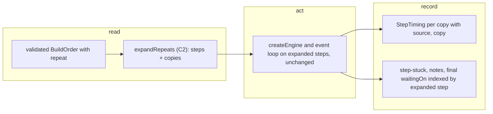

# SGS-208: Repeat a build or move step: schema, expansion, simulator copies, OpenAPI 2.7.0

- **Type**: Feature
- **Component**: aoe4-build-order
- **Milestone**: M12
- **Priority**: high
- **Risk**: high
- **Invariants**: A3 (same input, same timings: `simulateBuildOrder` now expands first), S3 (the step cap now also bounds the expanded count)
- **Unverified assumptions**: none
- **LOC estimate**: 150 (`repeat.ts` ~40, `schema.ts` ~40, `simulate.ts` and `model.ts` ~35, `FIELD_LABELS` and bound lines; business logic only)
- **Depends on**: none
- **On merge**: none
- **Source**: design/M12.md (C1, C2, C4, Behavior rules "Repeat: validation and parsing" and "Repeat: simulation"), criteria M12.1 and M12.3; reports/M12-planner-5.md outline A and Design questions rows 2 and 3

## Context

M12.1 lets a `build` or `move` step carry an optional integer `repeat`. This ticket is the server half: the schema
accepts and bounds it, `simulateBuildOrder` expands the order once at its top into consecutive copies, and each
copy gets its own `StepTiming` with `source` and `copy`. A repeat therefore gives exactly the timings of the step
written out N times. Today `schema.ts` `stepUnion` is a zod object per action, so a `repeat` key on any step is
silently dropped, and `StepTiming` has one entry per submitted step.

Interim state until the paste and table ticket lands (settled in the planner's design questions, rows 2 and 3):
the API accepts and expands `repeat`; the page cannot enter it (no `xN` in the paste text, no table field); a
save or named-build body carrying `repeat` gets the existing round-trip 400 (`reopening it as text would change
the build`) because `parse-text.ts` `formatAction` does not print it yet. Specs in this ticket must not save a
repeated build. `docs/api/openapi.json` `info.version` becomes 2.7.0 here and in the rename-API ticket; the two
edits are identical, so whichever lands second rebases cleanly and neither depends on the other.

## Scope

All paths under `lib/aoe4-build-order/` unless noted. Names follow design/M12.md C1, C2, C4.

- **New `repeat.ts`** (browser-safe: imports only types and `model.ts` values): `REPEATABLE_ACTIONS` (`build`,
  `move`), `repeatCount(step)` (`step.repeat ?? 1`), `expandedStepCount(steps)` (sum of `repeatCount`),
  `StepCopy { source, copy }` (`copy` 1-based), `ExpandedOrder { order, copies }` and `expandRepeats(order)`. It keeps
  `civ`, `name`, `source`, `start`; replaces step `j` by `repeatCount` consecutive copies, each without its `repeat` key
  and with `trigger` and `reaction` kept (design D2); `copies[i]` describes `order.steps[i]`. Pure, never throws on a
  validated order, never mutates its input; an order with no `repeat` gives deep-equal `steps` and
  `copies[i] = { source: i, copy: 1 }`. New `repeat.test.ts`.
- **`schema.ts`**:
  - `common` gains `repeat: count('repeat').optional()`; `SIM_INPUT_BOUNDS.repeat` is 1..200, integer. Not a number
    is `syntax`; a non-integer or outside 1..200 is `out-of-range`. `repeat: 1` is valid and means once.
  - `crossFieldProblems` (tier 2): `repeat` present on an action not in `REPEATABLE_ACTIONS` (`produce`, `research`,
    `rally`, `pause`) is one `invalid` issue on that step. The wording names the action and says only build and move
    repeat. It runs only when the step's fields passed, like the other cross-field rules.
  - `withCrossChecks` (tier 3), beside `crossStepProblems`: when every step's fields passed and
    `expandedStepCount(steps)` exceeds `SIM_INPUT_BOUNDS.steps.max`, one `out-of-range` issue with path `['steps']`
    (label `steps`, no `step`, no `line`) and the message `steps: <n> steps after repeats, more than 200` (design
    C1 fixes this text; `<n>` is the expanded count). It sorts at the step-count-cap position (the rank of `steps`
    in `rankOf`). It is not run under `skipWholeOrderRules`, and not when a field issue exists elsewhere in the
    order. A written array over 200 steps still gets only today's step-count issue.
  - `OPTIONAL_STEP_FIELDS`: `repeat` is added to `build` and `move`.
- **`model.ts`**: `StepTiming` gains required `source: number` (index into the submitted `steps`) and `copy: number`
  (1-based within that source; 1 for an unrepeated step), placed after `step`.
- **`simulate.ts`** (`simulateBuildOrder`, a `criticalPaths` symbol): the first statement is
  `expandRepeats(order)`; every later use of the order in `simulateBuildOrder` and `createEngine` uses the expanded
  order (`createEngine`, `runRefs`, the final `waitingOn` loop with `isReaction`, `researchNotes(order, data)`,
  `stepStuckWarning`'s `engine.order.steps[...]` lookup). Each `StepTiming` is created with `source` and `copy` from
  `copies` (whether `createEngine` takes `copies` or `simulateBuildOrder` sets them is the implementer's choice).
  `result.steps` has one entry per copy in expanded order and `result.steps[i].step === i`. `BuildOrderNote.step` and
  `step-stuck.step` index `result.steps`. The `step-stuck` message for a copy of a repeated source reads
  `step <source+1> (<action>, copy <copy> of <n>) was still waiting on ...`; an unrepeated source's message is
  unchanged. No other engine change.
- **`components/apps/aoe4-build-order/step-table-model.ts`**: add `FIELD_LABELS.repeat` (`Repeat`) only. The existing
  tests "labels every field a row can render" and "has no label beyond those fields" fail once `repeat` is in
  `OPTIONAL_STEP_FIELDS` without a label; the Repeat table field and `changeAction` rule stay with the paste and table
  ticket.
- **OpenAPI `docs/api/openapi.json`**: `repeat` (`integer`, 1..200) in every `BuildStep` branch, described as valid
  only on build and move (else `invalid`); the `BuildStep` description keeps "unknown extra keys are ignored"
  (`repeat` is now a known key); `StepTiming` gains `source` and `copy`, both in `required`, with descriptions;
  descriptions that state a 200-step limit or "one `StepTiming` per step" are corrected to the expanded count and per
  copy; `info.version` is `2.7.0`.
- **Docs made untrue** (name the statement, the implementer writes the replacement): `docs/aoe4-build-order-format.md`
  (the step-fields paragraph that lists `trigger` and `reaction` as the optional common keys; the cross-field and
  tier lists and the issue order that name the step-count cap; the "at most 200 steps" request sentence; the Outputs
  `steps` bullet "one `StepTiming` per step"; the `step-stuck` message sentence and that `step` indexes the expanded
  order); `docs/aoe4-build-order.md` (the 200-step cap sentences in the bounds table and the paragraph after it; the
  Outputs `steps` description; the `step-stuck` row if it describes the message); `lib/aoe4-build-order/README.md` (the
  module map: new file `repeat.ts`; the `simulateBuildOrder` paragraph: it expands first); `ARCHITECTURE.md` (a row for
  the new file `repeat.ts`). The paste grammar (`xN`) and UI docs belong to the later tickets, not here.
- **Existing tests, by rule**: every test that builds or deep-equals a `StepTiming` gains `source` and `copy` (examples
  the search found: the `simulate*.test.ts` files, `research.test.ts`, `research.acceptance.test.ts`,
  `build-move.acceptance.test.ts`, `components/apps/aoe4-build-order/step-annotations.test.ts`, the `Timing` type and
  literals in `acceptance/helpers.ts`); every test that pins the key list of `StepTiming` or of the optional step
  fields gets the new keys (`schema.test.ts` "OPTIONAL_STEP_FIELDS" table needs `repeat` on its `build` and `move`
  rows; `step-table-model.test.ts` label count). Any other assertion keeps its expected value. The four specs that
  pin `info.version` `2.6.0` (`acceptance/aoe4-gathered-resources.spec.ts`,
  `aoe4-simulate-api-issue-shape.spec.ts`, `aoe4-named-builds-api-contract.spec.ts`,
  `aoe4-builds-api-contract.spec.ts`, as examples; grep `2.6.0`) move to `2.7.0`. The implementer lists every test it
  edits.
- **New tests**: `repeat.test.ts`; `simulate-repeat.test.ts`; `schema.test.ts` rows; and
  new `acceptance/aoe4-simulate-api-repeat.spec.ts` (follow the `aoe4-simulate-api-*.spec.ts` style and
  `acceptance/helpers.ts`; it may also hold the `repeat`-on-research 400 case, or that case may be one row in
  `aoe4-simulate-api-checks.spec.ts` style).

**Out of scope:** `parse-text.ts` (`xN` grammar and printing), the step table Repeat field and `changeAction`, any
annotation, row, popover or shading change (`step-annotations.ts`, `results.tsx`), the UI doc, `page-help.tsx`,
rewriting shipped builds to use `repeat` (design D15), the PATCH rename route.

## Diagrams

`simulateBuildOrder` is the core loop; the change is a new first phase and a new field in the record phase.

## Acceptance criteria

- [ ] Schema field: `repeat` absent runs once; `1` is valid; a string, `true` or `null` is one `syntax` issue on the
      step; `0`, `201`, `2.5` and `-1` are one `out-of-range` issue on the step (a `schema.test.ts` table). A test
      fails if the bound is not 1..200 or a non-integer passes.
- [ ] Tier-2 rule: `repeat` on each of `produce`, `research`, `rally` and `pause` is exactly one `invalid` issue on that
      step, naming the action; on `build` and `move` it is valid, also on a reaction step. The `invalid` issue
      is not reported for a step that has a field issue (a test with a `research` step carrying both an unknown tech and
      `repeat` expects only the `unknown-id`).
- [ ] Expanded cap: an order of 200 written steps whose expansion is exactly 200 is accepted; one whose expansion is 201
      gives exactly one `out-of-range` issue labelled `steps` with no `step` and no `line`, the message above, placed
      where the step-count-cap issue sorts, and nothing is simulated. With a field issue on another step the cap issue
      is not reported. Under `skipWholeOrderRules` it is not reported. More than 200 written steps still gives only the
      existing step-count issue. A test fails if the count uses written steps instead of `expandedStepCount`.
- [ ] Issue location: an issue on a repeated step is reported on its submitted step index (and its paste line), never on
      a copy.
- [ ] `expandRepeats` cases (`repeat.test.ts`): no `repeat` gives deep-equal steps with `copies[i] = { source: i, copy: 1 }`
      and an equal result object; `repeat: 1`; `x3` in the middle of three steps gives five steps with `copies` in
      `source` order and `copy` 1..3; two repeated steps; a repeated reaction or triggered step keeps `trigger` and
      `reaction` on every copy; no copy has a `repeat` key; the input order and its steps are not mutated (a test freezes
      or compares a deep clone); `civ`, `name`, `source` and `start` are kept; `expandedStepCount` and `repeatCount`
      agree with the expansion length.
- [ ] Equivalence (`simulate-repeat.test.ts`): for an order with `build house from wood x3` (or another buildable step the
      implementer picks) and `move 1 sheep to wood x2`, the whole `SimulationResult` equals the result of the order with
      each repeated step written out `repeat` times, once `source`, `copy` and `step-stuck` messages are set aside. A
      test fails if any series, marker, note, `waitingOn` or `step` index differs. A second order covers a bank trigger on a
      repeated step (each copy re-checks the trigger when it arms) and a `depleted` reaction repeated (all copies arm at the
      run-out instant, `move all` after the first copy moves 0 and completes at once).
- [ ] `source` and `copy` (`simulate-repeat.test.ts`): `result.steps.length` equals `expandedStepCount` of the submitted
      steps; `result.steps[i].step === i`; copies of a source are consecutive with `copy` 1..n and the same `source`; an order
      with no `repeat` gives `source === step` and `copy === 1` for every entry, including a shipped build (its result
      is unchanged apart from the two fields).
- [ ] Not reached and waiting copies: a repeated `move` whose villagers are short makes that copy `waiting` on `villagers`
      and later copies `not-reached` with `earlier-step`; the cursor copy that never armed is `not-reached` with
      `trigger`. A test fails if the final `waitingOn` loop reads the unexpanded order.
- [ ] Stuck copy: a copy still waiting at the horizon has its own `step-stuck` warning whose `step` is its expanded index
      and whose message names the source step, the action, `copy <k> of <n>`, the reason and the times; an unrepeated
      step's message is unchanged. A test fails if `n` is the written count or the message numbers the copy as a step.
- [ ] Notes: a `research` step after a repeated step has `BuildOrderNote.step` equal to its expanded index, and equal to
      `researchNotes` of the expanded order.
- [ ] Same input twice gives the same result (A3), and the submitted order is not mutated by `simulateBuildOrder`.
- [ ] Interim state: no spec added here saves or names a build carrying `repeat`; the existing page specs keep their assertions.
- [ ] OpenAPI: the document validates a live repeated-build response (the existing contract spec passes with `source` and
      `copy` required); `BuildStep` accepts `repeat` in every branch; `info.version` is `2.7.0` and every spec that pinned
      the old version pins the new one.
- [ ] Acceptance `aoe4-simulate-api-repeat.spec.ts`: POST a build with a repeated step; the response has the consecutive
      copies with `source` j and `copy` 1..n; `repeat` on a `research` step is a 400 with code `invalid` on that step.
      Specs mutation-checked and run per common.md.
- [ ] Existing tests of the changed behavior get the new expected values and every other test keeps its assertions; the report lists each test edited.
- [ ] No doc under `docs/aoe4-build-order-format.md`, `docs/aoe4-build-order.md`, `lib/aoe4-build-order/README.md` or
      `ARCHITECTURE.md` still states that a result has one `StepTiming` per submitted step or that the 200-step limit
      counts only written steps; `repeat.ts` has its `ARCHITECTURE.md` row.
- [ ] `npx tsc --noEmit`, `npm test`, `npm run lint:dup` pass.
- [ ] No INVARIANTS.md regressions

## Open questions

none
