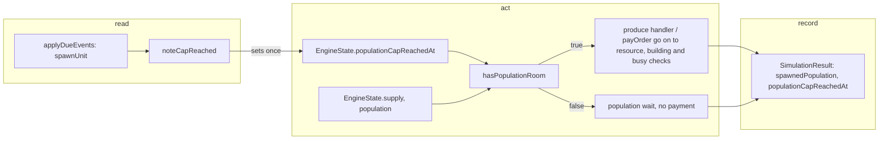

# SGS-215: Let production continue past the population cap

- **Type**: Feature
- **Component**: aoe4-build-order
- **Milestone**: M13
- **Priority**: medium
- **Risk**: high
- **Invariants**: AoE4 Build Order Simulator (A1, A2, A3, S3)
- **Unverified assumptions**: none
- **LOC estimate**: 40 (`simulate.ts`: `hasPopulationRoom`, the field move, two gate replacements, `noteCapReached` signature; tests, docs, OpenAPI descriptions and the build JSON excluded)
- **Depends on**: none
- **On merge**: none
- **Source**: M13 criteria M13.1 and the engine, format-doc, OpenAPI, data-README and unit-test parts of M13.3; the M13 design revision 2, C1, C5, D1, D7, D11, D12, Behavior rules "Population limit (C1)"; plan M13-20261124 outline A

## Context

Supply and auto-houses stop at `data.base.maxPopCap` (200), and the two production gates (`produce` handler and `payOrder` in `lib/aoe4-build-order/simulate.ts`) refuse a unit once `population + popcap > supply`, so every run stops growing at 200. From the first instant the spawned population has reached the cap while supply is at the cap, production must ignore the supply check for the rest of the run (the units past 200 stand in for combat losses the simulator does not model); before that instant nothing changes, so a run whose `populationCapReachedAt` is `null` keeps exactly today's result. The one prebuilt build that stops meeting the builds bar once it produces past 200 (`english-spear-longbow-maa-crossbow.json`) is retuned in this ticket.

## Scope

All names are the design's (M13 design C1, C5).

**Engine (`lib/aoe4-build-order/simulate.ts`):**

- Add and export `hasPopulationRoom(state: EngineState, popcap: number): boolean`: true when `state.populationCapReachedAt` is not `null` and `state.supply >= state.data.base.maxPopCap.value`; otherwise `state.population + popcap <= state.supply`. The `!= null` form treats a fake state without the field as not reached.
- Move `populationCapReachedAt: number | null` from the internal `Engine` to `EngineState` (same meaning: the instant `spawnedPopulation` first reached `maxPopCap`, `0` when the start already does). `Engine` no longer declares it. `noteCapReached` takes `EngineState`, so the `state as Engine` cast in `spawnUnit` goes. `createEngine` and the returned `SimulationResult.populationCapReachedAt` keep working unchanged.
- Replace the inline supply check in the `produce` handler (the check before `canAffordHeld`; `popcap` is `targets.length * entry.costs.popcap`, the returned `population` wait and its `populationWait` detail unchanged) and the one in `payOrder` (`popcap` is one unit's) with `!hasPopulationRoom(...)`. These are the only two places `population` is compared with `supply` in `lib/`.
- Unchanged: `addBuildingInstance`'s clamp of `supply` to `maxPopCap`, `planAutoHouse` in `houses.ts` (its `room` is 0 or less at supply 200, so no house is due after the lift), `houses.ts`, the default villager order stopping at `villagerTarget` (a `produce villager` step is not capped, D11), `SIM_INPUT_BOUNDS` (including `triggerCount` 1..200, D12), the result shape, the OpenAPI schema and enums. No literal 200 enters code (A1): every rule reads `data.base.maxPopCap.value`.

**Prebuilt build (D7).** `data/aoe4-build-order/builds/english-spear-longbow-maa-crossbow.json` stops meeting the builds bar once production continues past 200. Probed with the engine change applied to origin/main 7d74800: the gold deposit runs out earlier (about 1204.8 s instead of 1206.9 s) and a `idle-arrival` warning appears at 1800 s and at 3600 s, so three tests in `lib/aoe4-build-order/builds.test.ts` fail (the `3600` row of "moves every gatherer off a gold deposit at its run-out ... with no gold warning", "leaves no villager arriving at an empty resource and no stuck step through 1800 s", and the pinned first-gold run-out time). Retune the build file (which reaction, rally or timing is the implementer's choice, within the plan the build documents: Feudal through the Council Hall, then Castle through the King's Palace, then men-at-arms and crossbowmen) so those tests pass with their assertions unchanged except the pinned run-out time, which is re-pinned to what the retuned build returns. The bar is not relaxed and no exception is listed. One probe is already ruled out: appending `rally` reaction steps (Town Center and King's Palace to `gold#2`) after the `depleted gold` trigger leaves the same three failures.

**Tests that change (rules, with examples).** Run the unit suite and the acceptance specs that touch the engine and fix every test the change moves:

- A test of the changed behavior gets the new expected value. Examples found at the base with the engine change applied: `lib/aoe4-build-order/simulate-construction.test.ts` "raises supply only at completion and never past maxPopCap" and auto-houses "stop at maxPopCap" (both use `maxPopCap` 30 and read the villager count at 900 s as a proxy for supply; the count no longer proves the supply limit, so each is rewritten to observe supply, the house count or `spent.buildings` directly, and a separate row asserts villagers keep spawning past 30); the two 1800 s digests in `lib/aoe4-build-order/simulate-house-gate.test.ts` ("prebuilt builds at 1800 s": ENG 1TC and ENG Spear/Longbow) are re-pinned; `lib/aoe4-build-order/research.acceptance.test.ts` "the Knight/Longbow build converts its longbowmen ..." pins the tier-3 longbowman total at 1800 s, which grows; `lib/aoe4-build-order/simulate.test.ts` "exports exactly the seam names" pins the export list and the export count of `simulate.ts`, and gains `hasPopulationRoom`; `acceptance/aoe4-simulate-api-spend-population.spec.ts` ("is the spawn instant of the 200th population ...") asserts the last `spawnedPopulation` of an 1800 s ENG 1TC run is exactly 200.
- Any other test keeps its expected value; one that fails for a reason other than production past 200 is a defect to report, not a pin to move.
- Search the acceptance specs that read `spawnedPopulation` or run a prebuilt build to 1800 s or 3600 s and check each still holds: examples `aoe4-simulate-api-house-rule.spec.ts`, `aoe4-simulate-api-house-gate.spec.ts`, `aoe4-simulate-api-spear-longbow-build.spec.ts`, `aoe4-simulate-api-prebuilt-plans.spec.ts`, `aoe4-simulate-api-prebuilt-farms.spec.ts`. Run each changed or at-risk acceptance spec alone per common.md (the implementer does not run the whole suite).
- Fakes built with `as unknown as EngineState` (`houses.test.ts`, `wait-detail.test.ts`, `engine-common.test.ts`, `simulate-busy-buildings.test.ts`, `simulate-triggers.test.ts`) never reach the gate and need no edit unless the typecheck says otherwise; a fake that reaches `hasPopulationRoom` sets `populationCapReachedAt`.

**New tests.** In the style of the nearest existing tests (`simulate-series.test.ts` "populationCapReachedAt" for the fixtures, `simulate-construction.test.ts` for `editGameData` with `maxPopCap` 30, `simulate-house-gate.test.ts` for `digestTimeline`): cases are the Acceptance criteria below.

**Docs made untrue (statements to fix; the implementer writes the replacement against the code).** Searched `docs/`, `README.md`, `ARCHITECTURE.md`, `lib/aoe4-build-order/README.md`, `data/aoe4-build-order/README.md`, `components/apps/aoe4-build-order/page-help.tsx`, `docs/api/openapi.json`:

- `docs/aoe4-build-order.md`: the Determinism-table row for `Trigger.count` (villagers) says the range is "(the population cap)"; it becomes a request cap (D12). Model rules statements that supply always gates a unit or a `produce` step ("supply has room for it", "supply has room for one unit per target", "A step waiting on supply ... reserves nothing", the `build house` paragraph's "production blocks at supply until a `build house` step adds more", "supply may block production meanwhile"): each states the rule holds before the limit lifts. "Houses and supply" ("total supply is capped at `maxPopCap`, 200"; "planning stops once supply plus the supply of all of them reaches 200") gains the lift rule: when it lifts (spawned population and supply both at the cap), that production then continues with supply at the cap and no house built past it, that the units past the cap stand in for combat losses the simulator does not model, and the start-already-at-the-cap case. The Data sources line giving `maxPopCap` (200) and the feature-list bullet "houses, starting state and the population cap" are checked and edited where they imply a hard stop.
- `docs/aoe4-build-order-format.md` Outputs: `spawnedPopulation` may exceed the population cap once it has been reached; `populationCapReachedAt` keeps its first instant. The statements that a step waits "while supply has no room" and the `population` wait code and detail rows (`needed`, `used`, `supply`) say a `population` wait occurs only before the limit lifts.
- `docs/api/openapi.json`: the `spawnedPopulation` property description (may exceed the cap once reached); the description of the `population` wait detail ("Too little supply for the units the step pays") says it occurs only before the limit lifts. Descriptions only: no schema, enum or `info.version` change (four acceptance specs pin `info.version`).
- `data/aoe4-build-order/README.md`: the Spear/Longbow entry sentence "at 1000 s both villager producers rally to gold so the income past the 200 population cap goes into upgrades" and any retuned reaction or timing (rewritten to match the retuned file), and the Council Hall entry's sentence "Past the population cap these techs spend part of the economy's income" (checked against the lifted limit; its prebuilt build passes the bar unchanged in the probe).
- `lib/aoe4-build-order/README.md` event-loop text (population and supply change in events) and `ARCHITECTURE.md` state no population gate and need no edit; `components/apps/aoe4-build-order/page-help.tsx` does not mention the cap. Re-run the grep for `supply` and `population cap` before finishing.

**Out of scope:** any page-side change (the Population chart, the cap mark, `docs/aoe4-build-order-ui.md`, page help, `ARCHITECTURE.md`; ticket SGS-216 owns them); a new result field, supply series or cap value in the result (D14); raising `triggerCount` or any `SIM_INPUT_BOUNDS` value; combat losses; houses or supply past 200; a Playwright spec for the chart.

## Diagrams

The change alters the production gate in the core event loop: the gate reads one new field set by the spawn event.

## Acceptance criteria

- [ ] `hasPopulationRoom` is exported and is the only place `population` is compared with `supply` for production: the `produce` handler and `payOrder` both call it, so a produce step and a continuous order both keep producing once the limit has lifted. A unit test per gate fails if either gate keeps the old inline check (a `produce` step with several targets past the lift starts all targets together or none on the other checks; a continuous order past the lift keeps paying).
- [ ] Before the cap is reached the rule is exactly `population + popcap <= supply`: with `populationCapReachedAt` `null`, supply at `maxPopCap` and population (paid units still queued included) at `maxPopCap`, the check is false. A test fails if the lift is keyed on supply alone (the case D1 names).
- [ ] After the cap is reached with supply at the cap, a test with `maxPopCap` lowered through `editGameData` shows `spawnedPopulation` growing past the cap, `supply` staying at the cap, `populationCapReachedAt` keeping its first instant after later spawns, and no auto-house started after the lift (the house count and `spent.buildings` stop growing).
- [ ] After `populationCapReachedAt` is set but with supply below the cap (the start population already at or past a lowered cap with too little supply), the supply check still applies: auto-houses build up to the cap and production resumes at the instant supply reaches it. A test fails if the lift ignores `supply >= maxPopCap`.
- [ ] A produce step or order that waited on population while the spawn that reaches the cap was pending starts at the instant of that spawn, not at a later wake or sample (the second step offer and `startProduction` of the instant already see the lift); a test fails if the lift only applies from the next instant.
- [ ] A `population` wait and its `population` wait detail occur only before the lift: a test over a run that crosses the cap finds no step with `waitingOn: 'population'` that begins after `populationCapReachedAt`.
- [ ] Villagers: the default villager order still stops at `villagerTarget` alive or paid after the lift, and a `produce villager` step keeps producing past the cap. Each is a test case that fails if the other rule is applied to both.
- [ ] Runs that never reach the cap give the base result exactly: for ENG 1TC at 1060 s and at 1090 s, each test first asserts `populationCapReachedAt === null` and then compares `digestTimeline` with a digest pinned from the base (before the change); the 1090 s row is the one that fails if the lift is keyed on supply alone.
- [ ] Every prebuilt build, run to its pinned horizons, gives the same result before `populationCapReachedAt` as at the base (the existing prebuilt digest and timing tests that pin runs through the cap are re-pinned only for the part after it).
- [ ] The retuned Spear/Longbow build passes `lib/aoe4-build-order/builds.test.ts` and `acceptance/aoe4-simulate-api-spear-longbow-build.spec.ts` and `acceptance/aoe4-simulate-api-prebuilt-plans.spec.ts` with their assertions as written (only the pinned gold run-out time is re-pinned to the value the retuned build returns, recorded in the report), still reaches Castle and produces its plan's unit types, and `data/aoe4-build-order/README.md`'s entry matches the file.
- [ ] `EngineState` declares `populationCapReachedAt` and `Engine` does not; the typecheck passes with `noteCapReached` taking `EngineState` and no cast. `simulateBuildOrder` keeps its signature and `SimulationResult` keeps its fields.
- [ ] `maxPopCap` is read from data: a test with `maxPopCap` lowered (30 and 11 are used today) passes through the same rules, and no numeric literal 200 appears in the new code (the existing literal-scan test in `simulate.test.ts` passes).
- [ ] Every test the change moves is edited as the Scope rules say (changed behavior gets the new value; the two `maxPopCap` 30 tests observe supply directly instead of through the villager count; the export-list test gains `hasPopulationRoom`); the implementer's report lists each edited test.
- [ ] Docs and OpenAPI: the statements Scope lists in `docs/aoe4-build-order.md`, `docs/aoe4-build-order-format.md`, `docs/api/openapi.json` and `data/aoe4-build-order/README.md` match the new behavior (no doc says production always stops at the cap or that `Trigger.count`'s range is the population cap, and `spawnedPopulation` is documented as possibly past the cap); `docs/api/openapi.json` `info.version` is unchanged and the OpenAPI acceptance specs pass.
- [ ] No INVARIANTS.md regressions

## Open questions

none
